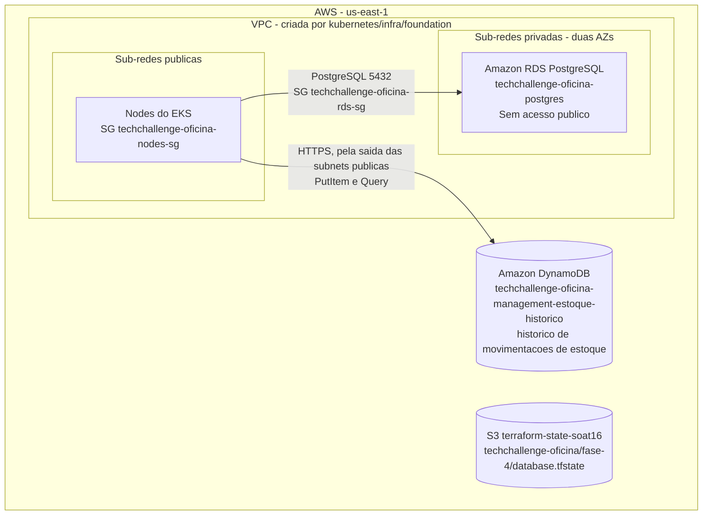

# DB: Amazon RDS PostgreSQL e Amazon DynamoDB

Infraestrutura do banco de dados do projeto **Tech Challenge Oficina** (SOAT16, fase 4). Aqui ficam o Amazon RDS PostgreSQL e a tabela do Amazon DynamoDB com o histórico de movimentações de estoque da Management ([ADR-027](../docs/adr/ADR-027-Historico-de-Movimentacoes-de-Estoque-no-DynamoDB.md)), criados com Terraform em [infra/](infra) e aplicados pelas pipelines do monorepo ([.github/workflows](../.github/workflows/README.md)). A política IAM da tabela não fica aqui: ela vai para o usuário IAM da Management, no [SQS/](../SQS/README.md) (seção 1).

A pasta tem o próprio Terraform state e não lê o state de outra pasta. Para rodar, porém, depende do cluster EKS e da rede criados em [kubernetes/infra/foundation](../kubernetes/infra/README.md) (seção 3). O schema do PostgreSQL (tabelas) é criado pela aplicação ([server/](../server)), quando a Management API sobe.

Este é o banco da Management. Desde a fase 4, o OS Service, o Billing e o Execução e Produção têm o próprio RDS, criado na mesma rede e no mesmo padrão desta pasta: `techchallenge-oficina-os-postgres` (banco `oficina_os`), pelo [repo OS-SERVICE](https://github.com/GuiToniello/tech-challenge-fase-4-OS-SERVICE-soat16-rm374658), `techchallenge-oficina-billing-postgres` (banco `oficina_billing`), pelo [repo BILLING](https://github.com/GuiToniello/tech-challenge-fase-4-BILLING-soat16-rm374658), e `techchallenge-oficina-execution-postgres` (banco `oficina_execution`), pelo [repo EXECUTION](https://github.com/GuiToniello/tech-challenge-fase-4-EXECUTION-AND-PRODUCTION-soat16-rm374658). Cada um também tem a própria tabela DynamoDB, criada no repositório dele. Um serviço não acessa o banco do outro ([ADR-019](https://github.com/GuiToniello/tech-challenge-fase-4-OS-SERVICE-soat16-rm374658/blob/main/docs/adr/ADR-019-OS-Service-Microsservico-com-Banco-Proprio.md), [ADR-021](https://github.com/GuiToniello/tech-challenge-fase-4-BILLING-soat16-rm374658/blob/main/docs/adr/ADR-021-Billing-Service-Orcamento-e-Pagamentos-com-Banco-Proprio.md) e [ADR-023](https://github.com/GuiToniello/tech-challenge-fase-4-EXECUTION-AND-PRODUCTION-soat16-rm374658/blob/main/docs/adr/ADR-023-Execucao-e-Producao-Fila-de-Execucao-e-Status-por-Eventos.md)).

> Na fase 3, esta pasta era um repositório separado (`tech-challenge-fase-3-DB-soat16-rm374658`).

## 1. O que é provisionado

Tudo fica na AWS, região `us-east-1`:

| Recurso | Nome | Detalhes |
|---|---|---|
| `aws_db_instance` | `techchallenge-oficina-postgres` | PostgreSQL, `db.t3.micro`, 20 GiB `gp3` criptografado, single-AZ, sem acesso público, porta `5432`, database `oficina`, usuário `sa` |
| `aws_db_subnet_group` | `techchallenge-oficina-rds-subnets` | Usa as duas subnets privadas criadas pela foundation (duas AZs) |
| `aws_security_group` | `techchallenge-oficina-rds-sg` | Esta pasta cria só a entrada na porta `5432` a partir do SG dos nodes do EKS. O repo LAMBDA adiciona a própria regra (seção 3) |
| `aws_dynamodb_table` | `techchallenge-oficina-management-estoque-historico` | Histórico de movimentações de estoque ([dynamodb.tf](infra/dynamodb.tf)): sob demanda (`PAY_PER_REQUEST`), chave de partição `InsumoId` (S) e de ordenação `OcorridoEm` (S), TTL em `ExpiraEm` (180 dias), sem proteção contra exclusão, sem PITR e sem streams. Fica fora da VPC: os pods chegam a ela pela saída das subnets públicas, como chegam ao SQS |

É um ambiente acadêmico e descartável: `deletion_protection = false`, `skip_final_snapshot = true` e `backup_retention_period = 0`, e a tabela DynamoDB também não tem proteção contra exclusão. Por isso, **um destroy apaga todos os dados**, inclusive o histórico de movimentações.

A tabela é complementar: o saldo de cada insumo continua no PostgreSQL (`insumos.quantidade_disponivel`), que é a fonte da verdade, e a API grava no DynamoDB em *best-effort* (ADR-027). A política inline `dynamodb-historico-estoque` (só `dynamodb:PutItem` e `dynamodb:Query` nesta tabela) fica no [SQS/infra/iam.tf](../SQS/infra/iam.tf), no mesmo state do usuário IAM da Management (`techchallenge-oficina-management-sqs`), porque o `DB/infra` e o `SQS/infra` rodam em paralelo nas pipelines. O nome da tabela é repetido lá, no ARN da política: mudar o nome exige mudar os dois.



## 2. Escolha do banco

A aplicação precisa de persistência relacional: clientes, veículos, serviços, insumos e a referência de cada ordem de serviço, ligados por chaves estrangeiras e com índices únicos (por exemplo, a identificação CPF/CNPJ do cliente). O banco escolhido é o PostgreSQL, acessado com Entity Framework Core e Npgsql. O **RDS** assume a operação do banco (provisionamento, patches, armazenamento criptografado) e o mantém isolado em subnets privadas.

Na fase 4, a migration `ExtrairOrdemServico` tirou deste banco as tabelas de OS, histórico de status e indicadores, que agora ficam no banco do OS Service, e criou `ordens_servico_referencias`, `orcamentos` e `orcamentos_servicos`. Depois, a migration `ExtrairOrcamento` tirou `orcamentos` e `orcamentos_servicos`, porque o orçamento foi para o banco do Billing, e criou a coluna `estoque_debitado` em `ordens_servico_referencias`. As duas apagam as tabelas antigas sem levar os dados. As tabelas e os relacionamentos atuais estão na ADR-017.

A decisão está documentada em [docs/](../docs):
- [ADR-017: PostgreSQL no Amazon RDS e Modelo de Dados](../docs/adr/ADR-017-PostgreSQL-no-Amazon-RDS-e-Modelo-de-Dados.md): justificativa formal, diagrama ER e explicação de cada relacionamento.
- [RFC-002: Escolha do banco de dados](../docs/rfc/RFC-002-Escolha-do-Banco-de-Dados.md): as opções comparadas (Aurora, MySQL, SQL Server, DynamoDB, MongoDB e PostgreSQL dentro do EKS).
- [ADR-027: Histórico de Movimentações de Estoque no Amazon DynamoDB](../docs/adr/ADR-027-Historico-de-Movimentacoes-de-Estoque-no-DynamoDB.md): a tabela DynamoDB, complementar ao saldo do PostgreSQL, e por que a política dela fica no `SQS/infra`.

A visão geral do sistema inteiro está no [docs/arquitetura.md](../docs/arquitetura.md).

Os detalhes do acesso a dados e das migrations estão na [ADR-007](../docs/adr/ADR-007-EFCore-com-PostgreSQL.md) (*EF Core com PostgreSQL*) e na [ADR-009](../docs/adr/ADR-009-Migracoes-Automaticas-no-Startup.md) (*Migrações automáticas no startup*). Esta pasta só cria a instância e o database vazio `oficina`, além da tabela DynamoDB. A Management API cria as tabelas do PostgreSQL quando sobe; na AWS, ela nunca cria nem descreve a tabela DynamoDB, só grava e consulta.

## 3. Dependências

### Ordem

| Operação | Ordem |
|---|---|
| Subir | **Bootstrap** deste monorepo: testes → foundation (rede, EKS e API Gateway) → addons → **DB** (RDS e tabela DynamoDB) → imagem no ECR → K8s Apply (manifests + Secret da API com o endpoint do RDS); o SQS (com a política da tabela) em paralelo. Depois, os **Bootstraps** dos repos OS-SERVICE e EXECUTION, nesta ordem, e o do BILLING (a qualquer momento), e o **Deploy** do repo LAMBDA |
| Destruir | **Destroy** dos repos LAMBDA, OS-SERVICE, BILLING e EXECUTION → **Destroy** deste monorepo: **DB** → addons → foundation (o SQS em paralelo com o DB) |

- O DB roda depois do cluster porque usa a VPC, as subnets privadas e o SG dos nodes criados pela foundation. No Destroy, ele sai antes: a regra do RDS referencia o SG dos nodes, e as subnets privadas têm as ENIs do RDS. Se o destroy do DB falhar, o da foundation não roda.
- O LAMBDA é o único consumidor deste banco fora do monorepo. Antes de destruir, o Destroy deste monorepo confere se o SG da Lambda (`techchallenge-oficina-lambda-sg`) já foi removido e falha se ele ainda existir.
- Os RDS do OS Service, do Billing e do Execução e Produção ficam nas mesmas subnets privadas e têm um SG que referencia o SG dos nodes. Por isso, o Destroy deste monorepo também confere se eles já foram removidos e falha se algum ainda existir: o `os-service-check` olha o RDS `techchallenge-oficina-os-postgres` e o SG `techchallenge-oficina-os-rds-sg`, o `billing-check`, o RDS `techchallenge-oficina-billing-postgres` e o SG `techchallenge-oficina-billing-rds-sg`, e o `execution-check`, o RDS `techchallenge-oficina-execution-postgres` e o SG `techchallenge-oficina-execution-rds-sg`.
- **SG do RDS recriado**, com outro ID. Acontece em Destroy + Bootstrap, ou quando muda o `name`, a `description` ou a VPC do SG. Rode de novo o Deploy do repo **LAMBDA**: a regra de acesso dele sumiu junto com o SG antigo.
- **Instância do RDS recriada**. Acontece em Destroy + Bootstrap, ou numa mudança que force replace da instância. O banco volta vazio. O Bootstrap e o Deploy de uma mudança em `DB/infra/**` já terminam com o K8s Apply com restart: o Secret recebe o endpoint do RDS e a API aplica as migrations ao subir. Fora desses casos, rode o workflow **K8s Apply** (`restart-pods = true`).

### Contrato consumido (criado por `kubernetes/infra/foundation`)

O DB encontra o cluster e a rede via data sources ([infra/data.tf](infra/data.tf)), sem ler o state da foundation. Os `DB/infra` dos repos OS-SERVICE, BILLING e EXECUTION fazem a mesma busca:

| O que | Como é encontrado |
|---|---|
| Cluster EKS | Nome `techchallenge-oficina-eks` (variável `cluster_name`) |
| VPC | A do cluster (`vpc_config.vpc_id` do `data "aws_eks_cluster"`). Não usa a tag `Project`, que pode casar com VPCs órfãs de applies anteriores |
| Subnets privadas | Tag `Name = techchallenge-oficina-private-*`, na VPC do cluster, pelo menos 2, em AZs diferentes |
| SG dos nodes | Nome `techchallenge-oficina-nodes-sg`, na mesma VPC, **anexado aos worker nodes** (launch template do node group) |

Se algum desses itens não existir, o `plan` falha antes de criar qualquer recurso.

### Contrato produzido (usado por `kubernetes/` e pelo repo LAMBDA)

O Secret da API (`oficina-api-secrets`, com a connection string) é gerado pelo K8s Apply ([_k8s-apply.yml](../.github/workflows/_k8s-apply.yml)).

| Item | Valor | Onde é usado |
|---|---|---|
| Identifier do RDS | `techchallenge-oficina-postgres` | Variable `RDS_INSTANCE_IDENTIFIER`: o K8s Apply busca o endpoint com `aws rds describe-db-instances` |
| Database | `oficina` | Variable `RDS_DATABASE` |
| Usuário | `sa` | Variable `RDS_USERNAME` |
| Porta | `5432` | Connection string |
| Senha | Secret `RDS_PASSWORD` | Um só secret no monorepo, usado pelo Terraform do DB e pelo K8s Apply. O repo LAMBDA precisa do **mesmo valor** |
| SG do RDS | `techchallenge-oficina-rds-sg` | O repo LAMBDA adiciona neste SG a própria regra de entrada na porta `5432` |
| Tabela DynamoDB | `techchallenge-oficina-management-estoque-historico` | `DynamoDbSettings__TabelaHistoricoEstoque` no ConfigMap da API ([kubernetes/k8s/README.md](../kubernetes/k8s/README.md)) e o ARN da política `dynamodb-historico-estoque`, no `SQS/infra` |

As regras do SG do RDS são recursos separados (`aws_vpc_security_group_ingress_rule` / `aws_vpc_security_group_egress_rule`), não blocos inline. Assim, a regra criada pelo repo LAMBDA não é removida no próximo apply do DB.

Outputs do Terraform: `rds_identifier`, `rds_endpoint`, `rds_port`, `rds_database`, `rds_security_group_id`, `dynamodb_historico_estoque_nome` e `dynamodb_historico_estoque_arn`.

## 4. Pré-requisitos (manuais, uma vez)

1. **Ambiente da fase 3 destruído** (mesmos nomes de recursos, como `techchallenge-oficina-postgres` e `techchallenge-oficina-rds-sg`): rode o Destroy dos repos da fase 3 e desative os workflows deles antes do primeiro Bootstrap.
2. **Bucket S3 `terraform-state-soat16`** em `us-east-1`, com versionamento, criptografia e bloqueio de acesso público. É o mesmo bucket dos outros states do projeto, cada um com uma key própria. O DB usa `techchallenge-oficina/fase-4/database.tfstate`, com lock nativo (`use_lockfile`).
3. **Usuário IAM `terraform`**, cujas access keys vão para os secrets do GitHub. Permissões necessárias para o DB:
   - EC2:
     - `ec2:Describe*`. Os data sources usam, entre outras, `DescribeVpcs`, `DescribeVpcAttribute`, `DescribeSubnets` e `DescribeSecurityGroups`, e o destroy do SG usa `DescribeNetworkInterfaces`. Ações Describe não aceitam restrição por recurso.
     - `ec2:CreateSecurityGroup`, `ec2:DeleteSecurityGroup`
     - `ec2:AuthorizeSecurityGroupIngress`, `ec2:AuthorizeSecurityGroupEgress`, `ec2:RevokeSecurityGroupIngress`, `ec2:RevokeSecurityGroupEgress`
     - `ec2:ModifySecurityGroupRules`, `ec2:CreateTags`, `ec2:DeleteTags`
   - EKS: `eks:DescribeCluster`, para achar a VPC pelo cluster (`data "aws_eks_cluster"`).
   - RDS: `rds:*DBInstance*`, `rds:*DBSubnetGroup*`, `rds:AddTagsToResource`, `rds:RemoveTagsFromResource`, `rds:ListTagsForResource`. Se for o primeiro RDS da conta, também `iam:CreateServiceLinkedRole`.
   - DynamoDB: criar, descrever, alterar (TTL e tags) e apagar a tabela `techchallenge-oficina-management-estoque-historico` (hoje o usuário `terraform` é administrador). A política da tabela, no `SQS/infra`, usa as permissões de IAM do [SQS/README.md](../SQS/README.md).
   - S3: `s3:GetObject`, `s3:PutObject` e `s3:DeleteObject` em `arn:aws:s3:::terraform-state-soat16/techchallenge-oficina/fase-4/*` (states e locks de todas as pastas do Terraform do monorepo), mais `s3:ListBucket` no bucket.
4. **Secrets e Variables do GitHub**: veja a seção 5.
5. **Environment `destroy`** (Settings → Environments). Crie **antes** do primeiro Destroy, com você como *Required reviewer* e *Deployment branches* restrito a `main`. Se ele não existir, o GitHub cria na hora, sem proteção. Não dispare o Destroy com um Deploy ou Bootstrap em andamento (veja a seção 9).
6. **Proteção da branch `main`** (Settings → Branches): exija Pull Request e os status checks obrigatórios do monorepo. O do DB é o `validate-db / terraform` (lista completa no [README das pipelines](../.github/workflows/README.md)). Cada check só aparece na lista depois que o primeiro PR rodar a pipeline.

## 5. Secrets e Variables

Ficam no monorepo, e a lista completa está no [README das pipelines](../.github/workflows/README.md). O DB usa:
- os secrets `AWS_ACCESS_KEY_ID` e `AWS_SECRET_ACCESS_KEY` (usuário IAM `terraform`) e a variable `AWS_REGION` (`us-east-1`);
- o secret `RDS_PASSWORD`, senha master do RDS, passada ao Terraform como `TF_VAR_rds_password`. É o mesmo secret que o K8s Apply usa na connection string;
- as variables `RDS_INSTANCE_IDENTIFIER`, `RDS_DATABASE` e `RDS_USERNAME`, usadas pelo K8s Apply (seção 3).

**Regras para `RDS_PASSWORD`:**
- Use de 8 a 128 caracteres ASCII imprimíveis, **sem** `/`, `'`, `"`, `@`, espaço e `;`.
  - O RDS rejeita os cinco primeiros.
  - O `;` quebra a connection string montada pelo K8s Apply.
- Não reaproveite a senha de desenvolvimento local.
- O secret `RDS_PASSWORD` do repo LAMBDA precisa ter o mesmo valor.

**Rotação da senha:**
1. Atualize o secret `RDS_PASSWORD` no monorepo e no repo LAMBDA.
2. Rode o workflow **Bootstrap**: ele aplica a senha nova no RDS e termina com o K8s Apply com restart, que atualiza o Secret da API. Trocar um secret não dispara o Deploy, e o Deploy só aplica o DB com push em `DB/infra/**` ou no `_terraform.yml`.
3. Rode o **Deploy** do repo LAMBDA, para a Lambda buscar-cliente receber a senha nova.

## 6. Pipelines (GitHub Actions)

O DB não tem workflows próprios: roda nas pipelines do monorepo, pelo workflow reutilizável `_terraform.yml` com `working-directory: DB/infra`. Os detalhes estão no [README das pipelines](../.github/workflows/README.md).

| Workflow | O que faz com o DB |
|---|---|
| **Bootstrap** (manual) | `terraform apply` depois da foundation e dos addons, antes da imagem e do K8s Apply |
| **Deploy**, em Pull Request | `validate-db` (sem AWS, check obrigatório) e `plan-db` (informativo; exige o cluster de pé e não roda em PR de fork, que não recebe secrets) |
| **Deploy**, em push na `main` com mudança em `DB/infra/**` ou no `_terraform.yml` | `apply-db` e, em seguida, o K8s Apply com restart, para o Secret receber o endpoint do RDS |
| **Destroy** (manual, `confirm = destroy` + aprovação) | `terraform destroy` do DB antes dos addons e da foundation |

Apply e destroy só rodam a partir da `main` e esperam até 15 min por um lock do state (`-lock-timeout=15m`). A tabela DynamoDB segue os mesmos jobs do RDS, sem job novo.

Enquanto o cluster EKS não existir (antes do primeiro Bootstrap ou depois do Destroy), o `plan-db` dos PRs e o `apply-db` do push falham, porque o DB acha a VPC pelo cluster. O `validate-db` continua verde, então os PRs podem ser mergeados. Quando o ambiente voltar, rode o **Bootstrap** para aplicar o estado da `main`. **Não use "Re-run" em um Deploy antigo que falhou**: o re-run aplica o commit daquele run, que pode estar desatualizado, e desfaria mudanças mergeadas depois. O Bootstrap sempre aplica a HEAD da `main`.

## 7. Uso local

Com a AWS CLI configurada com o usuário `terraform`, a partir de `DB/infra/`:

```powershell
Copy-Item terraform.tfvars.example terraform.tfvars   # e informe rds_password
terraform init
terraform fmt -check -recursive
terraform validate
terraform plan -var-file="terraform.tfvars"
terraform apply -var-file="terraform.tfvars"
```

Em `rds_password`, use **o mesmo valor** do secret `RDS_PASSWORD`. O state é o mesmo do CI, e um valor diferente troca na hora a senha master do RDS (`apply_immediately = true`), derrubando a conexão da API e da Lambda buscar-cliente. O `terraform.tfvars` é ignorado pelo Git e não deve ser versionado. O `.terraform.lock.hcl` **é** versionado e fixa a versão do provider AWS. Para atualizá-lo, rode `terraform init -upgrade` e depois `terraform providers lock -platform=linux_amd64 -platform=windows_amd64`.

Para validar sem acessar a AWS: `terraform init -backend=false` e `terraform validate`.

## 8. Destruição e custos

O RDS gera custo enquanto existe. A tabela DynamoDB é sob demanda: é cobrada por requisição e por armazenamento, o que, com poucos itens e a expiração em 180 dias, fica perto de zero. Para remover, rode o workflow **Destroy** do monorepo com `confirm = destroy` e aprove no environment. Ele destrói o ambiente inteiro (SQS, DB, addons e foundation), inclusive a tabela DynamoDB e o histórico: não há um destroy só do banco. Antes, rode o Destroy do repo LAMBDA e os dos repos OS-SERVICE, BILLING e EXECUTION, que removem os RDS desses serviços (seção 3). O bucket S3 do state não é removido.

## 9. Troubleshooting

- **Cluster EKS não encontrado / `no matching EC2 Security Group found` / precondition das subnets (2 AZs):** o cluster ou a rede da foundation não existe ou mudou de nome. Confira o contrato da seção 3.
- **`Error acquiring the state lock`:** outro apply/destroy está rodando (no CI, o apply e o destroy esperam até 15 min pelo lock). Se o lock ficou preso depois de um run cancelado, rode em `DB/infra/` `terraform force-unlock <LOCK_ID>`, ou apague o objeto `techchallenge-oficina/fase-4/database.tfstate.tflock` do bucket.
- **Destroy aparece como "cancelled":** no comportamento padrão do GitHub (`queue: single`), um run mais novo no mesmo grupo de concorrência substitui o que estava pendente. Rode o Destroy de novo, sem nenhum Deploy ou Bootstrap em andamento.
