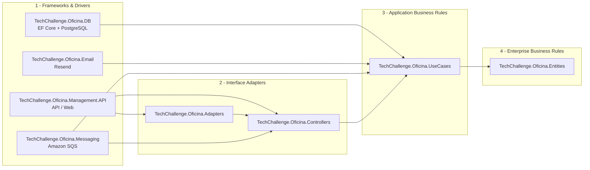
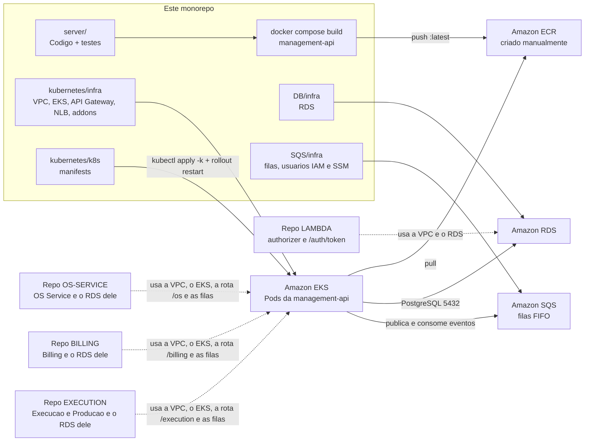
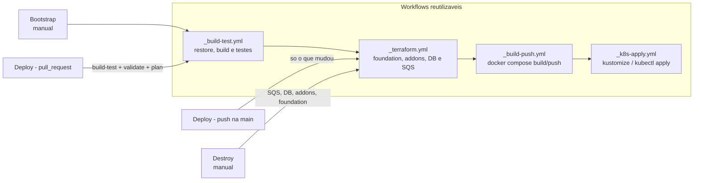

# Projeto Oficina — Management

## 1. Identificação

Software de gestão para uma oficina mecânica.

Tech Challenge da Fase 4 do curso SOAT16 da FIAP. Este é o **monorepo do serviço Management**, com quatro partes: a aplicação (.NET), o banco (Amazon RDS), as filas (Amazon SQS) e o cluster com a borda (Amazon EKS e API Gateway). Na fase 3, a aplicação, o banco e o cluster ficavam em três repositórios separados (APP, DB e K8S).

O sistema tem cinco repositórios:
- **MANAGEMENT** (este): cadastros (clientes, veículos, serviços e insumos), estoque, validação da OS e o e-mail de mudança de status. Também cria a rede, o cluster, o API Gateway, o Datadog e as filas usados pelos outros serviços.
- [OS-SERVICE](https://github.com/GuiToniello/tech-challenge-fase-4-OS-SERVICE-soat16-rm374658): o microsserviço de ordens de serviço (OS), com banco próprio. Na fase 4, o ciclo de vida da OS saiu deste repositório e foi para lá ([ADR-019](https://github.com/GuiToniello/tech-challenge-fase-4-OS-SERVICE-soat16-rm374658/blob/main/docs/adr/ADR-019-OS-Service-Microsservico-com-Banco-Proprio.md)).
- [BILLING](https://github.com/GuiToniello/tech-challenge-fase-4-BILLING-soat16-rm374658): o microsserviço de orçamento e pagamento (Mercado Pago), com banco próprio. Na fase 4, o orçamento também saiu deste repositório e foi para lá ([ADR-021](https://github.com/GuiToniello/tech-challenge-fase-4-BILLING-soat16-rm374658/blob/main/docs/adr/ADR-021-Billing-Service-Orcamento-e-Pagamentos-com-Banco-Proprio.md)).
- [EXECUTION](https://github.com/GuiToniello/tech-challenge-fase-4-EXECUTION-AND-PRODUCTION-soat16-rm374658): o microsserviço de Execução e Produção, com banco próprio: a fila de produção da oficina, o início do diagnóstico e o início e a finalização da execução ([ADR-023](https://github.com/GuiToniello/tech-challenge-fase-4-EXECUTION-AND-PRODUCTION-soat16-rm374658/blob/main/docs/adr/ADR-023-Execucao-e-Producao-Fila-de-Execucao-e-Status-por-Eventos.md)). Ele avisa o OS Service por eventos; quem muda o status da OS continua sendo o OS Service.
- [LAMBDA](https://github.com/GuiToniello/tech-challenge-fase-4-LAMBDA-soat16-rm374658): as Lambdas de autenticação.

A Management, o OS Service, o Billing e o Execução e Produção se comunicam só por eventos no Amazon SQS ([ADR-020](./docs/adr/ADR-020-Eventos-com-SQS-e-Saga-Coreografada.md)): não há chamadas HTTP entre as APIs, e nenhum serviço lê o banco do outro.

Grupo:
-  Guilherme Toniello Vieira -  SOAT16 - rm374658

### 1.1 Estrutura do monorepo

```
/
├── server/               Solução .NET: Management API, camadas da Clean Architecture e testes
├── e2e/                  Collection do Postman da Management API (cadastros) e environment da AWS
├── docker-compose.yml    Postgres + ElasticMQ (SQS local) + Management API para rodar localmente
├── elasticmq.conf        Filas FIFO do ElasticMQ, as mesmas do SQS na AWS
├── DB/                   Terraform do Amazon RDS PostgreSQL
├── SQS/                  Terraform das filas Amazon SQS FIFO, dos usuários IAM e das chaves no SSM
├── kubernetes/           Terraform da VPC, EKS, API Gateway, NLB e addons (Datadog), e os manifests Kubernetes
├── docs/                 Arquitetura, observabilidade, ADRs e RFCs
└── .github/workflows/    Pipelines (build, testes, imagem, Terraform e deploy no cluster)
```

| Pasta | O que tem | Documentação |
|---|---|---|
| [server/](./server/) | Código .NET 10 da `TechChallenge.Oficina.Management.API` e testes | Seções 2 a 4 deste README |
| [e2e/](./e2e/) | Collection do Postman e environment da AWS | Seção 8 |
| [DB/](./DB/) | Amazon RDS PostgreSQL (state `techchallenge-oficina/fase-4/database.tfstate`) | [DB/README.md](./DB/README.md) |
| [SQS/](./SQS/) | Filas FIFO entre a Management, o OS Service, o Billing e o Execução e Produção, com DLQ, usuários IAM e chaves no SSM Parameter Store (state `techchallenge-oficina/fase-4/sqs.tfstate`) | [SQS/README.md](./SQS/README.md) |
| [kubernetes/](./kubernetes/) | `infra/foundation` (VPC, EKS, API Gateway, VPC Link e NLB, com as rotas das quatro APIs), `infra/addons` (Metrics Server, Datadog Agent e recursos do Datadog) e `k8s/` (manifests da Management API, via Kustomize) | [kubernetes/README.md](./kubernetes/README.md) |
| [docs/](./docs/) | Visão geral, contrato de observabilidade, ADRs e RFCs | [docs/arquitetura.md](./docs/arquitetura.md) |
| [.github/workflows/](./.github/workflows/) | Bootstrap, Deploy, Destroy e K8s Apply | [.github/workflows/README.md](./.github/workflows/README.md) |

### 1.2 Links Úteis

- Blueprint no Miro: http://miro.com/app/board/uXjVHVfHuvI=/?share_link_id=633470424823
- Entregas anteriores. Os binários não foram trazidos para este repositório:
  - [relatório completo da Fase 2](https://github.com/GuiToniello/tech-challenge-fase-3-APP-soat16-rm374658/blob/main/docs/relat%C3%B3rio-completo.pdf), no repositório APP da fase 3;
  - [vídeo da Fase 2](https://youtu.be/BRWWTNrfGdY).

## 2. Arquitetura

A visão geral do sistema está em [docs/arquitetura.md](./docs/arquitetura.md). Lá estão:
- o diagrama de componentes (nuvem, APIs, bancos, filas e monitoramento);
- os diagramas de sequência da autenticação e da saga entre os serviços (abertura da OS, diagnóstico, orçamento, pagamento e execução);
- o índice das RFCs e ADRs.

O código da API segue a Clean Architecture (ADR-001), com 4 anéis. As dependências apontam sempre para dentro:



A mensageria segue o mesmo padrão do e-mail: os casos de uso publicam eventos pela porta `IEventosPublisher`, e o projeto `TechChallenge.Oficina.Messaging` implementa a publicação e o consumidor da fila. O evento consumido entra pelo `EventosController`, como uma requisição HTTP entra por um endpoint ([ADR-020](./docs/adr/ADR-020-Eventos-com-SQS-e-Saga-Coreografada.md)).

### 2.1. Visão Geral

As decisões arquiteturais estão documentadas como ADRs (Architecture Decision Records) em [docs/adr/](./docs/adr/). As RFCs (Request for Comments) são propostas que compararam opções antes de uma decisão e ficam em [docs/rfc/](./docs/rfc/). A numeração é compartilhada com os repositórios OS-SERVICE, que guarda a ADR-019, BILLING, que guarda a ADR-021, a ADR-022 e a ADR-024, EXECUTION, que guarda a ADR-023, e LAMBDA, que guarda a RFC-003.

| ADR | Resumo | Link |
|-----|--------|------|
| ADR-001 — Clean Architecture com Folder-by-Feature | Adota Clean Architecture com 4 anéis de dependência (Entities, UseCases, Controllers, API/Infra), organizados por feature. Define separação de responsabilidades guiada pela regra de inversão de dependência. | [ver](./docs/adr/ADR-001-Clean-Architecture.md) |
| ADR-002 — DDD e Entidades Ricas | Entidades encapsulam comportamentos e validações de domínio via factory methods obrigatórios. Evita entidades anêmicas; erros de negócio são sinalizados com `DomainException`. | [ver](./docs/adr/ADR-002-DDD-e-Entidades-Ricas.md) |
| ADR-003 — Value Objects para CPF/CNPJ | CPF e CNPJ são encapsulados em Value Objects com validação de dígitos verificadores. `IdentificacaoCliente` detecta o tipo automaticamente e garante que apenas valores válidos existam no domínio. | [ver](./docs/adr/ADR-003-Value-Objects-Identificacao.md) |
| ADR-004 — Gateways e Persistência | Contratos de persistência (Gateways) residem nos UseCases; implementações ficam no projeto DB via EF Core. Leituras retornam coleções materializadas; escritas persistem via `SaveChangesAsync`. | [ver](./docs/adr/ADR-004-Gateways-e-Persistencia.md) |
| ADR-005 — Separação de Commands/Queries/ViewModels | Commands (escrita), Queries (leitura) e ViewModels (resposta) são contratos explícitos na camada de UseCases. A API consome esses contratos diretamente, sem criar os seus próprios. | [ver](./docs/adr/ADR-005-Separacao-Commands-Queries-ViewModels.md) |
| ADR-006 — AutoMapper nos UseCases | Mapeamento entre entidades de domínio e DTOs é responsabilidade exclusiva dos UseCases via AutoMapper. Controllers nunca instanciam `IMapper`; recebem apenas ViewModels já mapeadas. | [ver](./docs/adr/ADR-006-AutoMapper-nos-UseCases.md) |
| ADR-007 — EF Core com PostgreSQL | EF Core 10.x com Npgsql como ORM para PostgreSQL, com migrations versionadas. Configurações de mapeamento via `IEntityTypeConfiguration<T>` e connection string via `appsettings.json`. | [ver](./docs/adr/ADR-007-EFCore-com-PostgreSQL.md) |
| ADR-008 — Swagger para Documentação | Documentação automática de endpoints via Swashbuckle com suporte a autenticação JWT no UI. Swagger UI disponível na raiz da aplicação. | [ver](./docs/adr/ADR-008-Swagger-para-API.md) |
| ADR-009 — Migrações Automáticas no Startup | Migrations pendentes são aplicadas automaticamente ao iniciar a API via `ApplyMigrations()`. Elimina intervenção manual no deploy, incluindo ambientes de container. | [ver](./docs/adr/ADR-009-Migracoes-Automaticas-no-Startup.md) |
| ADR-011 — Envio de E-mail de Orçamento | E-mail pelo Resend, atrás de uma porta de saída na camada de UseCases. A API funciona normalmente sem a ApiKey; o envio de e-mail é desabilitado. Desde a fase 4, a Management envia só o e-mail de mudança de status, ao consumir o evento `OrdemServicoStatusAlterado`; o e-mail do orçamento foi para o Billing (ADR-021). | [ver](./docs/adr/ADR-011-Envio-de-Email-de-Orcamento.md) |
| ADR-012 — Controle de Estoque de Insumos | A Management confere o estoque ao validar a OS (sem reserva) e informa o resultado no evento `OrdemServicoValidada` (`estoqueSuficiente`); o Billing só gera o orçamento com estoque. O débito acontece uma vez por OS, quando a Management consome `PagamentoAprovado`. | [ver](./docs/adr/ADR-012-Controle-de-Estoque-de-Insumos.md) |
| ADR-013 — Tratamento de Erros em Duas Camadas | Erros de negócio esperados são tratados nos controllers com resposta HTTP semântica (4xx). Erros inesperados são capturados pelo middleware global, evitando vazamento de stack trace. | [ver](./docs/adr/ADR-013-Estrategia-de-Tratamento-de-Erros-em-Duas-Camadas.md) |
| ADR-014 — Observabilidade com Datadog | As APIs escrevem logs JSON no stdout (Serilog) com eventos de negócio, e o tracer é injetado no cluster, sem mudar a imagem. Métricas de negócio derivadas dos logs, monitores, synthetics e dashboard ficam em Terraform em `kubernetes/infra/addons` e cobrem as quatro APIs: Management, OS Service, Billing e Execução e Produção. | [ver](./docs/adr/ADR-014-Observabilidade-com-Datadog.md) |
| ADR-015 — Comunicação Síncrona via API Gateway | Os clientes falam com as APIs por HTTPS (REST e JSON), sempre pelo API Gateway. Não há chamadas HTTP entre as APIs; entre os serviços, a comunicação é por eventos (ADR-020). | [ver](./docs/adr/ADR-015-Comunicacao-Sincrona-via-API-Gateway.md) |
| ADR-016 — Escalabilidade da API com HPA | Cada API tem um HPA que mantém de 1 a 2 pods conforme o uso de CPU (alvo de 30%) e de memória (alvo de 150%), medido pelo Metrics Server. Os 2 nós do cluster são fixos. | [ver](./docs/adr/ADR-016-Escalabilidade-com-HPA.md) |
| ADR-017 — PostgreSQL no Amazon RDS e Modelo de Dados | Justificativa formal da escolha do PostgreSQL no Amazon RDS, com o diagrama ER e a explicação dos relacionamentos entre as tabelas da Management. | [ver](./docs/adr/ADR-017-PostgreSQL-no-Amazon-RDS-e-Modelo-de-Dados.md) |
| ADR-018 — Monorepo e API Única (Management) | Junta os repositórios APP, DB e K8S da fase 3 neste monorepo, com pipelines unificados. Remove as 4 APIs dedicadas e renomeia a Monolith para Management. | [ver](./docs/adr/ADR-018-Monorepo-e-API-Unica-Management.md) |
| ADR-019 — OS Service, microsserviço com banco próprio (repo OS-SERVICE) | Tira o ciclo de vida da OS e os indicadores da Management e cria o OS Service, com banco, namespace e pipelines próprios. A OS guarda só os ids dos cadastros. | [ver](https://github.com/GuiToniello/tech-challenge-fase-4-OS-SERVICE-soat16-rm374658/blob/main/docs/adr/ADR-019-OS-Service-Microsservico-com-Banco-Proprio.md) |
| ADR-020 — Eventos com SQS e Saga Coreografada | Os serviços trocam eventos em filas Amazon SQS FIFO, uma de entrada por serviço, numa saga coreografada com compensação. Quem publica envia o mesmo evento para a fila de cada serviço que consome algum evento dele (*fan-out* no publicador). Define o envelope, os eventos, a idempotência, a DLQ e as credenciais (usuário IAM por serviço, com a chave no SSM). | [ver](./docs/adr/ADR-020-Eventos-com-SQS-e-Saga-Coreografada.md) |
| ADR-021 — Billing Service, orçamento e pagamentos com banco próprio (repo BILLING) | Tira o orçamento da Management e cria o Billing, com banco, namespace e pipelines próprios: gera, envia, aprova e recusa o orçamento e cuida do pagamento. | [ver](https://github.com/GuiToniello/tech-challenge-fase-4-BILLING-soat16-rm374658/blob/main/docs/adr/ADR-021-Billing-Service-Orcamento-e-Pagamentos-com-Banco-Proprio.md) |
| ADR-022 — Pagamentos com Mercado Pago (repo BILLING) | O pagamento do orçamento usa o Checkout Pro do Mercado Pago, com verificação por consulta e webhook. O pagamento aprovado vira o evento `PagamentoAprovado`. | [ver](https://github.com/GuiToniello/tech-challenge-fase-4-BILLING-soat16-rm374658/blob/main/docs/adr/ADR-022-Pagamentos-com-Mercado-Pago.md) |
| ADR-023 — Execução e Produção, fila de execução e status por eventos (repo EXECUTION) | Cria o Execução e Produção, com banco, namespace e pipelines próprios: a fila de produção da oficina, o início do diagnóstico e o início e a finalização da execução. Ele avisa o OS Service pelos eventos `DiagnosticoIniciado` e `ExecucaoFinalizada`; o status da OS continua sendo só do OS Service. | [ver](https://github.com/GuiToniello/tech-challenge-fase-4-EXECUTION-AND-PRODUCTION-soat16-rm374658/blob/main/docs/adr/ADR-023-Execucao-e-Producao-Fila-de-Execucao-e-Status-por-Eventos.md) |
| ADR-024 — Histórico de pagamentos no Amazon DynamoDB (repo BILLING) | O Billing grava o histórico dos eventos de pagamento de cada OS numa tabela DynamoDB (NoSQL), em *best-effort* e com expiração em 180 dias. O PostgreSQL continua sendo a fonte da verdade. | [ver](https://github.com/GuiToniello/tech-challenge-fase-4-BILLING-soat16-rm374658/blob/main/docs/adr/ADR-024-Historico-de-Pagamentos-no-DynamoDB.md) |

| RFC | Resumo | Link |
|-----|--------|------|
| RFC-001 — Escolha da nuvem | Compara AWS, Azure e Google Cloud. Resultado: AWS, na região `us-east-1`. | [ver](./docs/rfc/RFC-001-Escolha-da-Nuvem.md) |
| RFC-002 — Escolha do banco de dados | Compara PostgreSQL, Aurora, MySQL, SQL Server, DynamoDB, MongoDB e PostgreSQL dentro do EKS. Resultado: PostgreSQL no Amazon RDS. | [ver](./docs/rfc/RFC-002-Escolha-do-Banco-de-Dados.md) |
| RFC-003 — Estratégia de autenticação (repo LAMBDA) | Compara onde validar o token e como gravar o CPF nele. Resultado: Lambda authorizer exigindo a claim `cpf`, com o JWT emitido pelo Auth0. | [ver](https://github.com/GuiToniello/tech-challenge-fase-4-LAMBDA-soat16-rm374658/blob/main/docs/rfc/RFC-003-Estrategia-de-Autenticacao.md) |
| RFC-004 — Comunicação entre microsserviços | Compara HTTP entre as APIs, SQS Standard e FIFO, SNS, EventBridge, Kafka e RabbitMQ, e orquestração com coreografia. Resultado: SQS FIFO com saga coreografada. | [ver](./docs/rfc/RFC-004-Comunicacao-entre-Microsservicos.md) |

### 2.2. Autenticação

O projeto usa autenticação via JWT emitido pelo `Auth0` (http://auth0.com/) como provedor de identidade.

**Como funciona na prática:**

A API valida cada requisição verificando o JWT no header `Authorization: Bearer <token>`. A integração usa o pacote `Microsoft.AspNetCore.Authentication.JwtBearer`. As configurações ficam em `appsettings.json` na chave `AuthSettings`:

```json
"AuthSettings": {
  "Authority": "<seu-dominio>.us.auth0.com",
  "Audience": "http://localhost:7194"
}
```

O `Authority` aponta para o domínio Auth0, que expõe o endpoint `/.well-known/openid-configuration` usado pelo middleware para buscar as chaves públicas de validação. O `Audience` identifica esta API junto ao Auth0.

Todos os endpoints exigem autenticação por padrão (política de fallback `RequireAuthenticatedUser`). Os únicos endpoints públicos são `/health` e `/health/ready`, que também verifica o banco (seção 6.3).

**Você não precisa criar uma conta no Auth0.** A Collection do Postman em `/e2e` já possui um request configurado com as credenciais de demonstração para obter o token de acesso via password grant (Resource Owner Password).

Na AWS, o API Gateway (em `kubernetes/infra/foundation`) tem um Lambda authorizer, do repositório LAMBDA, que exige, além do JWT válido, a claim `cpf` do cliente. Ele protege as rotas das quatro APIs (`/management/...`, `/os/...`, `/billing/...` e `/execution/...`).
- **Como o token é gerado:** pela Lambda `POST /auth/token` (`{"email","senha","cpf"}`), que confere o cliente no banco e pede ao Auth0 o JWT já com a claim.
- **Exceção:** só o cadastro de cliente (`POST /management/api/clientes`) aceita o token direto do Auth0, sem `cpf`.
- **Rota pública do webhook:** `POST /billing/api/pagamentos/notificacoes` não passa pelo authorizer, porque o Mercado Pago não envia o JWT ([ADR-022](https://github.com/GuiToniello/tech-challenge-fase-4-BILLING-soat16-rm374658/blob/main/docs/adr/ADR-022-Pagamentos-com-Mercado-Pago.md)).
- **Na API:** o código não muda; ela continua validando o JWT normalmente. O OS Service, o Billing e o Execução e Produção validam o mesmo JWT, com a mesma configuração do Auth0.

O fluxo está no [diagrama de sequência da autenticação](./docs/arquitetura.md#3-diagrama-de-sequência-autenticação), e as opções avaliadas, na [RFC-003](https://github.com/GuiToniello/tech-challenge-fase-4-LAMBDA-soat16-rm374658/blob/main/docs/rfc/RFC-003-Estrategia-de-Autenticacao.md) do repo LAMBDA.

### 2.3. CQRS (CQS)

O padrão implementado é o **CQS (Command Query Separation)** — o nível mais básico do CQRS — sem separação de banco de dados para leitura e escrita.

A separação acontece na **camada de UseCases** (`3 - Application Business Rules`). Cada feature é organizada com as seguintes pastas:

- `Commands/` — objetos de entrada para operações de escrita (ex: `CriarClienteCommand`, `AtualizarClienteCommand`)
- `Queries/` — objetos de entrada para operações de leitura (ex: `ListarClientesQuery`, `ObterClientePorIdQuery`)
- `ViewModels/` — objetos de saída (resposta da API)
- `UseCases/` — a classe que executa a operação, recebendo um `Command` ou uma `Query` como parâmetro tipado

O benefício é tornar a **intenção explícita no contrato**: ao receber um `Command`, sabe-se que haverá efeito colateral; ao receber uma `Query`, sabe-se que é apenas leitura. Não há mediator (ex: MediatR), o roteamento é feito diretamente via injeção de dependência.

## 3. Referências Bibliográficas

### 3.1. Padrões de Arquitetura

Esse projeto foi construído usando os padrões descritos abaixo.

- Clean Architecture (4 anéis e regra de dependência)
  - ADR: [ADR-001](./docs/adr/ADR-001-Clean-Architecture.md)
  - Codigo: [server/](./server/)
- Domain-Driven Design (DDD)
  - ADR: [ADR-002](./docs/adr/ADR-002-DDD-e-Entidades-Ricas.md)
  - Codigo: [Entidades de dominio](./server/4%20-%20Enterprise%20Business%20Rules/TechChallenge.Oficina.Entities/)
- CQS (separação entre Commands e Queries)
  - ADR: [ADR-005](./docs/adr/ADR-005-Separacao-Commands-Queries-ViewModels.md)
  - Codigo: [UseCases](./server/3%20-%20Application%20Business%20Rules/TechChallenge.Oficina.UseCases/)

### 3.2. Padrões Estruturais

- Folder-by-Feature
  - ADR: [ADR-001](./docs/adr/ADR-001-Clean-Architecture.md)
- Gateway/Repository para persistência
  - ADR: [ADR-004](./docs/adr/ADR-004-Gateways-e-Persistencia.md)
  - Codigo: [Gateways DB](./server/1%20-%20Frameworks%20%26%20Drivers/TechChallenge.Oficina.DB/)
- Mapper/Adapter (AutoMapper nos UseCases)
  - ADR: [ADR-006](./docs/adr/ADR-006-AutoMapper-nos-UseCases.md)
  - Codigo: [UseCases](./server/3%20-%20Application%20Business%20Rules/TechChallenge.Oficina.UseCases/)
- Dependency Injection (Inversion of Control)
  - Codigo: [Program.cs](./server/1%20-%20Frameworks%20%26%20Drivers/TechChallenge.Oficina.Management.API/Program.cs)
- Service Layer (aplicada na camada de UseCases)
  - Codigo: [UseCases](./server/3%20-%20Application%20Business%20Rules/TechChallenge.Oficina.UseCases/)

### 3.3. Padrões de Design

- Factory Method (entidades ricas com métodos de criação)
  - ADR: [ADR-002](./docs/adr/ADR-002-DDD-e-Entidades-Ricas.md)
- Value Object (CPF/CNPJ e identificação)
  - ADR: [ADR-003](./docs/adr/ADR-003-Value-Objects-Identificacao.md)
- DTO/ViewModel Pattern
  - ADR: [ADR-005](./docs/adr/ADR-005-Separacao-Commands-Queries-ViewModels.md)
- Centralized Exception Handling (duas camadas: controller + middleware)
  - ADR: [ADR-013](./docs/adr/ADR-013-Estrategia-de-Tratamento-de-Erros-em-Duas-Camadas.md)
  - Codigo: [Middleware](./server/1%20-%20Frameworks%20%26%20Drivers/TechChallenge.Oficina.Management.API/Middleware/) e [Controllers](./server/2%20-%20Interface%20Adapters/TechChallenge.Oficina.Controllers/)

### 3.4. Padrões Comportamentais

- CQS (Command Query Separation)
  - ADR: [ADR-005](./docs/adr/ADR-005-Separacao-Commands-Queries-ViewModels.md)
  - Implementacao: Commands (escrita), Queries (leitura), ViewModels (resposta)
- Domain Exceptions para regras de negócio e invariantes
  - ADR: [ADR-002](./docs/adr/ADR-002-DDD-e-Entidades-Ricas.md)
  - Codigo: [Exceptions](./server/4%20-%20Enterprise%20Business%20Rules/TechChallenge.Oficina.Entities/Exceptions/)
- Eventos e Saga coreografada (com compensação), entre a Management, o OS Service, o Billing e o Execução e Produção
  - ADR: [ADR-020](./docs/adr/ADR-020-Eventos-com-SQS-e-Saga-Coreografada.md)
  - Codigo: [Messaging](./server/1%20-%20Frameworks%20%26%20Drivers/TechChallenge.Oficina.Messaging/), [EventosController](./server/2%20-%20Interface%20Adapters/TechChallenge.Oficina.Controllers/Features/Eventos/EventosController.cs) e [OrdemServicoReferenciaUseCases](./server/3%20-%20Application%20Business%20Rules/TechChallenge.Oficina.UseCases/Features/OrdensServico/UseCases/OrdemServicoReferenciaUseCases.cs)

### 3.5. Referências

#### 3.5.1. Livros e Artigos

MARTIN, Robert C. Clean Architecture: A Craftsman's Guide to Software Structure and Design. Boston: Prentice Hall, 2017.

EVANS, Eric. Domain-Driven Design: Tackling Complexity in the Heart of Software. Boston: Addison-Wesley, 2003.

VERNON, Vaughn. Implementing Domain-Driven Design. Boston: Addison-Wesley, 2013.

FOWLER, Martin. Patterns of Enterprise Application Architecture. Boston: Addison-Wesley, 2003.

GAMMA, Erich; HELM, Richard; JOHNSON, Ralph; VLISSIDES, John. Design Patterns: Elements of Reusable Object-Oriented Software. Boston: Addison-Wesley, 1994.

MARTIN, Robert C. Agile Software Development, Principles, Patterns, and Practices. Upper Saddle River: Prentice Hall, 2002.

#### 3.5.2. Material de Apoio

FOWLER, Martin. CQRS. Martin Fowler, 14 jul. 2011. Disponível em: http://martinfowler.com/bliki/CQRS.html. Acesso em: 10 jun. 2026.

FOWLER, Martin. Inversion of Control Containers and the Dependency Injection pattern. Martin Fowler, 23 jan. 2004. Disponível em: http://martinfowler.com/articles/injection.html. Acesso em: 02 jun. 2026.

## 4. Executando o Projeto

Para executar o projeto localmente, na sua maquina dev, temos 3 alternativas descritas nas subseções `4.2`, `4.3` e `4.4`.

Siga apenas 1 delas.

### 4.1. Pré-requisito

Se você for rodar sem container, vai precisar:

- dotnet 10.x
http://dotnet.microsoft.com/pt-br/download/dotnet/thank-you/sdk-10.0.301-windows-x64-installer

- Postgres instalado e com instância ativa: http://www.postgresql.org/

Para containers, precisa do docker (http://www.docker.com/) ou Podman (http://podman.io/) instalado.

Já temos docker-compose pronto com todas as configurações.

> Recomenda-se o uso de containers

### 4.1.1. Configuração por .env (recomendado para container)

Existe um arquivo de exemplo na raiz do projeto: `.env.example`.

Passo 1 - gere o arquivo `.env` a partir do exemplo.

- Linux/macOS: `cp .env.example .env`
- Windows PowerShell: `Copy-Item .env.example .env`

Passo 2 - ajuste as variáveis conforme necessário, principalmente:

- `POSTGRES_PORT`
- `API_MANAGEMENT_PORT`
- `DATABASE_CONNECTION_STRING`
- `RESEND_API_KEY` (opcional)
- `ELASTICMQ_PORT`, `SQS_FILA_CONSUMO`, `SQS_FILA_PUBLICACAO_OS_SERVICE`, `SQS_FILA_PUBLICACAO_BILLING`, `SQS_FILA_PUBLICACAO_EXECUTION` e `SQS_SERVICE_URL` (filas do SQS local; os padrões já funcionam)

> O `.env.example` traz `REGISTRY_PREFIX` apontando para o ECR. Localmente, isso só muda o nome da imagem gerada. Se preferir um nome curto, deixe a variável vazia.

### 4.2. Alternativa A - Containers (docker, podman, ...)

Passo 1 - Com o console apontado para o root do repositório, execute `docker compose up -d --build`

Se estiver usando o podman, use `podman compose up -d --build`

E pronto!

O banco de dados `postgres`, o `elasticmq` (o SQS local, com as oito filas FIFO do `elasticmq.conf`: a de cada um dos quatro serviços e a DLQ dela) e a `management-api` estarão disponíveis.

Passo 2 - Use `http://localhost:7194/index.html` para acessar o swagger.

### 4.3. Alternativa B - Local com dotnet cli

Passo 1 - rode o `postgres` e o `elasticmq` via container: `docker compose up -d postgres elasticmq`. O Postgres também pode ser uma instância local.

Passo 2 - aponte o console para a pasta `server/1 - Frameworks & Drivers/TechChallenge.Oficina.Management.API/` e então execute `dotnet run`

Pronto!

A API sobe em `http://localhost:7194`, conforme o perfil `http` do `launchSettings.json`. Esse perfil usa o ambiente `Development`, cujo `appsettings.Development.json` aponta o SQS para o ElasticMQ (`http://localhost:9324`), e define credenciais AWS fictícias (`local`), que o ElasticMQ aceita.

Passo 3 - Use `http://localhost:7194/index.html` para acessar o Swagger.

### 4.4. Alternativa C - Local com Visual Studio 2026 ou VS Code

Passo 1 - rode o `postgres` e o `elasticmq` via container: `docker compose up -d postgres elasticmq`.

Passo 2 - abra o arquivo `.slnx` em `/server`

Passo 3 - no Visual Studio, rode usando o perfil `http`.

Passo 4 - Use `http://localhost:7194/index.html` para acessar o Swagger.

### 4.4.1. Saga local com o OS Service, o Billing e o Execução e Produção

Sozinha, a Management atende os cadastros normalmente, mas as OS chegam por eventos do OS Service, o orçamento e o pagamento ficam no Billing, e o diagnóstico e a execução, no Execução e Produção. Para ver a saga funcionando, rode também o [OS Service](https://github.com/GuiToniello/tech-challenge-fase-4-OS-SERVICE-soat16-rm374658), o [Billing](https://github.com/GuiToniello/tech-challenge-fase-4-BILLING-soat16-rm374658) e o [Execução e Produção](https://github.com/GuiToniello/tech-challenge-fase-4-EXECUTION-AND-PRODUCTION-soat16-rm374658), com os quatro serviços usando o ElasticMQ da Management (container `oficina-elasticmq`), que tem as filas de todos:

1. Neste repositório: `podman compose up -d` (ou `docker compose up -d`).
2. Nos repositórios OS-SERVICE, BILLING e EXECUTION, suba o compose apontando o SQS para o ElasticMQ da Management:
   - bash: `SQS_SERVICE_URL=http://oficina-elasticmq:9324 podman compose up -d --build`
   - PowerShell: `$env:SQS_SERVICE_URL="http://oficina-elasticmq:9324"; podman compose up -d --build`
3. Ligue os containers do OS Service, do Billing e do Execução e Produção à rede do compose da Management, para eles acharem o ElasticMQ pelo nome do container:
   - `podman network connect tech-challenge-fase-4-management-soat16-rm374658_default oficina-os-service-api` e, com o mesmo nome de rede, `oficina-billing-api` e `oficina-execution-api` (no Docker, `docker network connect ...` com os mesmos argumentos).
   - O nome da rede vem do nome da pasta deste repositório (o nome do projeto do compose, em minúsculas) mais `_default`. Se a pasta tiver outro nome, confira com `podman network ls`.

A Management fica em `http://localhost:7194`, o OS Service em `http://localhost:7195`, o Billing em `http://localhost:7196` e o Execução e Produção em `http://localhost:7197`. Para testar, use a pasta **Saga** da collection do Postman do repo OS-SERVICE.


### 4.5. Banco de dados

Para popular o banco de dados, use a Collection do Postman na pasta `/e2e`.

Não temos scripts SQL ou endpoint específico, apenas use a collection que ela irá popular o banco e executar demais operações de demonstração.

Se você estiver rodando em container, não é preciso configurar mais nada, apenas rodar, a connection string já está certa.

Se você está rodando o Postgres localmente, com instância não containerizada, precisa configurar a connection string em `server/1 - Frameworks & Drivers/TechChallenge.Oficina.Management.API/appsettings.json`, na chave `DatabaseSettings:ConnectionString`.

Na AWS, o banco é o Amazon RDS criado pelo Terraform de [DB/](./DB/README.md).

### 4.6. Rodando os testes

Os testes automatizados estão organizados em `server/Tests/` por camada da arquitetura. Eles usam banco em memória e mocks (inclusive do SQS), sem precisar de Postgres, ElasticMQ ou Docker.

Para executar todos os testes da solução, use:

`dotnet test ./server/TechChallenge.Oficina.API.slnx`

Se quiser executar apenas um projeto de teste específico, use o `.csproj` correspondente em `server/Tests/`.

### 4.7. Problemas comuns (troubleshooting)

1. Porta 5432 em uso
Se o Postgres não subir na porta padrão, altere `POSTGRES_PORT` no arquivo `.env` (por exemplo, `5433`) e ajuste também `DATABASE_CONNECTION_STRING` para usar a mesma porta.

2. Erro de autenticação JWT (401)
Verifique se `AuthSettings:Authority` e `AuthSettings:Audience` no `appsettings.json` correspondem exatamente ao token usado pela collection.

3. E-mail não está sendo enviado
O único e-mail da Management é o de mudança de status (o do orçamento é do Billing). Sem `RESEND_API_KEY` (container) ou `ApiKey` no `appsettings.json` (execução local), a API continua funcionando, mas o envio de e-mail fica desabilitado por configuração. O e-mail também depende de `ResendSettings:SendEmailOnStatusChange`, que é `false` nos `appsettings.json`. Para ligá-lo, defina `ResendSettings__SendEmailOnStatusChange=true`.

4. Porta 9324 em uso
Altere `ELASTICMQ_PORT` no `.env`. Na execução com `dotnet run`, ajuste também `SqsSettings:ServiceUrl` no `appsettings.Development.json`.

5. Logs `integracao.falha` com `Integracao` = `sqs` a cada poucos segundos
O consumidor não alcança o ElasticMQ (container parado ou URL errada). Suba o `elasticmq` e confira `SQS_SERVICE_URL`/`SqsSettings:ServiceUrl`. Sem a fila, os cadastros continuam funcionando, mas a validação das OS e o débito de estoque esperam até a fila voltar.

6. O Billing não gera o orçamento (404 ou "ainda nao foi validada pela Management")
O Billing ainda não recebeu o `OrdemServicoValidada` da Management: o OS Service ou o Billing não está usando o mesmo ElasticMQ (seção 4.4.1), a OS foi rejeitada por um cadastro inexistente, ou o evento ainda está a caminho. Aguarde alguns segundos e tente de novo.

## 5. Requisitos Implementados

Abaixo, você encontra uma tabela com o resumo dos requisitos implementados: os de negócio e os de observabilidade (R1 a R7). Na fase 4, os requisitos do ciclo de vida da OS (abertura, consulta de status, listagem, mudanças de status e indicadores) passaram para o OS Service: as evidências estão nos [requisitos atendidos do repo OS-SERVICE](https://github.com/GuiToniello/tech-challenge-fase-4-OS-SERVICE-soat16-rm374658#4-requisitos-atendidos). Os do orçamento e do pagamento passaram para o Billing, com as evidências no [README do repo BILLING](https://github.com/GuiToniello/tech-challenge-fase-4-BILLING-soat16-rm374658), e os da fila de produção (diagnóstico e execução), para o Execução e Produção, com as evidências no [README do repo EXECUTION](https://github.com/GuiToniello/tech-challenge-fase-4-EXECUTION-AND-PRODUCTION-soat16-rm374658). As rotas da Management ficam na raiz da API e, na AWS, ganham o prefixo `/management` do API Gateway; as do OS Service ganham o prefixo `/os`, as do Billing, `/billing`, e as do Execução e Produção, `/execution`.

| Requisito | Atende? | Observação de escopo | Rota | Evidências |
|---|---|---|---|---|
| Consulta de status da Ordem de Serviço (OS) | Sim, no OS Service | Acompanhamento da OS com o status atual, o histórico, o valor do orçamento e o motivo do cancelamento. | `GET /os/api/ordens-servico/{id}/acompanhamento` | [Repo OS-SERVICE](https://github.com/GuiToniello/tech-challenge-fase-4-OS-SERVICE-soat16-rm374658#4-requisitos-atendidos) |
| Aprovação/recusa de orçamento por endpoint externo | Sim, no Billing | O orçamento saiu da Management e é do Billing. Recusar publica `OrcamentoRecusado` (OS `Finalizada`). Aprovar cria a cobrança no Mercado Pago e devolve o link de pagamento; a OS só vai para `EmExecucao` com o pagamento aprovado (`PagamentoAprovado`). | `POST /billing/api/orcamentos/{ordemServicoId}/aprovar` e `/recusar` | [Repo BILLING](https://github.com/GuiToniello/tech-challenge-fase-4-BILLING-soat16-rm374658) · [ADR-021](https://github.com/GuiToniello/tech-challenge-fase-4-BILLING-soat16-rm374658/blob/main/docs/adr/ADR-021-Billing-Service-Orcamento-e-Pagamentos-com-Banco-Proprio.md) |
| Geração, consulta e envio do orçamento por e-mail | Sim, no Billing | O Billing monta o orçamento com os serviços e preços que a Management envia no `OrdemServicoValidada` e só gera com estoque suficiente (`estoqueSuficiente`, ADR-012). Gerar avisa o OS Service (`OrcamentoGerado`); enviar manda o orçamento ao e-mail do cliente, pelo Resend. | `POST /billing/api/orcamentos/{ordemServicoId}/gerar`, `GET /billing/api/orcamentos/{ordemServicoId}` e `POST /billing/api/orcamentos/{ordemServicoId}/enviar` | [Repo BILLING](https://github.com/GuiToniello/tech-challenge-fase-4-BILLING-soat16-rm374658) · [Preços e estoque na validação (Management)](./server/3%20-%20Application%20Business%20Rules/TechChallenge.Oficina.UseCases/Features/OrdensServico/UseCases/OrdemServicoReferenciaUseCases.cs) |
| Pagamento do orçamento | Sim, no Billing | Checkout Pro do Mercado Pago, com verificação por consulta e webhook. O pagamento aprovado publica `PagamentoAprovado`: o OS Service leva a OS para `EmExecucao`, e a Management debita o estoque, uma vez por OS (ADR-012). | `POST /billing/api/pagamentos/{ordemServicoId}/verificar`, `GET /billing/api/pagamentos/{ordemServicoId}` e o webhook público `POST /billing/api/pagamentos/notificacoes` | [ADR-022](https://github.com/GuiToniello/tech-challenge-fase-4-BILLING-soat16-rm374658/blob/main/docs/adr/ADR-022-Pagamentos-com-Mercado-Pago.md) · [Débito de estoque (Management)](./server/3%20-%20Application%20Business%20Rules/TechChallenge.Oficina.UseCases/Features/OrdensServico/UseCases/OrdemServicoReferenciaUseCases.cs) |
| Abertura de OS com cliente, veículo e serviços, retornando ID único | Sim, no OS Service | A OS é aberta no OS Service com os ids de cadastros que já existem. A Management valida o cliente, o veículo (do cliente) e os serviços ao receber o evento `OrdemServicoAberta`; se algo não existir, a OS é cancelada (compensação). A antiga abertura completa (`/completa`) foi removida. | `POST /os/api/ordens-servico` | [Validação na Management](./server/3%20-%20Application%20Business%20Rules/TechChallenge.Oficina.UseCases/Features/OrdensServico/UseCases/OrdemServicoReferenciaUseCases.cs) · [Repo OS-SERVICE](https://github.com/GuiToniello/tech-challenge-fase-4-OS-SERVICE-soat16-rm374658#4-requisitos-atendidos) |
| Listagem de OS por prioridade + antiguidade, excluindo finalizadas/entregues | Sim, no OS Service | Escopo acordado: endpoint ordenado /ordenadas (também exclui as canceladas), o acompanhamento do ciclo de vida das OS em aberto. A fila de produção da oficina fica no Execução e Produção (linha abaixo). | `GET /os/api/ordens-servico/ordenadas` | [Repo OS-SERVICE](https://github.com/GuiToniello/tech-challenge-fase-4-OS-SERVICE-soat16-rm374658#4-requisitos-atendidos) |
| Fila de execução, diagnóstico e reparo (Execução e Produção) | Sim, no Execução e Produção | Fila de produção da oficina. Iniciar o diagnóstico publica `DiagnosticoIniciado` (OS `EmDiagnostico`), e finalizar a execução publica `ExecucaoFinalizada` (OS `Finalizada`): quem muda o status é o OS Service, ao consumir os eventos. O início da execução fica só no Execução e Produção (data e log, sem evento). | `GET /execution/api/execucoes/fila`, `GET /execution/api/execucoes/{osId}` e `POST /execution/api/execucoes/{osId}/iniciar-diagnostico`, `/iniciar` e `/finalizar` | [Repo EXECUTION](https://github.com/GuiToniello/tech-challenge-fase-4-EXECUTION-AND-PRODUCTION-soat16-rm374658) · [ADR-023](https://github.com/GuiToniello/tech-challenge-fase-4-EXECUTION-AND-PRODUCTION-soat16-rm374658/blob/main/docs/adr/ADR-023-Execucao-e-Producao-Fila-de-Execucao-e-Status-por-Eventos.md) |
| Atualização de status da OS com notificação ao cliente | Sim | O status muda só no OS Service: a entrega pela rota, e as demais mudanças pelos eventos do Execução e Produção (`DiagnosticoIniciado` e `ExecucaoFinalizada`) e do Billing. A cada mudança, o OS Service publica `OrdemServicoStatusAlterado`; a Management consome o evento e avisa o cliente por e-mail (desligado por padrão, seção 4.7). | `POST /os/api/ordens-servico/{id}/entregar` e, por evento, `POST /execution/api/execucoes/{osId}/iniciar-diagnostico` e `/finalizar` | [Consumo do evento](./server/3%20-%20Application%20Business%20Rules/TechChallenge.Oficina.UseCases/Features/OrdensServico/UseCases/OrdemServicoReferenciaUseCases.cs) · [Sender Status](./server/1%20-%20Frameworks%20%26%20Drivers/TechChallenge.Oficina.Email/Features/OrdensServico/OrdemServicoStatusEmailSender.cs) · [Repo OS-SERVICE](https://github.com/GuiToniello/tech-challenge-fase-4-OS-SERVICE-soat16-rm374658#4-requisitos-atendidos) |
| Comunicação entre os serviços (saga) | Sim | Eventos em filas Amazon SQS FIFO, saga coreografada com compensação, *fan-out* feito por quem publica, DLQ e consumidores idempotentes. | Filas `techchallenge-oficina-management.fifo`, `techchallenge-oficina-os-service.fifo`, `techchallenge-oficina-billing.fifo` e `techchallenge-oficina-execution.fifo` | [ADR-020](./docs/adr/ADR-020-Eventos-com-SQS-e-Saga-Coreografada.md) · [Messaging](./server/1%20-%20Frameworks%20%26%20Drivers/TechChallenge.Oficina.Messaging/) · [EventosController](./server/2%20-%20Interface%20Adapters/TechChallenge.Oficina.Controllers/Features/Eventos/EventosController.cs) · [SQS/README.md](./SQS/README.md) |
| R1 — Latência da API | Sim | APM com o tracer .NET injetado pelo Datadog Agent no cluster, sem mudança no código ou no Dockerfile. Latência p95 por serviço no monitor e no dashboard; por rota, na página do serviço no APM. | `service` = `management-api`, `os-service-api`, `billing-api` e `execution-api` | [ADR-014](./docs/adr/ADR-014-Observabilidade-com-Datadog.md) · [kubernetes/infra/DATADOG.md](./kubernetes/infra/DATADOG.md) |
| R2 — Consumo de recursos do Kubernetes na AWS | Sim | Datadog Agent (DaemonSet + Cluster Agent) instalado pelo `kubernetes/infra/addons`. Monitores de CPU e memória em relação ao limit, restarts, CrashLoopBackOff e nós, mais widgets. Os monitores por deployment cobrem o namespace `oficina` (limitação registrada na ADR-014). | Cluster EKS | [ADR-014](./docs/adr/ADR-014-Observabilidade-com-Datadog.md) · [kubernetes/infra/DATADOG.md](./kubernetes/infra/DATADOG.md) |
| R3 — Healthchecks e uptime | Sim | `/health/ready` verifica o banco e é consultado pelo `http_check` do Datadog Agent; o `/health` não muda. Uptime externo por Synthetics em `GET /management/health`, `GET /os/health`, `GET /billing/health` e `GET /execution/health` pelo API Gateway, com SLO. | `/health` e `/health/ready` | [Program.cs](./server/1%20-%20Frameworks%20%26%20Drivers/TechChallenge.Oficina.Management.API/Program.cs) · [Health check do banco](./server/1%20-%20Frameworks%20%26%20Drivers/TechChallenge.Oficina.DB/Extensions.cs) · [docs/observabilidade.md](./docs/observabilidade.md) (seção 6) · [kubernetes/infra/DATADOG.md](./kubernetes/infra/DATADOG.md) |
| R4 — Falhas no processamento de OS | Sim | Eventos de log `os.falha` por etapa (regra de negócio, nos quatro serviços), `integracao.falha` (Resend, Mercado Pago e SQS) e `http.erro_nao_tratado` (500, identificando banco indisponível), mais 5xx por rota no APM. Viram métricas, monitores e widgets. Na Management, saem da validação da OS e do débito de estoque; os do orçamento e do pagamento saem do Billing, e os do diagnóstico e da execução, do Execução e Produção. | Fluxo de OS, orçamento, pagamento e execução | [docs/observabilidade.md](./docs/observabilidade.md) (seções 3 e 5) · [Eventos](./server/3%20-%20Application%20Business%20Rules/TechChallenge.Oficina.UseCases/Features/OrdensServico/Logging/OrdemServicoLogEventos.cs) · [Validação e débito de estoque](./server/3%20-%20Application%20Business%20Rules/TechChallenge.Oficina.UseCases/Features/OrdensServico/UseCases/OrdemServicoReferenciaUseCases.cs) · [Middleware](./server/1%20-%20Frameworks%20%26%20Drivers/TechChallenge.Oficina.Management.API/Middleware/GlobalExceptionHandlerMiddleware.cs) · [Observabilidade do Billing](https://github.com/GuiToniello/tech-challenge-fase-4-BILLING-soat16-rm374658/blob/main/docs/observabilidade.md) · [Observabilidade do Execução e Produção](https://github.com/GuiToniello/tech-challenge-fase-4-EXECUTION-AND-PRODUCTION-soat16-rm374658/blob/main/docs/observabilidade.md) |
| R5 — Logs estruturados (JSON) | Sim | Serilog com 1 JSON por linha no stdout e chaves que o Datadog reconhece sem configuração (`timestamp`, `level`, `message`, `evento`, `dd.*` e `error.*`). | As quatro APIs | [LoggingExtension](./server/1%20-%20Frameworks%20%26%20Drivers/TechChallenge.Oficina.Management.API/Extensions/LoggingExtension.cs) · [docs/observabilidade.md](./docs/observabilidade.md) (seção 2) |
| R6 — Correlação entre logs e traces | Sim | Dentro de cada API: o tracer injeta `dd.trace_id` e `dd.span_id` em cada log, que abre o trace no APM. Entre os serviços, os logs `evento.*` levam o `OrdemServicoId` e o id do evento. API Gateway e Lambdas não são rastreados (limitação registrada na ADR-014). | As quatro APIs | [LoggingExtension](./server/1%20-%20Frameworks%20%26%20Drivers/TechChallenge.Oficina.Management.API/Extensions/LoggingExtension.cs) · [ADR-014](./docs/adr/ADR-014-Observabilidade-com-Datadog.md) |
| R7 — Dashboard | Sim | 1 dashboard: OS criadas e encerradas por dia, tempo médio por status, falhas (de negócio por etapa e 5xx por rota), erros de integração e seções técnicas de R1 a R3. Os widgets de negócio só recebem dados durante o trial de 14 dias do Datadog. | Datadog | [docs/observabilidade.md](./docs/observabilidade.md) (seção 5) · [kubernetes/infra/DATADOG.md](./kubernetes/infra/DATADOG.md) |

## 6. Infraestrutura

A infraestrutura fica em três pastas deste monorepo. O OS Service, o Billing e o Execução e Produção têm o próprio banco e os próprios manifests, nos repositórios OS-SERVICE, BILLING e EXECUTION, e as Lambdas de autenticação ficam no repositório LAMBDA.

| Parte | Onde | Responsabilidade |
|---|---|---|
| Aplicação | [server/](./server/) | Código .NET, testes e imagem Docker, publicada no Amazon ECR |
| Cluster e borda | [kubernetes/](./kubernetes/README.md) | VPC, Amazon EKS, Amazon API Gateway (acesso externo às quatro APIs: `/management`, `/os`, `/billing` e `/execution`, mais a rota pública do webhook do Mercado Pago), VPC Link e NLB interno, addons (Metrics Server e Datadog Agent), recursos do Datadog (métricas de log, monitores, synthetics e dashboard) e manifests Kubernetes da Management API. O pipeline gera o Secret com a connection string do RDS, a chave do Resend e a chave do SQS |
| Banco | [DB/](./DB/README.md) | Amazon RDS PostgreSQL. O schema é criado pelas migrations da API, no startup (ADR-009) |
| Filas | [SQS/](./SQS/README.md) | Quatro filas Amazon SQS FIFO (uma de entrada por serviço), com DLQ, um usuário IAM por serviço e as chaves de acesso no SSM Parameter Store |
| OS Service | [OS-SERVICE](https://github.com/GuiToniello/tech-challenge-fase-4-OS-SERVICE-soat16-rm374658) (outro repositório) | Código do OS Service, o RDS dele (`techchallenge-oficina-os-postgres`) e os manifests no namespace `os-service`. Usa a VPC, o EKS, a rota `/os` do API Gateway, o NLB (NodePort 30081) e as filas criados aqui |
| Billing | [BILLING](https://github.com/GuiToniello/tech-challenge-fase-4-BILLING-soat16-rm374658) (outro repositório) | Código do Billing, o RDS dele (`techchallenge-oficina-billing-postgres`), a tabela DynamoDB do histórico de pagamentos (`techchallenge-oficina-billing-pagamentos-historico`, com a policy dela no usuário IAM do Billing criado aqui) e os manifests no namespace `billing`. Usa a VPC, o EKS, as rotas `/billing` e do webhook no API Gateway, o NLB (NodePort 30082) e as filas criados aqui |
| Execução e Produção | [EXECUTION](https://github.com/GuiToniello/tech-challenge-fase-4-EXECUTION-AND-PRODUCTION-soat16-rm374658) (outro repositório) | Código do Execução e Produção, o RDS dele (`techchallenge-oficina-execution-postgres`) e os manifests no namespace `execution`. Usa a VPC, o EKS, a rota `/execution` do API Gateway, o NLB (NodePort 30083) e as filas criados aqui |
| Autenticação | [LAMBDA](https://github.com/GuiToniello/tech-challenge-fase-4-LAMBDA-soat16-rm374658) (outro repositório) | Lambda authorizer do API Gateway (JWT do Auth0 com a claim `cpf`) e Lambda `POST /auth/token`, que gera o JWT com o CPF do cliente |

**Ordem para subir:**
1. **Bootstrap** deste repositório, que roda tudo na sequência: testes → foundation → addons → RDS → imagem no ECR → manifests. As filas SQS sobem em paralelo, logo depois dos testes, e antes dos manifests.
2. **Bootstrap do repo OS-SERVICE e, depois dele, o do EXECUTION**: o OS Service precisa consumir os eventos novos (`DiagnosticoIniciado` e `ExecucaoFinalizada`) antes de o Execução e Produção publicá-los. O **Bootstrap do BILLING** pode rodar a qualquer momento depois do deste repositório. Os três usam a VPC, o EKS, as rotas `/os`, `/billing` e `/execution` e as filas criados aqui.
3. **Deploy do repo LAMBDA**, que usa a VPC e o RDS criados aqui.

**Ordem para derrubar:** primeiro o **Destroy dos repos LAMBDA, OS-SERVICE, BILLING e EXECUTION**, em qualquer ordem, depois o **Destroy deste repositório**, que remove o SQS (em paralelo) e RDS → addons → foundation. O Destroy deste repositório falha se o SG da Lambda ou o RDS do OS Service, do Billing ou do Execução e Produção (ou o SG de um deles) ainda existirem.

O ECR é criado manualmente e fica fora de qualquer `destroy` (6.2).



### 6.1 Contrato entre as partes

| Item | Valor |
|---|---|
| Imagem | `903936907231.dkr.ecr.us-east-1.amazonaws.com/techchallenge-oficina-management:latest`, o mesmo nome do `docker-compose.yml`. O manifest em `kubernetes/k8s` usa `:latest` com `imagePullPolicy: Always` |
| Porta e health | A API escuta em `8080` e expõe `/health` sem autenticação. Ele é usado pelas probes do Kubernetes, pelo health check do NLB do API Gateway e pelos synthetics do Datadog |
| Health com banco | A API expõe `/health/ready` sem autenticação: verifica o banco e responde `Healthy` (200) ou `Unhealthy` (503). É consultado só pelo `http_check` do Datadog Agent. O `readinessProbe` e o NLB continuam em `/health`, que não depende do banco |
| Rotas | As rotas ficam na raiz (`/api/...` e `/health`), sem `PathBase`. O API Gateway recebe `/management/...` e remove o prefixo antes de encaminhar. `/os/...` vai para o OS Service (repo OS-SERVICE), `/billing/...` vai para o Billing (repo BILLING), `/execution/...` vai para o Execução e Produção (repo EXECUTION), e `POST /auth/token`, para a Lambda do repo LAMBDA |
| Configuração | Na AWS, `DatabaseSettings__ConnectionString`, `ResendSettings__ApiKey`, `AWS_ACCESS_KEY_ID` e `AWS_SECRET_ACCESS_KEY` (chave do usuário IAM da Management no SQS, lida do SSM) vêm do Secret `oficina-api-secrets`, gerado pelo pipeline (`_k8s-apply.yml`). O ConfigMap `management-api-config` define `ASPNETCORE_*`, `AllowedHosts`, o nível de log, as filas (`SqsSettings__FilaConsumo` e a lista `SqsSettings__FilasPublicacao__0` a `__2`) e o `AWS_REGION`. Ele sobrescreve a seção `Serilog` do `appsettings.json` com `Serilog__MinimumLevel__Default` e `Serilog__MinimumLevel__Override__Microsoft.AspNetCore`. `AuthSettings` e o restante de `ResendSettings` (`FromEmail`, `SendEmailOnStatusChange`) vêm do `appsettings.json` da imagem |
| Eventos | A API consome a fila `techchallenge-oficina-management.fifo` e publica o mesmo envelope na `techchallenge-oficina-os-service.fifo`, na `techchallenge-oficina-billing.fifo` e na `techchallenge-oficina-execution.fifo` (*fan-out* no publicador), com os eventos da [ADR-020](./docs/adr/ADR-020-Eventos-com-SQS-e-Saga-Coreografada.md). Cada serviço consome a própria fila e publica nas filas dos serviços que consomem algum evento dele: o OS Service, nas da Management, do Billing e do Execução e Produção; o Billing, nas do OS Service e da Management; o Execução e Produção, só na do OS Service. As filas são criadas por [SQS/](./SQS/README.md) |
| Logs | JSON no stdout, 1 por linha (Serilog), com `timestamp`, `level`, `message`, `evento`, `logger.name`, `dd.*`, `error.*` e as propriedades dos eventos. O Datadog Agent coleta o stdout dos pods. As métricas de log, os monitores e o dashboard dependem dos nomes de eventos, propriedades e valores de [docs/observabilidade.md](./docs/observabilidade.md), que o OS Service, o Billing e o Execução e Produção também seguem |
| Datadog | O Deployment tem as labels `tags.datadoghq.com/env: study` e `tags.datadoghq.com/service: management-api`, que definem as tags `env` e `service` de logs, traces e métricas. O Agent injeta o tracer .NET nos pods dos namespaces `oficina`, `os-service` (OS Service, `os-service-api`), `billing` (Billing, `billing-api`) e `execution` (Execução e Produção, `execution-api`) |
| Banco | As migrations do EF Core rodam no startup da API. Com um RDS novo (vazio), as tabelas são criadas quando a API sobe. A Lambda `buscar-cliente` do repo LAMBDA lê a tabela `clientes`. O OS Service, o Billing e o Execução e Produção não acessam este banco |

### 6.2 ECR (manual)

Crie uma vez, em `us-east-1`, o repositório privado `techchallenge-oficina-management` com *tag mutability* **MUTABLE**. A tag `latest` é sobrescrita a cada push, e com IMMUTABLE o segundo push falha. Os repos OS-SERVICE, BILLING e EXECUTION usam outros repositórios ECR, o `techchallenge-oficina-os-service`, o `techchallenge-oficina-billing` e o `techchallenge-oficina-execution`, também manuais e MUTABLE.

### 6.3 Observabilidade (Datadog)

A API escreve logs em JSON no stdout, 1 por linha (Serilog):
- com eventos de negócio da validação da OS e do débito de estoque (`os.falha`) e da troca de eventos com os outros serviços (`evento.publicado`, `evento.consumido` e `evento.ignorado`). Os eventos do ciclo de vida da OS (`os.criada`, `os.status_alterado` e `os.encerrada`) saem do OS Service (`os-service-api`), os do orçamento e do pagamento, que saíram da Management (`os.orcamento_gerado`, `pagamento.*` etc.), saem do Billing (`billing-api`), e os da fila de produção (`execucao.*`) saem do Execução e Produção (`execution-api`), no mesmo formato;
- com erros em `error.*`.

Na AWS, o Datadog Agent (instalado por `kubernetes/infra/addons`) coleta esses logs e injeta o tracer .NET nos pods (APM). Isso não exige mudança no código nem no Dockerfile, e cada log traz o `dd.trace_id` da requisição. O `/health/ready` verifica o banco para o `http_check` do Agent.

- Decisão, consequências e limitações: [ADR-014](./docs/adr/ADR-014-Observabilidade-com-Datadog.md).
- Contrato entre a API e o Datadog: [docs/observabilidade.md](./docs/observabilidade.md). Cobre o formato do log, o catálogo de eventos, os valores permitidos, o mapa evento → métrica → dashboard e consultas úteis.
- Agent, métricas, monitores, synthetics, dashboard, secrets e liga/desliga (`DD_ENABLED`): [kubernetes/infra/DATADOG.md](./kubernetes/infra/DATADOG.md).

Localmente, o `docker compose` mostra o mesmo JSON, só sem o objeto `dd`, porque não há tracer. A conta do Datadog é um trial de 14 dias; depois dele, APM, logs e synthetics param (ADR-014).

## 7. Fluxo de Deploy (CI/CD)

O CI/CD usa GitHub Actions, com pipelines únicos para a aplicação, o banco, as filas e o cluster. Os detalhes estão em [.github/workflows/README.md](./.github/workflows/README.md).

- **Bootstrap** (manual): testes → foundation → addons → RDS → build e push da imagem → `kubectl apply` com restart. As filas SQS (`SQS/infra`) sobem em paralelo, logo depois dos testes, e antes do `kubectl apply`. Use na primeira criação, para recriar o ambiente depois do Destroy e para reaplicar a HEAD da `main`. Depois, rode os Bootstraps dos repos OS-SERVICE e EXECUTION, nesta ordem, e o do BILLING (a qualquer momento), e por fim o Deploy do repo LAMBDA.
- **Deploy**:
  - **Pull Request para a `main`:** build e testes, validação offline do Terraform (foundation, addons, DB e SQS) e do Kustomize. Também roda os `plan` informativos.
  - **Push na `main`:** aplica só o que mudou, na ordem: foundation → addons → RDS → imagem → manifests. O SQS é aplicado em paralelo, antes dos manifests. O passo dos manifests reinicia a API.
- **Destroy** (manual, com `confirm=destroy` e aprovação no environment `destroy`): confere que as Lambdas e os RDS do OS Service, do Billing e do Execução e Produção já foram destruídos e remove o SQS (em paralelo) e RDS → addons → foundation.
- **K8s Apply** (manual): reaplica os manifests e reinicia a API. Use, por exemplo, depois de trocar `RESEND_API_KEY`.
- **Trocar `RDS_PASSWORD`:** rode o Bootstrap, que aplica a senha nova no RDS e recria o Secret da API. Depois rode o Deploy do repo LAMBDA.



Apply, destroy e o push da imagem só rodam a partir da `main`: disparados em outra branch, os jobs falham com erro.

**Atenção ao primeiro push na `main`:** todos os arquivos entram como alterados. Por isso, o Deploy tenta aplicar tudo: foundation, addons, RDS, SQS, imagem e manifests. Isso **cria o ambiente inteiro na AWS (custo)**. O mesmo vale para o primeiro push dos repos OS-SERVICE, BILLING e EXECUTION, que criam o RDS de cada um.
- **Se ainda não quiser subir o ambiente:** faça o primeiro push sem os secrets da AWS configurados. Os jobs de apply falham logo na credencial e não criam nada.
- **Quando quiser subir:** configure tudo e rode o Bootstrap.

Antes de subir o ambiente:
- crie o ECR (6.2);
- configure os secrets, as variables e o environment `destroy`;
- libere ao usuário IAM `terraform` as novas chaves de state (`techchallenge-oficina/fase-4/*` no bucket `terraform-state-soat16`) e as permissões de SQS, IAM e SSM usadas pelo `SQS/infra` ([SQS/README.md](./SQS/README.md)).

Tudo isso está em [.github/workflows/README.md](./.github/workflows/README.md). Não há secret do GitHub para o SQS: as chaves vêm do SSM.

**Desative também os workflows dos repositórios APP, DB e K8S da fase 3.** Eles usam os mesmos nomes de recursos na AWS e publicam no mesmo ECR. O ambiente da fase 3 precisa estar destruído antes do primeiro Bootstrap deste repositório.

## 8. Finalização

Nessa seção, você encontra observações gerais.

- Para fazer requisições, use a Collection do Postman na pasta `/e2e` (`TechChallenge.Oficina.Management.API.postman_collection.json`)
  - ela cobre os cadastros (clientes, veículos, insumos e serviços). As ordens de serviço e a saga entre os serviços (com o orçamento e o pagamento no Billing e o diagnóstico e a execução no Execução e Produção) estão na collection do [repo OS-SERVICE](https://github.com/GuiToniello/tech-challenge-fase-4-OS-SERVICE-soat16-rm374658), que chama as quatro APIs;
  - importe a collection no Postman
  - Em `variables`, altere para apontar a URL para onde está rodando o projeto.
  - Na AWS:
    - importe também o environment `e2e/AWS.postman_environment.json` e selecione-o;
    - preencha só `gatewayUrl`, com a URL do API Gateway (output `api_gateway_endpoint` de `kubernetes/infra/foundation`);
    - o environment monta o `baseUrl` com o prefixo `/management` e o `tokenUrl` (`/auth/token`);
    - o endpoint só aceita HTTPS, e o Swagger UI não abre atrás do prefixo (use a collection).
  - O "00 - Setup" da collection:
    1. pega o token direto do Auth0;
    2. cadastra um cliente com ele;
    3. gera, pela Lambda `/auth/token`, o JWT com a claim `cpf` desse cliente, usado em todos os requests seguintes.
  - Rodando local (sem gateway), `tokenUrl` fica vazio: a geração pela Lambda é pulada e a collection segue com o token direto do Auth0.

- Para o envio do e-mail de mudança de status, é preciso configurar `ApiKey` no appsettings.json ou `ResendSettings__ApiKey` para container (seção 4.7)

Você pode criar uma conta em http://resend.com/ e gerar a ApiKey.

Sem a ApiKey, a API funciona normalmente, só não envia os e-mails.
