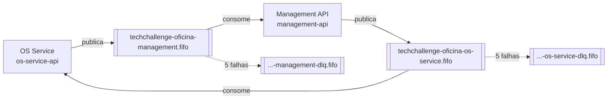

# SQS: filas da comunicação entre os serviços

Infraestrutura das filas do projeto **Tech Challenge Oficina** (SOAT16, fase 4). A Management API (este monorepo) e o OS Service ([repo OS-SERVICE](https://github.com/GuiToniello/tech-challenge-fase-4-OS-SERVICE-soat16-rm374658)) conversam só por eventos nessas filas, numa saga coreografada ([ADR-020](../docs/adr/ADR-020-Eventos-com-SQS-e-Saga-Coreografada.md)). As opções comparadas estão na [RFC-004](../docs/rfc/RFC-004-Comunicacao-entre-Microsservicos.md).

Tudo é criado com Terraform em [infra/](infra) e aplicado pelas pipelines do monorepo ([.github/workflows](../.github/workflows/README.md)). A pasta tem o próprio state e não depende da VPC nem do EKS: pode ser aplicada antes deles.

## 1. O que é provisionado

Tudo fica na AWS, região `us-east-1`. Cada serviço tem uma fila de entrada, uma DLQ e um usuário IAM ([locals.tf](infra/locals.tf)):

| Recurso | Management | OS Service |
|---|---|---|
| Fila FIFO de entrada (`aws_sqs_queue`) | `techchallenge-oficina-management.fifo` | `techchallenge-oficina-os-service.fifo` |
| DLQ FIFO | `techchallenge-oficina-management-dlq.fifo` | `techchallenge-oficina-os-service-dlq.fifo` |
| Usuário IAM (`aws_iam_user`) | `techchallenge-oficina-management-sqs` | `techchallenge-oficina-os-service-sqs` |
| Access key (SSM, SecureString) | `/techchallenge-oficina/sqs/management/access-key-id` e `/secret-access-key` | `/techchallenge-oficina/sqs/os-service/access-key-id` e `/secret-access-key` |

Configuração das filas ([sqs.tf](infra/sqs.tf)):
- **Fila de entrada:** FIFO, sem deduplicação por conteúdo (quem publica informa o `MessageGroupId` e o `MessageDeduplicationId`) e *visibility timeout* de 60 s.
- **DLQ:** recebe a mensagem depois de 5 recebimentos sem sucesso (`maxReceiveCount`) e a guarda por 14 dias, o máximo do SQS. Só a fila do próprio serviço pode usá-la (*redrive allow policy*).



### 1.1 Permissões dos usuários IAM

Cada usuário tem uma policy inline chamada `sqs`, de menor privilégio ([iam.tf](infra/iam.tf)):

| Statement | Ações | Recurso |
|---|---|---|
| `ConsumirFilaPropria` | `sqs:ReceiveMessage`, `sqs:DeleteMessage`, `sqs:ChangeMessageVisibility`, `sqs:GetQueueAttributes` e `sqs:GetQueueUrl` | A fila de entrada do próprio serviço |
| `PublicarNaFilaDoOutroServico` | `sqs:SendMessage` e `sqs:GetQueueUrl` | A fila de entrada do outro serviço |

Nenhum dos dois usuários acessa as DLQs: analisar e reprocessar uma mensagem da DLQ é feito com um usuário administrativo (seção 7).

### 1.2 Chaves no SSM e no Secret dos pods

- O Terraform cria uma access key para cada usuário e guarda o ID e o segredo no SSM Parameter Store, como SecureString no tier Standard ([ssm.tf](infra/ssm.tf)).
- O `_k8s-apply.yml` **de cada repositório** lê só os parâmetros do próprio serviço e grava os valores no Secret do Kubernetes como `AWS_ACCESS_KEY_ID` e `AWS_SECRET_ACCESS_KEY`, mascarados no log. O SDK da AWS lê essas variáveis sozinho, e a região vem de `AWS_REGION`, no ConfigMap.
  - Management: Secret `oficina-api-secrets`, namespace `oficina` ([kubernetes/k8s/README.md](../kubernetes/k8s/README.md)).
  - OS Service: Secret `os-service-api-secrets`, namespace `os-service` (repo OS-SERVICE).
- Não há passo manual nem secret do GitHub para o SQS. O Destroy apaga as filas, os usuários e as chaves, e o Bootstrap seguinte cria tudo de novo, com chaves novas.

Outputs do Terraform (sem segredos): `queue_urls`, `queue_arns`, `dlq_urls`, `iam_user_names` e `ssm_parameter_names`.

## 2. Contrato com os serviços

| Item | Valor | Onde é usado |
|---|---|---|
| Fila consumida pela Management | `techchallenge-oficina-management.fifo` | `SqsSettings__FilaConsumo` da Management e `SqsSettings__FilaPublicacao` do OS Service (ConfigMaps) |
| Fila consumida pelo OS Service | `techchallenge-oficina-os-service.fifo` | `SqsSettings__FilaConsumo` do OS Service e `SqsSettings__FilaPublicacao` da Management |
| Parâmetros SSM | `/techchallenge-oficina/sqs/<management\|os-service>/access-key-id` e `/secret-access-key` | `_k8s-apply.yml` de cada repositório |
| Grupo e deduplicação | `MessageGroupId` = id da OS; `MessageDeduplicationId` = id do envelope | Publicadores dos dois serviços |
| Envelope e eventos | JSON camelCase com `id`, `tipo`, `versao`, `ocorridoEm`, `origem` e `dados`; atributo de mensagem `tipo` | [ADR-020](../docs/adr/ADR-020-Eventos-com-SQS-e-Saga-Coreografada.md) |

Os nomes são fixos: mudar uma fila ou um caminho do SSM exige mudar os ConfigMaps e os `_k8s-apply.yml` dos dois repositórios.

## 3. Pipelines (GitHub Actions)

O SQS não tem workflows próprios: roda nas pipelines do monorepo, pelo workflow reutilizável `_terraform.yml` com `working-directory: SQS/infra`. Os detalhes estão no [README das pipelines](../.github/workflows/README.md).

| Workflow | O que faz com o SQS |
|---|---|
| **Bootstrap** (manual) | `terraform-sqs` (apply), logo depois dos testes e em paralelo com a foundation. O `k8s-apply` espera por ele |
| **Deploy**, em Pull Request | `validate-sqs` (sem AWS, check obrigatório `validate-sqs / terraform`) e `plan-sqs` (informativo; não depende do cluster, mas não roda em PR de fork, que não recebe secrets) |
| **Deploy**, em push na `main` com mudança em `SQS/infra/**` ou no `_terraform.yml` | `apply-sqs` e, em seguida, o `apply-k8s` com restart, para o Secret receber a chave atual |
| **Destroy** (manual, `confirm = destroy` + aprovação) | `terraform-destroy-sqs`, em paralelo com o destroy do RDS |

O repo OS-SERVICE não aplica este Terraform: o `_k8s-apply.yml` dele só lê do SSM a chave do OS Service. Por isso, o Bootstrap deste monorepo precisa rodar antes do Bootstrap do OS-SERVICE.

| Pasta | State (bucket `terraform-state-soat16`) |
|---|---|
| `SQS/infra` | `techchallenge-oficina/fase-4/sqs.tfstate`, com lock nativo (`use_lockfile`) |

**Permissões do usuário IAM `terraform`** (o mesmo das outras pastas): além do state em `techchallenge-oficina/fase-4/*`, ele precisa criar e apagar filas SQS, usuários IAM com policy inline e access key, e parâmetros SecureString no SSM. O apply dos manifests lê os parâmetros com `ssm:GetParameter` (com `--with-decryption`).

## 4. Custo

- Fila parada não é cobrada. O nível gratuito do SQS cobre 1 milhão de requisições por mês.
- Os dois consumidores fazem *long polling* de 20 s: cerca de 130 mil requisições por mês por pod, ou cerca de 260 mil com uma réplica de cada API. Publicações e exclusões somam pouco.
- O SSM Parameter Store no tier Standard e o IAM não são cobrados.

## 5. Uso local (ElasticMQ)

Localmente não há SQS: o `docker-compose.yml` da raiz sobe o ElasticMQ (`softwaremill/elasticmq-native:1.6.14`), que emula o SQS na porta `9324`. O [elasticmq.conf](../elasticmq.conf) cria as mesmas quatro filas FIFO, com a DLQ depois de 5 recebimentos (lá o *visibility timeout* é de 30 s).

- A API usa o `SqsSettings:ServiceUrl` (`http://elasticmq:9324` no compose, `http://localhost:9324` no `dotnet run`) e credenciais fictícias (`local`), que o ElasticMQ aceita.
- Para rodar a saga com o OS Service, os dois serviços precisam usar o mesmo ElasticMQ, o desta pasta (container `oficina-elasticmq`):
  1. Neste repositório: `podman compose up -d` (ou `docker compose up -d`).
  2. No repositório OS-SERVICE: `SQS_SERVICE_URL=http://oficina-elasticmq:9324 podman compose up -d` (PowerShell: `$env:SQS_SERVICE_URL="http://oficina-elasticmq:9324"; podman compose up -d`).
  3. Ligue o container do OS Service à rede do compose deste repositório: `podman network connect tech-challenge-fase-4-management-soat16-rm374658_default oficina-os-service-api` (no Docker, `docker network connect ...`). O nome da rede vem do nome da pasta deste repositório (o nome do projeto do compose), mais `_default`.

Para validar o Terraform sem acessar a AWS, a partir de `SQS/infra/`:

```powershell
terraform init -backend=false
terraform fmt -check -recursive
terraform validate
```

O `.terraform.lock.hcl` **é** versionado e fixa o provider AWS (6.66.0).

## 6. Riscos aceitos

- **O segredo da access key fica no state** do Terraform (bucket S3 privado e criptografado), como a senha do RDS, além do SSM e do Secret dos pods.
- **O ID da access key aparece no log do `terraform apply`**, que é público no GitHub Actions (o segredo não aparece). Num ambiente de estudo, destruído depois, o risco foi aceito.
- **Chaves de longa duração**: só mudam quando os usuários ou as chaves são recriados pelo Terraform (por exemplo, num Destroy seguido de Bootstrap).

## 7. Troubleshooting

- **Apply dos manifests falha em "Adicionar a chave do SQS"** (`Parâmetro ... não encontrado no SSM`): o `SQS/infra` ainda não foi aplicado. Rode o Bootstrap deste monorepo.
- **Pods com `integracao.falha` (`sqs`) e erro de credencial no `error.*`**: o Secret tem uma chave que não existe mais, porque o SQS foi recriado depois do último apply dos manifests. O Deploy e o Bootstrap deste monorepo já atualizam o Secret da Management; o do OS Service, não. Rode o K8s Apply do repo OS-SERVICE (ou o do repositório afetado) com `restart-pods = true`.
- **Mensagens paradas na DLQ**: veja o motivo nos logs `integracao.falha` com `Operacao` = `consumo` ([docs/observabilidade.md](../docs/observabilidade.md)). Depois de corrigir a causa, reenvie as mensagens para a fila de origem pelo console do SQS (redrive da DLQ), com um usuário administrativo. Não há reprocessamento automático.
- **`Error acquiring the state lock`**: outro apply ou destroy está rodando. Se o lock ficou preso depois de um run cancelado, rode `terraform force-unlock <LOCK_ID>` em `SQS/infra/` ou apague o objeto `techchallenge-oficina/fase-4/sqs.tfstate.tflock` do bucket.
