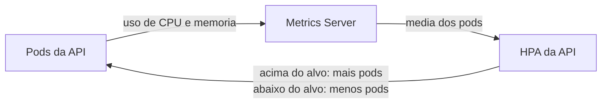

# ADR-016: Escalabilidade da API com HPA

**Status**: Aceita (atualizada na fase 4: quatro APIs no mesmo cluster, cada uma com um HPA de 1 a 2 pods)

**Resumo**:
Cada API tem um **HPA** (Horizontal Pod Autoscaler): uma regra do Kubernetes que aumenta ou diminui a quantidade de cópias (pods) da API conforme o uso de CPU e memória. Na fase 4, o cluster passou a rodar quatro APIs, a Management API, o OS Service, o Billing e o Execução e Produção, e cada uma varia de 1 a 2 pods. A quantidade de máquinas (nós) do cluster não muda: são sempre 2.

> As ADRs são numeradas em sequência única entre este monorepo e os repositórios [OS-SERVICE](https://github.com/GuiToniello/tech-challenge-fase-4-OS-SERVICE-soat16-rm374658), [BILLING](https://github.com/GuiToniello/tech-challenge-fase-4-BILLING-soat16-rm374658), [EXECUTION](https://github.com/GuiToniello/tech-challenge-fase-4-EXECUTION-AND-PRODUCTION-soat16-rm374658) e [LAMBDA](https://github.com/GuiToniello/tech-challenge-fase-4-LAMBDA-soat16-rm374658). O índice de todas as decisões está no [docs/arquitetura.md](../arquitetura.md#5-decisões-de-arquitetura-rfcs-e-adrs).

**Contexto**:
- A Management API roda no Amazon EKS, em um Deployment (`management-api`, namespace `oficina`) que começa com 1 pod. Desde a fase 4, o OS Service ([ADR-019](https://github.com/GuiToniello/tech-challenge-fase-4-OS-SERVICE-soat16-rm374658/blob/main/docs/adr/ADR-019-OS-Service-Microsservico-com-Banco-Proprio.md)), o Billing ([ADR-021](https://github.com/GuiToniello/tech-challenge-fase-4-BILLING-soat16-rm374658/blob/main/docs/adr/ADR-021-Billing-Service-Orcamento-e-Pagamentos-com-Banco-Proprio.md)) e o Execução e Produção ([ADR-023](https://github.com/GuiToniello/tech-challenge-fase-4-EXECUTION-AND-PRODUCTION-soat16-rm374658/blob/main/docs/adr/ADR-023-Execucao-e-Producao-Fila-de-Execucao-e-Status-por-Eventos.md)) rodam no mesmo cluster, nos Deployments `os-service-api` (namespace `os-service`, repo OS-SERVICE), `billing-api` (namespace `billing`, repo BILLING) e `execution-api` (namespace `execution`, repo EXECUTION), também começando com 1 pod.
- Cada pod das quatro APIs **reserva** 100m de CPU (um décimo de um núcleo) e 128Mi de memória (o *request*) e pode **usar no máximo** 500m de CPU e 512Mi de memória (o *limit*).
- A carga muda ao longo do dia. É preciso aguentar picos sem deixar pods sobrando no resto do tempo.
- O cluster é pequeno e tem custo fixo: 2 nós `t3.small` (mínimo, desejado e máximo iguais a 2), com espaço para 22 pods e cerca de 1,4 GiB de memória livre para pods em cada nó ([k8s/README.md](../../kubernetes/k8s/README.md#61-capacidade-do-cluster), seção 6.1).
- O requisito do projeto para o autoscaling é: CPU-alvo de 30%, mínimo de 1 e máximo de 10 réplicas ([k8s/README.md](../../kubernetes/k8s/README.md#6-regras-de-hpa-aplicadas), seção 6). Com quatro APIs no mesmo cluster, o máximo ficou em 2 por API: os 10 pods de sistema (7 do Kubernetes e 3 do Datadog) mais 4 × 2 réplicas somam 18, dentro dos 22 pods que cabem nos 2 nós. No pior caso, um rollout com as quatro APIs no máximo sobe um pod a mais por API por um momento: 22, o limite.

**Decisão**:

1. **Um HPA por API** (`autoscaling/v2`), em `kubernetes/k8s/features/management-api/hpa.yml` (neste monorepo), `kubernetes/k8s/features/os-service-api/hpa.yml` (repo OS-SERVICE), `kubernetes/k8s/features/billing-api/hpa.yml` (repo BILLING) e `kubernetes/k8s/features/execution-api/hpa.yml` (repo EXECUTION), com as mesmas regras:
   - mínimo de 1 e máximo de 2 pods (o HPA da Management ia até 10 antes do OS Service, até 5 antes do Billing e até 3 antes do Execução e Produção);
   - CPU-alvo de 30% do request, ou seja, 30m por pod, em média;
   - memória-alvo de 150% do request, ou seja, 192Mi por pod, em média. O alvo era 80% e subiu porque o tracer do Datadog aumenta a memória de cada pod ([ADR-014](ADR-014-Observabilidade-com-Datadog.md)).
2. **As medições vêm do Metrics Server**, instalado por Terraform em `kubernetes/infra/addons` ([metrics-server.tf](../../kubernetes/infra/addons/metrics-server.tf)).
3. **Escala horizontal:** o HPA cria mais pods iguais, em vez de deixar cada pod maior. Isso funciona porque as APIs não guardam dados na memória entre um pedido e outro: tudo fica no PostgreSQL de cada uma. Assim, qualquer pod atende qualquer pedido, e o Service do Kubernetes divide os pedidos entre eles. Cada pod também consome a fila SQS do seu serviço, e a fila FIFO não entrega a dois pods, ao mesmo tempo, mensagens da mesma OS ([ADR-020](ADR-020-Eventos-com-SQS-e-Saga-Coreografada.md)).
4. **Nós fixos:** o cluster não cria máquinas novas sozinho (sem Cluster Autoscaler ou Karpenter). O node group fica em 2 nós para o custo não crescer sem controle.

Como o HPA decide, em poucas palavras:

- A cada 15 segundos, o HPA compara o uso médio dos pods com o alvo.
- Se a média passa do alvo, ele calcula quantos pods trariam o uso de volta ao alvo e cria os que faltam, até 2. Exemplo: 1 pod usando 60m de CPU está no dobro do alvo (30m), então o HPA sobe para 2 pods.
- Quando o uso cai, ele remove pods aos poucos, depois de 5 minutos de calma, até voltar a 1.
- Com duas métricas, vale a que pedir mais pods.
- Cada API escala sozinha: o HPA de uma não olha as outras.

**Consequências**:
- ✅ Cada API cresce sozinha quando recebe mais pedidos e volta a 1 pod quando a carga passa, sem ação manual.
- ✅ Custo previsível: como os nós são fixos, o HPA só usa o espaço que já existe no cluster.
- ⚠ **O limite real é o espaço nos 2 nós.** O cluster comporta 22 pods no total e, em uso normal, já roda 14: as quatro APIs, os 3 do Datadog e os 7 do próprio Kubernetes. Com as quatro APIs no máximo (2 + 2 + 2 + 2), são 18 pods e cerca de 2,3 GiB de requests de memória, contra ~2,9 GiB alocáveis. Num rollout com as quatro APIs no máximo, cada uma sobe um pod a mais por um momento: 22 pods, no limite. Cabe, mas apertado, e pods além da capacidade ficam `Pending` (esperando espaço). A saída prevista é trocar os nós por `t3.medium` ([k8s/README.md](../../kubernetes/k8s/README.md#61-capacidade-do-cluster), seção 6.1).
- ⚠ **CPU-alvo baixo (30%):** o HPA escala cedo. Responde rápido aos picos, mas pode criar pods com pouca carga.
- ⚠ **Memória como métrica:** a memória de uma API .NET demora a cair depois de um pico e pode segurar pods a mais por um tempo. Se o HPA escalar sem carga, a orientação é deixar só a CPU ([k8s/README.md](../../kubernetes/k8s/README.md#6-regras-de-hpa-aplicadas), seção 6).
- ⚠ **Escalar não é instantâneo:** um pod novo precisa baixar a imagem, iniciar a API e passar no teste de saúde (`/health`) antes de receber pedidos.
- ⚠ **Depende do Metrics Server:** sem ele, o HPA fica sem medições e para de escalar (os pods atuais continuam rodando).
- ⚠ **Cada réplica a mais também consulta a fila:** o *long polling* de cada pod soma requisições ao SQS, ainda dentro do nível gratuito (ADR-020).

**Alternativas Rejeitadas**:
- Quantidade fixa de pods, sem autoscaling:
  - rejeitada porque sobra recurso fora dos picos e falta nos picos.
- VPA (Vertical Pod Autoscaler), que aumenta o tamanho de cada pod em vez da quantidade:
  - rejeitada porque precisa recriar os pods para mudar o tamanho, não ajuda em picos rápidos e exigiria instalar mais componentes no cluster.
- Cluster Autoscaler ou Karpenter, que criam e removem nós:
  - rejeitada para manter o custo fixo e previsível num projeto de estudo.
- KEDA, que escala por eventos (como o tamanho de uma fila):
  - rejeitada quando o sistema não tinha filas ([ADR-015](ADR-015-Comunicacao-Sincrona-via-API-Gateway.md)). Com as filas da fase 4 (ADR-020), continua rejeitada: o volume de mensagens é pequeno, e o KEDA somaria pods num cluster sem folga.
- Máximo de 10, de 5 ou de 3 pods para cada API (os valores usados antes do OS Service, do Billing e do Execução e Produção):
  - rejeitada porque, com as quatro APIs no máximo, o cluster chegaria ao limite de 22 pods ou passaria dele (com 3 por API, seriam 10 + 12 = 22 já em regime, sem folga para o rollout).
- Métricas personalizadas, como pedidos por segundo vindos do Datadog:
  - rejeitada porque exigiria um adaptador de métricas no cluster; CPU e memória bastam para o escopo.

**Relação com Outras ADRs**:
- **ADR-014**: o tracer do Datadog levou o alvo de memória de 80% para 150% e reduziu a folga do cluster.
- **ADR-015**: com as APIs sem estado e a entrada síncrona pelo API Gateway, escalar é só criar mais pods.
- **ADR-018**: o monorepo e a API única deixaram um só Deployment e um só HPA neste monorepo ([ADR-018](ADR-018-Monorepo-e-API-Unica-Management.md)).
- **ADR-019**: o OS Service trouxe o segundo Deployment e o segundo HPA, no repo OS-SERVICE ([ADR-019](https://github.com/GuiToniello/tech-challenge-fase-4-OS-SERVICE-soat16-rm374658/blob/main/docs/adr/ADR-019-OS-Service-Microsservico-com-Banco-Proprio.md)).
- **ADR-020**: cada pod consome a fila SQS do seu serviço ([ADR-020](ADR-020-Eventos-com-SQS-e-Saga-Coreografada.md)).
- **ADR-021**: o Billing trouxe o terceiro Deployment e o terceiro HPA, no repo BILLING ([ADR-021](https://github.com/GuiToniello/tech-challenge-fase-4-BILLING-soat16-rm374658/blob/main/docs/adr/ADR-021-Billing-Service-Orcamento-e-Pagamentos-com-Banco-Proprio.md)).
- **ADR-023**: o Execução e Produção trouxe o quarto Deployment e o quarto HPA, no repo EXECUTION, e o máximo de cada HPA caiu para 2 ([ADR-023](https://github.com/GuiToniello/tech-challenge-fase-4-EXECUTION-AND-PRODUCTION-soat16-rm374658/blob/main/docs/adr/ADR-023-Execucao-e-Producao-Fila-de-Execucao-e-Status-por-Eventos.md)).
- **RFC-001**: a escolha da AWS e dos nós `t3.small` define a capacidade do cluster ([RFC-001](../rfc/RFC-001-Escolha-da-Nuvem.md)).
