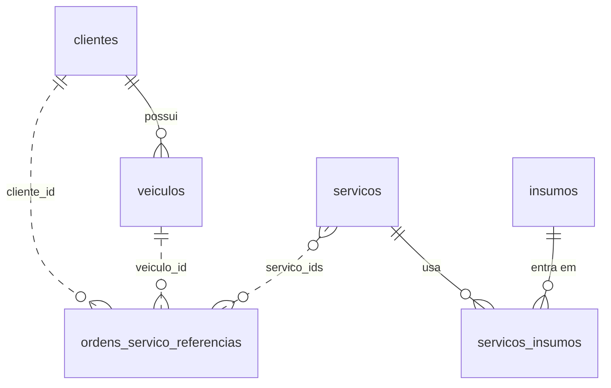

# ADR-017: PostgreSQL no Amazon RDS e Modelo de Dados

**Status**: Aceita (atualizada na fase 4: o banco da Management não tem mais as tabelas de OS, porque o OS Service tem o próprio RDS, ver [ADR-019](https://github.com/GuiToniello/tech-challenge-fase-4-OS-SERVICE-soat16-rm374658/blob/main/docs/adr/ADR-019-OS-Service-Microsservico-com-Banco-Proprio.md); depois, as tabelas do orçamento foram para o RDS do Billing, ver [ADR-021](https://github.com/GuiToniello/tech-challenge-fase-4-BILLING-soat16-rm374658/blob/main/docs/adr/ADR-021-Billing-Service-Orcamento-e-Pagamentos-com-Banco-Proprio.md))

**Resumo**:
O banco do sistema é o PostgreSQL, gerenciado pelo Amazon RDS. Esta ADR registra a justificativa formal da escolha e documenta o modelo de dados da Management: o diagrama ER (entidade-relacionamento) e a explicação de cada relacionamento, na seção [Modelo de dados](#modelo-de-dados). As opções comparadas estão na [RFC-002](../rfc/RFC-002-Escolha-do-Banco-de-Dados.md). Desde a fase 4, o OS Service, o Billing e o Execução e Produção usam a mesma escolha, cada um num RDS próprio, com os bancos `oficina_os` (ADR-019), `oficina_billing` (ADR-021) e `oficina_execution` (ADR-023).

> As ADRs são numeradas em sequência única entre este monorepo e os repositórios [OS-SERVICE](https://github.com/GuiToniello/tech-challenge-fase-4-OS-SERVICE-soat16-rm374658), [BILLING](https://github.com/GuiToniello/tech-challenge-fase-4-BILLING-soat16-rm374658), [EXECUTION](https://github.com/GuiToniello/tech-challenge-fase-4-EXECUTION-AND-PRODUCTION-soat16-rm374658) e [LAMBDA](https://github.com/GuiToniello/tech-challenge-fase-4-LAMBDA-soat16-rm374658). O índice de todas as decisões está no [docs/arquitetura.md](../arquitetura.md#5-decisões-de-arquitetura-rfcs-e-adrs).

**Contexto**:
- A Management guarda clientes, veículos, serviços, peças (insumos) e uma referência de cada ordem de serviço (OS). Até a fase 3, as OS, o histórico de status e os indicadores também ficavam aqui; na fase 4, eles foram para o banco do OS Service (ADR-019), e os orçamentos, para o banco do Billing (ADR-021).
- A Management API lê e grava no banco ([ADR-015](ADR-015-Comunicacao-Sincrona-via-API-Gateway.md)), e a Lambda buscar-cliente (repo LAMBDA) consulta a tabela `clientes`. O OS Service, o Billing e o Execução e Produção não acessam este banco: eles trocam eventos com a Management ([ADR-020](ADR-020-Eventos-com-SQS-e-Saga-Coreografada.md)).
- A pasta [DB/](../../DB/README.md) cria só a instância e o banco vazio `oficina`. As tabelas são criadas pelas migrations do Entity Framework Core (`server/`), quando a Management API sobe (ADR-007 e ADR-009).
- As opções avaliadas (Aurora, MySQL, SQL Server, DynamoDB, MongoDB e PostgreSQL dentro do EKS) estão na RFC-002.

**Decisão**:
Usar um banco relacional **PostgreSQL no Amazon RDS**, com a configuração da [seção 1 do DB/README.md](../../DB/README.md#1-o-que-é-provisionado) e o modelo de dados descrito na seção [Modelo de dados](#modelo-de-dados). Na fase 4, vale a regra de um banco por serviço: o OS Service, o Billing e o Execução e Produção têm o próprio RDS, criado no repositório de cada um.

**Justificativa formal**:

| Critério | Como o PostgreSQL no RDS atende | Evidência no projeto |
|---|---|---|
| Integridade dos relacionamentos | Chaves estrangeiras impedem apontar para um registro que não existe e definem o que acontece numa exclusão | 3 chaves estrangeiras entre as 6 tabelas da Management |
| Valores únicos | Índices únicos, garantidos pelo banco mesmo com várias requisições gravando ao mesmo tempo | `clientes.identificacao` (CPF/CNPJ) e `veiculos.placa` |
| Transações (ACID) | Cada gravação é "tudo ou nada" | O serviço é gravado junto com a lista de peças dele (`servicos_insumos`) |
| Consultas | SQL com filtros, junções e índices | Cadastros, a referência da OS e, no OS Service, as listas de OS por status e por cliente e o cálculo dos indicadores |
| Tipos de dados | Tipos nativos para os dados do modelo | `uuid` (identificadores), `uuid[]` (lista de serviços da OS), `interval` (tempos médios, no OS Service), `timestamp with time zone` (datas) e `numeric(18,2)` (valores) |
| Ecossistema .NET | Provider Npgsql maduro no Entity Framework Core | ADR-007 e ADR-009; a Lambda buscar-cliente também usa o Npgsql |
| Mesmo banco local e na nuvem | O mesmo motor nos dois ambientes | `postgres:17-alpine` no `docker-compose.yml` da raiz e RDS for PostgreSQL na AWS |
| Operação gerenciada | A AWS cuida da instalação, das atualizações e do disco criptografado | `aws_db_instance` com `storage_encrypted = true` ([rds.tf](../../DB/infra/rds.tf)) |
| Segurança de rede | Sem acesso pela internet; só os nós do EKS e a Lambda buscar-cliente conectam | `publicly_accessible = false`, sub-redes privadas e o SG `techchallenge-oficina-rds-sg` |
| Custo | Código aberto, sem licença; uma instância pequena basta | `db.t3.micro` com 20 GiB `gp3` |

**Consequências**:
- ✅ Os dados ficam consistentes mesmo com várias requisições gravando ao mesmo tempo: o banco recusa duplicatas e referências quebradas dentro de cada serviço.
- ✅ O mesmo banco roda na máquina de quem desenvolve e na AWS, então o que funciona localmente funciona na nuvem.
- ✅ Não há servidor de banco para administrar.
- ⚠ Uma zona só, sem backup e sem proteção contra exclusão: um Destroy apaga todos os dados. Aceito por ser um ambiente de estudo.
- ⚠ Banco compartilhado com a Lambda buscar-cliente (repo LAMBDA), que lê a tabela `clientes` direto: uma mudança nessa tabela também afeta a Lambda.
- ⚠ A versão do PostgreSQL não está fixada no Terraform: o RDS usa a versão padrão da AWS no momento da criação, enquanto o ambiente local usa a 17.
- ⚠ A publicação do evento acontece depois de gravar, fora da transação do banco (ADR-020). O débito de estoque, que gravava insumo por insumo, passou a usar uma transação única com a marca `estoque_debitado` (ADR-012).
- ⚠ **Sem chave estrangeira entre os serviços** (fase 4): a referência da OS guarda ids de clientes, veículos e serviços sem chave estrangeira. Excluir um cadastro usado por uma OS não é mais bloqueado pelo banco (limitação aceita, ADR-019).
- ⚠ A migration `ExtrairOrdemServico` (fase 4) apaga as tabelas antigas de OS, orçamento e indicadores. Os dados delas não são levados para o OS Service; num ambiente recriado do zero, isso não importa.
- ⚠ A migration `ExtrairOrcamento` (entrada do Billing) apaga as tabelas `orcamentos` e `orcamentos_servicos`, sem levar os dados para o Billing, e cria a coluna `estoque_debitado` em `ordens_servico_referencias`. Num ambiente recriado do zero, isso também não importa.

**Alternativas Rejeitadas** (comparação completa na RFC-002):
- Amazon Aurora PostgreSQL:
  - rejeitada por ser maior e mais complexa do que o projeto precisa.
- MySQL ou SQL Server no RDS:
  - rejeitadas por exigirem refazer as migrations e o ambiente local; o SQL Server também tem licença paga.
- DynamoDB ou MongoDB:
  - rejeitadas porque não garantem relacionamentos no banco, e o modelo da oficina é cheio deles.
  - Na fase 4, o DynamoDB passou a ser usado só no Billing, para um histórico complementar e descartável dos eventos de pagamento, sem relacionamentos. O banco de cada serviço continua sendo o PostgreSQL ([ADR-024](https://github.com/GuiToniello/tech-challenge-fase-4-BILLING-soat16-rm374658/blob/main/docs/adr/ADR-024-Historico-de-Pagamentos-no-DynamoDB.md), repo BILLING).
- PostgreSQL num pod do EKS:
  - rejeitada porque backup, atualização e disco ficariam por conta do time, ocupando um cluster pequeno (2 nós `t3.small`).
- Um banco compartilhado entre a Management e os outros serviços (fase 4):
  - rejeitada porque manteria o acoplamento pelo banco que a separação em serviços quer remover (ADR-019 e ADR-021).

**Relação com Outras ADRs**:
- **ADR-007**: acesso aos dados com Entity Framework Core e Npgsql: [ADR-007](ADR-007-EFCore-com-PostgreSQL.md).
- **ADR-009**: as tabelas são criadas pelas migrations, no startup da API: [ADR-009](ADR-009-Migracoes-Automaticas-no-Startup.md).
- **ADR-012**: controle de estoque na tabela `insumos`: [ADR-012](ADR-012-Controle-de-Estoque-de-Insumos.md).
- **ADR-015**: comunicação síncrona pelo API Gateway; a Management API e a Lambda buscar-cliente acessam este banco direto: [ADR-015](ADR-015-Comunicacao-Sincrona-via-API-Gateway.md).
- **ADR-019**: o OS Service e o banco dele (`ordens_servico`, `ordens_servico_historico_status` e `indicadores`), no repo OS-SERVICE: [ADR-019](https://github.com/GuiToniello/tech-challenge-fase-4-OS-SERVICE-soat16-rm374658/blob/main/docs/adr/ADR-019-OS-Service-Microsservico-com-Banco-Proprio.md).
- **ADR-020**: a referência da OS é mantida pelos eventos do OS Service, e o `estoque_debitado`, pelo `PagamentoAprovado` do Billing: [ADR-020](ADR-020-Eventos-com-SQS-e-Saga-Coreografada.md).
- **ADR-021**: o Billing e o banco dele (`oficina_billing`), com o orçamento e os pagamentos, no repo BILLING: [ADR-021](https://github.com/GuiToniello/tech-challenge-fase-4-BILLING-soat16-rm374658/blob/main/docs/adr/ADR-021-Billing-Service-Orcamento-e-Pagamentos-com-Banco-Proprio.md).
- **ADR-023**: o Execução e Produção e o banco dele (`oficina_execution`), com a fila de produção, no repo EXECUTION: [ADR-023](https://github.com/GuiToniello/tech-challenge-fase-4-EXECUTION-AND-PRODUCTION-soat16-rm374658/blob/main/docs/adr/ADR-023-Execucao-e-Producao-Fila-de-Execucao-e-Status-por-Eventos.md).
- **ADR-024**: o histórico de pagamentos do Billing no Amazon DynamoDB, complementar ao PostgreSQL dele, no repo BILLING: [ADR-024](https://github.com/GuiToniello/tech-challenge-fase-4-BILLING-soat16-rm374658/blob/main/docs/adr/ADR-024-Historico-de-Pagamentos-no-DynamoDB.md).

## Modelo de dados

Esta seção descreve o banco da Management (`oficina`). O banco do OS Service (`oficina_os`) está na [ADR-019](https://github.com/GuiToniello/tech-challenge-fase-4-OS-SERVICE-soat16-rm374658/blob/main/docs/adr/ADR-019-OS-Service-Microsservico-com-Banco-Proprio.md), o do Billing (`oficina_billing`), na [ADR-021](https://github.com/GuiToniello/tech-challenge-fase-4-BILLING-soat16-rm374658/blob/main/docs/adr/ADR-021-Billing-Service-Orcamento-e-Pagamentos-com-Banco-Proprio.md), e o do Execução e Produção (`oficina_execution`), na [ADR-023](https://github.com/GuiToniello/tech-challenge-fase-4-EXECUTION-AND-PRODUCTION-soat16-rm374658/blob/main/docs/adr/ADR-023-Execucao-e-Producao-Fila-de-Execucao-e-Status-por-Eventos.md).

### 1. Diagrama ER (visão geral)

Cada caixa é uma tabela, e cada linha liga duas tabelas. Os símbolos nas pontas das linhas dizem quantos registros de um lado se ligam ao outro:

| Na ponta da linha | Significa |
|---|---|
| Dois traços | Exatamente um |
| Círculo e traço | Zero ou um |
| Traço e "pé de galinha" (três riscos) | Um ou mais |
| Círculo e "pé de galinha" | Zero ou mais |

A linha cheia é uma chave estrangeira no banco. A linha tracejada é uma referência guardada sem chave estrangeira.

### 2. Explicação dos relacionamentos

| Relacionamento | Tipo | Em palavras simples | Ao excluir |
|---|---|---|---|
| `clientes` → `veiculos` | 1 para N | Um cliente pode ter vários veículos, e cada veículo tem um dono (`veiculos.cliente_id`) | O banco não deixa excluir um cliente que tem veículos (`RESTRICT`) |
| `servicos` ↔ `insumos`, pela tabela `servicos_insumos` | N para N, com dado extra | Um serviço usa várias peças, cada uma com uma quantidade, e uma peça pode ser usada em vários serviços | Excluir o serviço apaga a lista de peças dele (`CASCADE`). Uma peça usada em algum serviço não pode ser excluída (`RESTRICT`) |
| `clientes`, `veiculos` e `servicos` ⇢ `ordens_servico_referencias` | Referência sem chave estrangeira | A referência guarda os ids da OS do OS Service. A Management confere que eles existem (e que o veículo é do cliente) quando recebe o evento da OS; se não existirem, a OS é rejeitada (ADR-020) | Sem regra no banco: excluir um cadastro usado por uma OS não é bloqueado. O código apaga a referência quando recebe o evento `OrdemServicoExcluida` |

O orçamento e os serviços dele (antes `orcamentos` e `orcamentos_servicos`) ficam no banco do Billing desde a migration `ExtrairOrcamento`, com o nome e o valor de cada serviço copiados do evento `OrdemServicoValidada` ([ADR-021](https://github.com/GuiToniello/tech-challenge-fase-4-BILLING-soat16-rm374658/blob/main/docs/adr/ADR-021-Billing-Service-Orcamento-e-Pagamentos-com-Banco-Proprio.md)).

### 3. Tabelas e colunas

| Tabela | O que guarda | Colunas |
|---|---|---|
| `clientes` | Clientes da oficina | `Id` (chave), `nome_completo`, `identificacao` (CPF ou CNPJ, só números, único), `tipo_identificacao` (1 = CPF, 2 = CNPJ) e `email` (opcional) |
| `veiculos` | Veículos dos clientes | `Id` (chave), `placa` (padrão Mercosul, única), `marca`, `modelo`, `ano`, `renavam` e `cliente_id` |
| `servicos` | Catálogo de serviços | `Id` (chave), `nome` e `descricao` |
| `insumos` | Peças e materiais, com o estoque | `Id` (chave), `nome`, `fabricante`, `quantidade_disponivel` (estoque) e `valor_unitario` |
| `servicos_insumos` | Peças que cada serviço usa | `servico_id` e `insumo_id` (chave composta) e `quantidade` |
| `ordens_servico_referencias` | O que a Management sabe de cada OS do OS Service, recebido por eventos | `ordem_servico_id` (chave), `cliente_id`, `veiculo_id`, `status` (tabela abaixo), `servico_ids` (`uuid[]`) e `estoque_debitado` (`true` depois do débito de estoque do pagamento aprovado, ADR-012) |

Valores da coluna `status` em `ordens_servico_referencias`, os mesmos do OS Service e dos eventos:

| Valor | Status |
|---|---|
| 1 | Recebida |
| 2 | Em diagnóstico |
| 3 | Aguardando aprovação |
| 4 | Em execução |
| 5 | Finalizada |
| 6 | Entregue |
| 7 | Encerrada (prevista, mas nenhum fluxo usa) |
| 8 | Cancelada (OS rejeitada pela Management; a referência é apagada, então este valor aparece só no OS Service) |

Observações:
- As chaves das tabelas de cadastro se chamam `Id`, com "I" maiúsculo (padrão do Entity Framework Core). Numa consulta SQL feita à mão, use aspas: `SELECT "Id" FROM clientes`.
- O Entity Framework Core também cria a tabela `__EFMigrationsHistory`, que registra quais migrations já foram aplicadas.

### 4. Regras de integridade

Garantidas pelo banco:
- chave primária em todas as tabelas;
- as 3 chaves estrangeiras da seção 2, com `RESTRICT` (impede a exclusão) ou `CASCADE` (exclui junto);
- valores únicos: `clientes.identificacao` e `veiculos.placa`;
- índices para as consultas mais comuns, como `cliente_id` em `veiculos` e `insumo_id` em `servicos_insumos`.

Garantidas pelo código da API (regras de negócio):
- a OS só é aceita se o cliente, o veículo (do cliente) e os serviços existirem, e com pelo menos um serviço (validação da saga, ADR-020);
- o estoque de uma OS é debitado uma vez só, no pagamento aprovado (`estoque_debitado`, ADR-012);
- CPF e CNPJ com dígitos verificadores válidos, placa no padrão Mercosul e ano entre 1886 e o ano seguinte ao atual;
- quantidade de peça maior que zero, e estoque e valores nunca negativos.

### 5. Como manter este modelo atualizado

- A fonte da verdade são as [migrations](../../server/1%20-%20Frameworks%20%26%20Drivers/TechChallenge.Oficina.DB/Migrations) e as [configurações do Entity Framework Core](../../server/1%20-%20Frameworks%20%26%20Drivers/TechChallenge.Oficina.DB/Features), em `server/`.
- Ao criar uma migration nova, atualize o diagrama e as tabelas desta ADR.
- O modelo de domínio (as classes do código) está no [domain-model.puml](../diagram/domain-model.puml).
