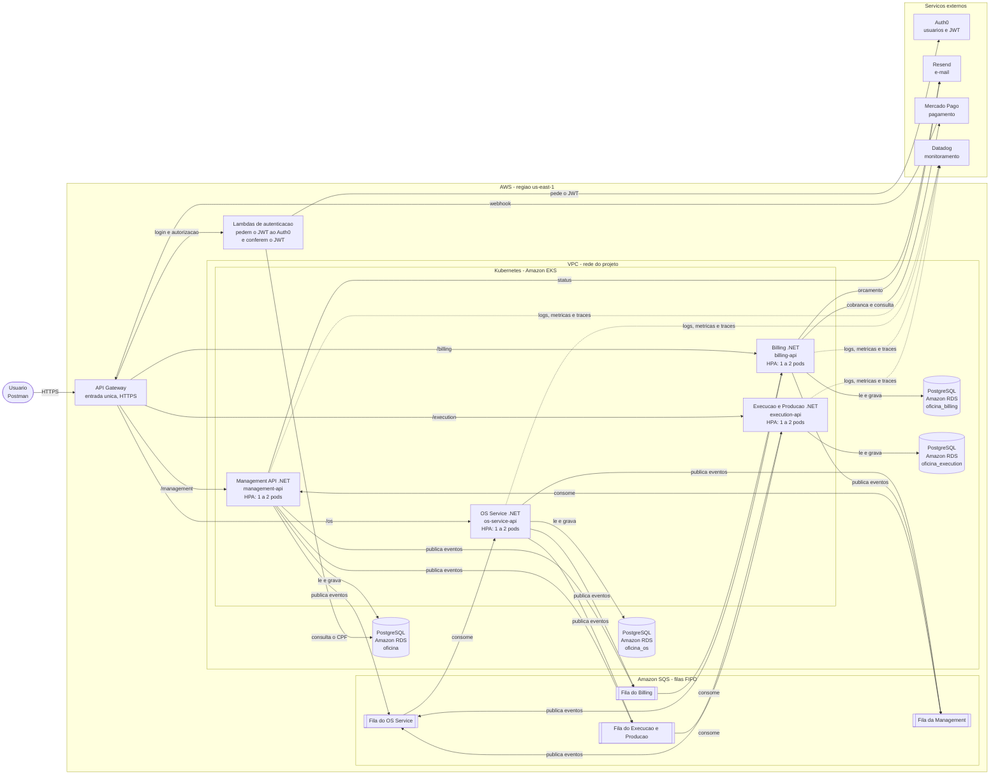
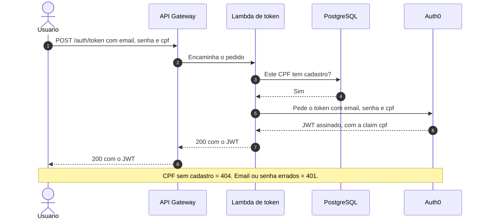
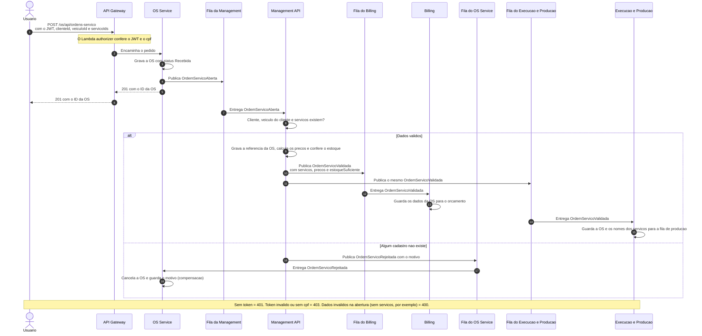
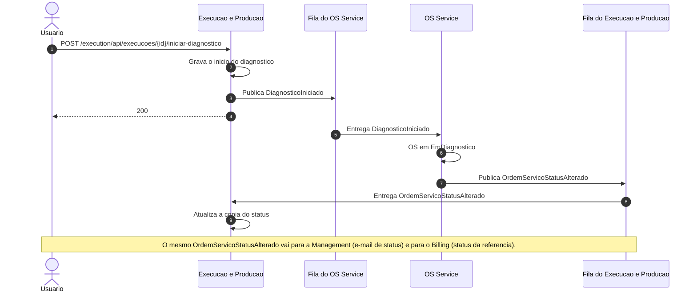
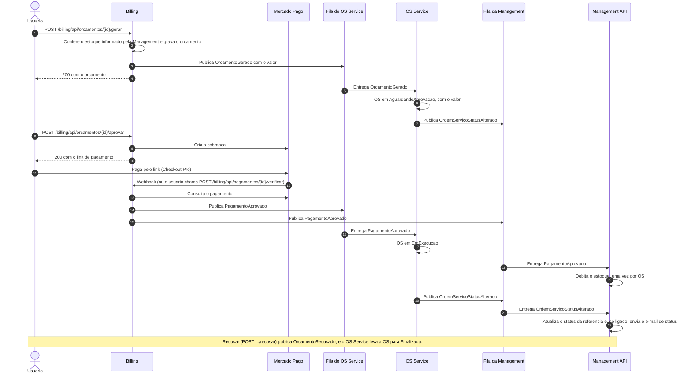
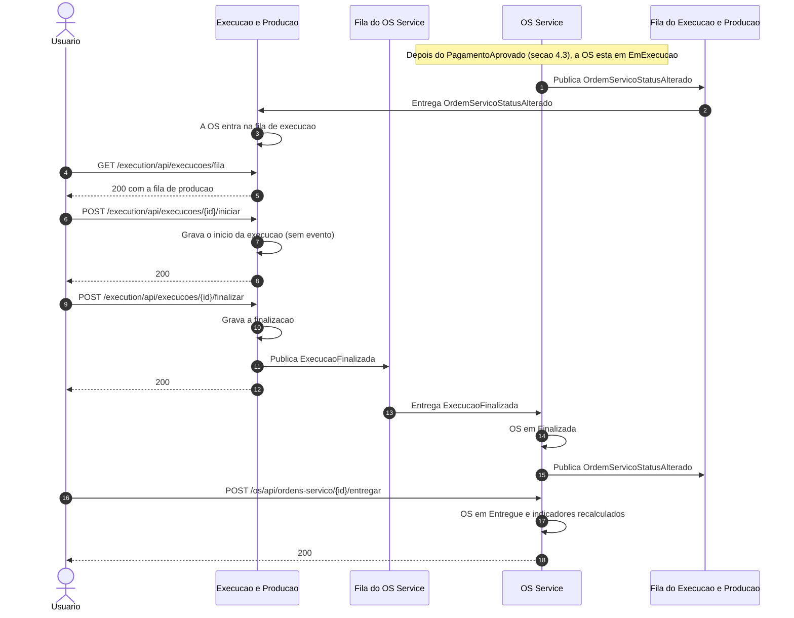

# Arquitetura da solução

Este documento dá a visão geral de como o sistema da oficina funciona de ponta a ponta. Ele junta as peças dos cinco repositórios do projeto:
- **este monorepo**: código da Management API em `server/`; rede, Kubernetes, API Gateway e Datadog em [kubernetes/](../kubernetes/README.md); banco de dados em [DB/](../DB/README.md); filas em [SQS/](../SQS/README.md);
- o [OS-SERVICE](https://github.com/GuiToniello/tech-challenge-fase-4-OS-SERVICE-soat16-rm374658): o microsserviço de ordens de serviço, com banco próprio;
- o [BILLING](https://github.com/GuiToniello/tech-challenge-fase-4-BILLING-soat16-rm374658): o microsserviço de orçamento e pagamento, com banco próprio;
- o [EXECUTION](https://github.com/GuiToniello/tech-challenge-fase-4-EXECUTION-AND-PRODUCTION-soat16-rm374658): o microsserviço de Execução e Produção (fila de produção, diagnóstico e execução), com banco próprio;
- o [LAMBDA](https://github.com/GuiToniello/tech-challenge-fase-4-LAMBDA-soat16-rm374658): autenticação.

Na fase 4, os repositórios APP, DB e K8S da fase 3 viraram pastas deste monorepo, com uma só API, a Management API ([ADR-018](./adr/ADR-018-Monorepo-e-API-Unica-Management.md)). Depois, o ciclo de vida da ordem de serviço saiu da Management API e virou o OS Service ([ADR-019](https://github.com/GuiToniello/tech-challenge-fase-4-OS-SERVICE-soat16-rm374658/blob/main/docs/adr/ADR-019-OS-Service-Microsservico-com-Banco-Proprio.md)), e o orçamento virou o Billing, que também cuida do pagamento ([ADR-021](https://github.com/GuiToniello/tech-challenge-fase-4-BILLING-soat16-rm374658/blob/main/docs/adr/ADR-021-Billing-Service-Orcamento-e-Pagamentos-com-Banco-Proprio.md)). Por fim, a fila de produção da oficina (diagnóstico e execução) virou o Execução e Produção ([ADR-023](https://github.com/GuiToniello/tech-challenge-fase-4-EXECUTION-AND-PRODUCTION-soat16-rm374658/blob/main/docs/adr/ADR-023-Execucao-e-Producao-Fila-de-Execucao-e-Status-por-Eventos.md)). Os quatro serviços conversam só por eventos no Amazon SQS ([ADR-020](./adr/ADR-020-Eventos-com-SQS-e-Saga-Coreografada.md)).

Neste documento:
1. Glossário rápido.
2. Diagrama de componentes: a nuvem, as APIs, os bancos, as filas e o monitoramento.
3. Diagrama de sequência da autenticação.
4. Diagramas de sequência da abertura de uma ordem de serviço, do diagnóstico, do orçamento, do pagamento e da execução (a saga entre os serviços).
5. Índice das decisões de arquitetura (RFCs e ADRs) dos cinco repositórios.

Os diagramas usam [Mermaid](https://mermaid.js.org/), que o GitHub desenha sozinho. Eles são uma **visão geral**: escondem detalhes como a rede interna e as pipelines, que estão nos documentos indicados ao longo do texto.

## 1. Glossário rápido

| Termo | O que significa aqui |
|---|---|
| API | Programa que recebe pedidos pela internet (requisições HTTP) e responde em JSON. O sistema tem quatro APIs em .NET: a Management API, o OS Service, o Billing e o Execução e Produção |
| Management API | Cadastros (clientes, veículos, serviços e peças), estoque, validação da OS e o e-mail de mudança de status |
| OS Service | Microsserviço das ordens de serviço: abertura, status, consultas e indicadores. É o único que muda o status da OS |
| Billing | Microsserviço do orçamento (gerar, enviar por e-mail, aprovar e recusar) e do pagamento, pelo Mercado Pago |
| Execução e Produção | Microsserviço da produção na oficina: a fila de execução, o início do diagnóstico e o início e o fim da execução. Avisa o OS Service por eventos, sem mudar o status da OS |
| OS | Ordem de serviço: o pedido de conserto de um veículo, com os serviços e as peças (insumos) |
| Evento | Mensagem que um serviço publica para avisar os outros de algo que já aconteceu, como "OS aberta" ou "pagamento aprovado" |
| Fila (Amazon SQS) | Onde os eventos esperam até o serviço de destino lê-los. A fila FIFO entrega os eventos de uma mesma OS na ordem em que foram publicados |
| DLQ | Fila de mensagens com erro (*dead-letter queue*): recebe o evento que falhou 5 vezes, para análise |
| Saga | Sequência de passos em serviços diferentes, sem uma transação única. Se um passo falha, um evento de compensação desfaz o anterior |
| JWT (token) | Um "crachá digital" assinado, que prova quem é o usuário. Vai em cada requisição, no header `Authorization` |
| Claim | Uma informação gravada dentro do JWT. Aqui, a mais importante é o `cpf` do cliente |
| AWS | A nuvem da Amazon, onde o sistema roda, na região `us-east-1` (leste dos EUA) |
| API Gateway | A porta de entrada pública. Recebe todas as requisições e envia cada uma para o lugar certo |
| Lambda | Função que roda na AWS só quando é chamada, sem servidor para administrar |
| VPC | A rede do projeto na AWS. Os bancos ficam numa parte dela sem acesso à internet |
| Kubernetes (EKS) | Sistema que roda as APIs em containers e as reinicia se caírem. O Amazon EKS é o Kubernetes gerenciado pela AWS |
| Pod | Uma cópia de uma API rodando no Kubernetes |
| HPA | Regra do Kubernetes que cria ou remove pods de uma API conforme o uso de CPU e memória |
| RDS (PostgreSQL) | Banco de dados relacional (organizado em tabelas), gerenciado pela AWS. Cada API tem o seu |
| Auth0 | Serviço externo que guarda os usuários (e-mail e senha) e emite os JWTs |
| Datadog | Serviço externo de monitoramento: recebe logs, métricas e traces, mostra painéis e envia alertas |
| Resend | Serviço externo de envio de e-mail |
| Mercado Pago | Serviço externo de pagamento. O Billing cria a cobrança (link do Checkout Pro) e confere se ela foi paga |

## 2. Diagrama de componentes

O diagrama mostra as peças principais do sistema e quem conversa com quem.

Como ler: a seta cheia é uma chamada ou uma mensagem; a tracejada é o envio dos dados de monitoramento. As setas das filas são assíncronas: quem publica não espera os outros serviços processarem o evento. Cada serviço publica o mesmo evento nas filas dos serviços que consomem algum evento dele (*fan-out* no publicador): a Management e o OS Service, nas filas dos outros três; o Billing, nas do OS Service e da Management; o Execução e Produção, só na do OS Service. Quem não trata aquele tipo de evento o ignora.

### 2.1. As peças do diagrama

| Peça | Papel | Onde fica |
|---|---|---|
| API Gateway | Única entrada pública. As rotas com o prefixo `/management` vão para a Management API, as com `/os` vão para o OS Service, as com `/billing` vão para o Billing, as com `/execution` vão para o Execução e Produção, e `POST /auth/token` vai para a Lambda de token. O webhook do Mercado Pago (`POST /billing/api/pagamentos/notificacoes`) é uma rota pública, sem o authorizer | `kubernetes/` |
| Lambdas de autenticação | A Lambda de token confere o CPF, pede ao Auth0 o JWT com o CPF do cliente e devolve esse JWT (seção 3). O Lambda authorizer confere o JWT antes de cada requisição chegar às APIs | Repo LAMBDA |
| Management API (.NET) no EKS | Cadastros (clientes, veículos, serviços e insumos com estoque), validação da OS e e-mail de mudança de status. Guarda uma referência de cada OS, recebida por eventos, para validar a OS, mandar ao Billing os serviços e os preços e debitar o estoque quando o pagamento é aprovado. O HPA ajusta de 1 a 2 pods | `server/` (código) e `kubernetes/` (cluster) |
| OS Service (.NET) no EKS | Ciclo de vida da OS: abertura, atualização, lista por prioridade, acompanhamento, mudanças de status e indicadores. É o único que muda o status: a entrega pela rota, e as demais mudanças pelos eventos do Execução e Produção e do Billing. A OS guarda só os ids do cliente, do veículo e dos serviços. O HPA ajusta de 1 a 2 pods | Repo OS-SERVICE (código, banco e manifests). A rota `/os` e o NLB ficam em `kubernetes/` deste monorepo |
| Billing (.NET) no EKS | Orçamento (gerar, enviar por e-mail, aprovar e recusar) e pagamento pelo Mercado Pago (link do Checkout Pro, consulta e webhook). Guarda os dados de cada OS recebidos da Management no evento `OrdemServicoValidada`. O HPA ajusta de 1 a 2 pods | Repo BILLING (código, banco e manifests). As rotas `/billing` e do webhook e o NLB ficam em `kubernetes/` deste monorepo |
| Execução e Produção (.NET) no EKS | Fila de produção da oficina, início do diagnóstico e início e finalização da execução. Conhece a OS pelo `OrdemServicoValidada` (Management) e guarda uma cópia do status, atualizada pelo `OrdemServicoStatusAlterado` (OS Service). Não muda o status: avisa o OS Service pelos eventos `DiagnosticoIniciado` e `ExecucaoFinalizada`. O HPA ajusta de 1 a 2 pods | Repo EXECUTION (código, banco e manifests). A rota `/execution` e o NLB ficam em `kubernetes/` deste monorepo |
| Filas Amazon SQS FIFO | Uma fila de entrada por serviço, cada uma com a sua DLQ. Levam os eventos da saga entre as quatro APIs | `SQS/` |
| PostgreSQL da Management (Amazon RDS) | Banco da Management API, também lido pela Lambda `buscar-cliente` (repo LAMBDA). Sem acesso pela internet | `DB/` |
| PostgreSQL do OS Service (Amazon RDS) | Banco do OS Service (`oficina_os`), na mesma rede. Só o OS Service o acessa | Repo OS-SERVICE |
| PostgreSQL do Billing (Amazon RDS) | Banco do Billing (`oficina_billing`), na mesma rede. Só o Billing o acessa | Repo BILLING |
| PostgreSQL do Execução e Produção (Amazon RDS) | Banco do Execução e Produção (`oficina_execution`), na mesma rede. Só o Execução e Produção o acessa | Repo EXECUTION |
| Auth0 | Guarda os usuários e emite e assina os JWTs | Externo (configurado no repo LAMBDA) |
| Resend | Envia o orçamento (Billing) e, se ligado, o e-mail de mudança de status (Management) | Externo |
| Mercado Pago | Recebe a cobrança do Billing, mostra o link de pagamento e avisa o pagamento pelo webhook | Externo (configurado no repo BILLING) |
| Datadog | Monitoramento das quatro APIs: logs, métricas, traces, alertas e dashboard | Externo (configurado em `kubernetes/`) |

Detalhes que o diagrama esconde:
- **Rede:** entre o API Gateway e as APIs há um VPC Link e um balanceador interno (NLB), e os bancos ficam numa sub-rede sem internet. Os pods chegam ao SQS pela saída das sub-redes públicas, como chegam ao ECR. Veja o [kubernetes/infra/ESTRUTURA.md](../kubernetes/infra/ESTRUTURA.md).
- **Kubernetes:** Deployment, Service, ConfigMap, Secret e HPA da Management API estão no [kubernetes/k8s/README.md](../kubernetes/k8s/README.md); os do OS Service, no repo OS-SERVICE (namespace `os-service`), os do Billing, no repo BILLING (namespace `billing`), e os do Execução e Produção, no repo EXECUTION (namespace `execution`).
- **Filas e credenciais:** cada serviço acessa o SQS com um usuário IAM próprio, cuja chave fica no SSM Parameter Store e vai para o Secret dos pods. Veja o [SQS/README.md](../SQS/README.md).
- **Monitoramento:** o Datadog Agent roda dentro do cluster e envia os dados ao Datadog. Veja [observabilidade.md](./observabilidade.md) e o [kubernetes/infra/DATADOG.md](../kubernetes/infra/DATADOG.md).
- **Entrega de versões (CI/CD):** cada repositório tem as próprias pipelines. Para subir: Bootstrap deste monorepo → Bootstrap do OS-SERVICE → Bootstrap do EXECUTION (o OS Service precisa consumir os eventos novos antes de o Execução e Produção publicá-los), com o do BILLING a qualquer momento depois deste monorepo → Deploy do LAMBDA. Para derrubar: Destroy do LAMBDA, do OS-SERVICE, do BILLING e do EXECUTION → Destroy deste monorepo. Veja as pipelines [deste monorepo](../.github/workflows/README.md), do [OS-SERVICE](https://github.com/GuiToniello/tech-challenge-fase-4-OS-SERVICE-soat16-rm374658/blob/main/.github/workflows/README.md), do [BILLING](https://github.com/GuiToniello/tech-challenge-fase-4-BILLING-soat16-rm374658/blob/main/.github/workflows/README.md), do [EXECUTION](https://github.com/GuiToniello/tech-challenge-fase-4-EXECUTION-AND-PRODUCTION-soat16-rm374658/blob/main/.github/workflows/README.md) e do [LAMBDA](https://github.com/GuiToniello/tech-challenge-fase-4-LAMBDA-soat16-rm374658#9-pipelines-github-actions).

## 3. Diagrama de sequência: autenticação

Um diagrama de sequência mostra, de cima para baixo, a ordem das mensagens trocadas entre as peças. Este mostra como um cliente **já cadastrado** consegue o JWT com o seu CPF, exigido em todas as rotas das APIs.

Pontos importantes:
- **Quem cria e assina o token é o Auth0.** A Lambda confere se o CPF tem cadastro, pede o token ao Auth0 e devolve esse token ao usuário.
- **A "Lambda de token" do diagrama é formada por duas funções:** uma consulta o banco da Management, dentro da rede do projeto, e a outra fala com o Auth0, fora dela. Assim o banco continua sem acesso à internet.
- **Cliente novo:** quem ainda não tem cadastro pega um token direto no Auth0 (sem `cpf`), se cadastra em `POST /management/api/clientes`, a única rota que aceita esse token, e depois segue o fluxo acima.
- **O mesmo JWT vale para as quatro APIs:** o Lambda authorizer protege as rotas `/management/...`, `/os/...`, `/billing/...` e `/execution/...`, e cada API confere o JWT de novo. A exceção é o webhook do Mercado Pago, que é público, porque o Mercado Pago não envia o JWT.
- Respostas de erro e configuração do Auth0: [README do repo LAMBDA](https://github.com/GuiToniello/tech-challenge-fase-4-LAMBDA-soat16-rm374658#2-fluxos). Opções avaliadas: [RFC-003](https://github.com/GuiToniello/tech-challenge-fase-4-LAMBDA-soat16-rm374658/blob/main/docs/rfc/RFC-003-Estrategia-de-Autenticacao.md).

## 4. Diagrama de sequência: abertura de ordem de serviço

A OS é aberta no OS Service, que guarda só os ids do cliente, do veículo e dos serviços. Quem confere se esses cadastros existem é a Management, ao receber o evento da OS. É uma saga coreografada: cada serviço faz a sua parte e avisa os outros por evento ([ADR-020](./adr/ADR-020-Eventos-com-SQS-e-Saga-Coreografada.md)). O usuário já tem o JWT da seção 3.

Cada evento vai para as filas dos serviços que consomem algum evento de quem o publica. Para simplificar, os diagramas mostram só a fila de quem usa o evento: quem o recebe sem precisar dele o ignora.

### 4.1. Abertura e validação da OS

### 4.2. Diagnóstico

O diagnóstico começa no Execução e Produção, que só avisa o OS Service: quem muda o status da OS continua sendo o OS Service. As requisições do usuário passam pelo API Gateway e pelo Lambda authorizer, omitidos aqui e nos próximos diagramas.

### 4.3. Orçamento e pagamento

O webhook do Mercado Pago também passa pelo API Gateway, mas sem o authorizer.

### 4.4. Execução, finalização e entrega

Com o pagamento aprovado, a OS entra na fila de produção do Execução e Produção. O início da execução fica só nele (data e log, sem evento); a finalização avisa o OS Service, que leva a OS para `Finalizada`. A entrega é feita no OS Service.

Pontos importantes:
- **A resposta não espera os outros serviços.** O 201 da abertura sai antes da validação na Management. Se algum cadastro não existir, a OS passa para `Cancelada` alguns segundos depois, e o acompanhamento (`GET /os/api/ordens-servico/{id}/acompanhamento`) mostra o `motivoCancelamento`. Do mesmo jeito, `iniciar-diagnostico` e `finalizar` respondem antes de o OS Service mudar o status.
- **Consistência eventual.** Logo depois da abertura, o Billing ainda pode não ter recebido o `OrdemServicoValidada`: gerar o orçamento responde 404 (ou 400, se a OS ainda não foi validada) até o evento chegar. O status no Execução e Produção também é uma cópia: ele muda alguns segundos depois do evento, quando chega o `OrdemServicoStatusAlterado`. Basta esperar alguns segundos; a collection do Postman do repo OS-SERVICE espera entre os passos.
- **Pagamento.** Sem o access token do Mercado Pago, o Billing simula a cobrança, e a verificação aprova o pagamento. Os detalhes estão na [ADR-022](https://github.com/GuiToniello/tech-challenge-fase-4-BILLING-soat16-rm374658/blob/main/docs/adr/ADR-022-Pagamentos-com-Mercado-Pago.md).
- **Estoque.** A Management confere o estoque na validação e manda o resultado no `OrdemServicoValidada`; o Billing só gera o orçamento com estoque. O débito acontece no `PagamentoAprovado` ([ADR-012](./adr/ADR-012-Controle-de-Estoque-de-Insumos.md)).
- **Compensação.** O cancelamento também publica `OrdemServicoStatusAlterado`, que a Management ignora, porque não tem a referência de uma OS rejeitada.
- **Atualização e exclusão.** O `PUT` (só com a OS `Recebida`) publica `OrdemServicoAtualizada`, validada da mesma forma. A exclusão publica `OrdemServicoExcluida`: a Management apaga a referência, o Billing apaga a referência e o orçamento (os pagamentos ficam), e o Execução e Produção tira a OS da fila de produção.
- **Mudanças de status:** só o OS Service muda o status da OS. Pela rota dele, só a entrega (`/entregar`); o diagnóstico e a finalização chegam pelos eventos do Execução e Produção (`DiagnosticoIniciado` e `ExecucaoFinalizada`), e o orçamento e o pagamento, pelos do Billing. Toda mudança publica `OrdemServicoStatusAlterado`. A Management avisa o cliente por e-mail nos status `EmDiagnostico`, `EmExecucao`, `Finalizada` e `Entregue`, se o e-mail de status estiver ligado (vem desligado). A OS só entra em execução pelo `PagamentoAprovado`: o pagamento não pode ser pulado.
- **Ordem e falhas.** A fila FIFO entrega os eventos de uma OS na ordem; um evento que falha volta para a fila e, depois de 5 tentativas, vai para a DLQ ([ADR-020](./adr/ADR-020-Eventos-com-SQS-e-Saga-Coreografada.md)).
- Os logs gerados (`os.criada`, `os.status_alterado`, `evento.publicado`, `evento.consumido` etc.) estão em [observabilidade.md](./observabilidade.md); os do orçamento e do pagamento, na [observabilidade do Billing](https://github.com/GuiToniello/tech-challenge-fase-4-BILLING-soat16-rm374658/blob/main/docs/observabilidade.md); e os da fila de produção (`execucao.*`), na [observabilidade do Execução e Produção](https://github.com/GuiToniello/tech-challenge-fase-4-EXECUTION-AND-PRODUCTION-soat16-rm374658/blob/main/docs/observabilidade.md). O padrão de comunicação dos clientes com as APIs (HTTP síncrono pelo API Gateway) está na [ADR-015](./adr/ADR-015-Comunicacao-Sincrona-via-API-Gateway.md).

## 5. Decisões de arquitetura (RFCs e ADRs)

As decisões ficam registradas em dois tipos de documento:
- **RFC (Request for Comments):** proposta escrita que apresenta um problema, compara as opções e recomenda uma. Serve para discutir antes de decidir.
- **ADR (Architecture Decision Record):** registro de uma decisão tomada, com o contexto, as consequências e as alternativas rejeitadas. Explica "por que é assim".

As RFCs e ADRs deste monorepo ficam em `docs/rfc/` e `docs/adr/`. A ADR-019, do OS Service, fica no repo OS-SERVICE, a ADR-021 e a ADR-022, do Billing, no repo BILLING, a ADR-023, do Execução e Produção, no repo EXECUTION, e a RFC-003, de autenticação, no repo LAMBDA. A numeração é compartilhada entre os cinco repositórios.

### 5.1. RFCs

| RFC | Assunto | Resultado | Repositório |
|---|---|---|---|
| [RFC-001](./rfc/RFC-001-Escolha-da-Nuvem.md) | Escolha da nuvem | AWS, região `us-east-1` | Este monorepo |
| [RFC-002](./rfc/RFC-002-Escolha-do-Banco-de-Dados.md) | Escolha do banco de dados | PostgreSQL no Amazon RDS, registrado na ADR-017 | Este monorepo |
| [RFC-003](https://github.com/GuiToniello/tech-challenge-fase-4-LAMBDA-soat16-rm374658/blob/main/docs/rfc/RFC-003-Estrategia-de-Autenticacao.md) | Estratégia de autenticação | O Auth0 continua emitindo o JWT, e o API Gateway exige a claim `cpf` com um Lambda authorizer | LAMBDA |
| [RFC-004](./rfc/RFC-004-Comunicacao-entre-Microsservicos.md) | Comunicação entre microsserviços | Amazon SQS FIFO, uma fila de entrada por serviço, com saga coreografada, registrado na ADR-020. Com o Billing, *fan-out* no publicador; com o Execução e Produção, publicação só para quem consome os eventos | Este monorepo |

### 5.2. ADRs

| ADR | Assunto | Repositório |
|---|---|---|
| ADR-001 a ADR-014 | Organização do código, persistência, e-mail, estoque, tratamento de erros e observabilidade. Índice em [docs/adr/INDICE.md](./adr/INDICE.md). A ADR-004, a ADR-011, a ADR-012 e a ADR-014 foram atualizadas na fase 4 | Este monorepo |
| [ADR-015](./adr/ADR-015-Comunicacao-Sincrona-via-API-Gateway.md) | Padrão de comunicação dos clientes com as APIs: síncrono (HTTP/REST) via API Gateway, sem chamadas HTTP entre as APIs | Este monorepo |
| [ADR-016](./adr/ADR-016-Escalabilidade-com-HPA.md) | Escalabilidade das APIs com HPA, de 1 a 2 pods cada | Este monorepo |
| [ADR-017](./adr/ADR-017-PostgreSQL-no-Amazon-RDS-e-Modelo-de-Dados.md) | Banco PostgreSQL no Amazon RDS: justificativa formal, diagrama ER e relacionamentos do banco da Management | Este monorepo |
| [ADR-018](./adr/ADR-018-Monorepo-e-API-Unica-Management.md) | Monorepo (os repositórios APP, DB e K8S da fase 3 viraram pastas) e uma só API neste monorepo, a Management API | Este monorepo |
| [ADR-019](https://github.com/GuiToniello/tech-challenge-fase-4-OS-SERVICE-soat16-rm374658/blob/main/docs/adr/ADR-019-OS-Service-Microsservico-com-Banco-Proprio.md) | OS Service: o ciclo de vida da OS num microsserviço com banco, namespace e pipelines próprios | OS-SERVICE |
| [ADR-020](./adr/ADR-020-Eventos-com-SQS-e-Saga-Coreografada.md) | Eventos em filas Amazon SQS FIFO e saga coreografada entre os serviços, com *fan-out* no publicador | Este monorepo |
| [ADR-021](https://github.com/GuiToniello/tech-challenge-fase-4-BILLING-soat16-rm374658/blob/main/docs/adr/ADR-021-Billing-Service-Orcamento-e-Pagamentos-com-Banco-Proprio.md) | Billing: o orçamento e o pagamento num microsserviço com banco, namespace e pipelines próprios | BILLING |
| [ADR-022](https://github.com/GuiToniello/tech-challenge-fase-4-BILLING-soat16-rm374658/blob/main/docs/adr/ADR-022-Pagamentos-com-Mercado-Pago.md) | Pagamento do orçamento pelo Checkout Pro do Mercado Pago, com verificação por consulta e webhook | BILLING |
| [ADR-023](https://github.com/GuiToniello/tech-challenge-fase-4-EXECUTION-AND-PRODUCTION-soat16-rm374658/blob/main/docs/adr/ADR-023-Execucao-e-Producao-Fila-de-Execucao-e-Status-por-Eventos.md) | Execução e Produção: a fila de produção, o diagnóstico e a execução num microsserviço com banco, namespace e pipelines próprios, que muda o status da OS só por eventos ao OS Service | EXECUTION |
