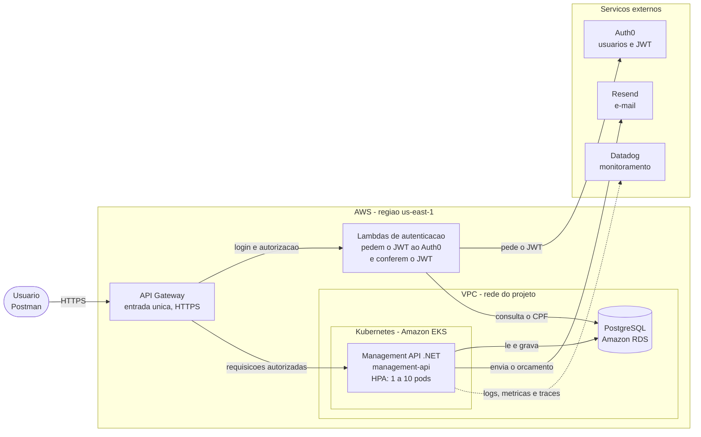
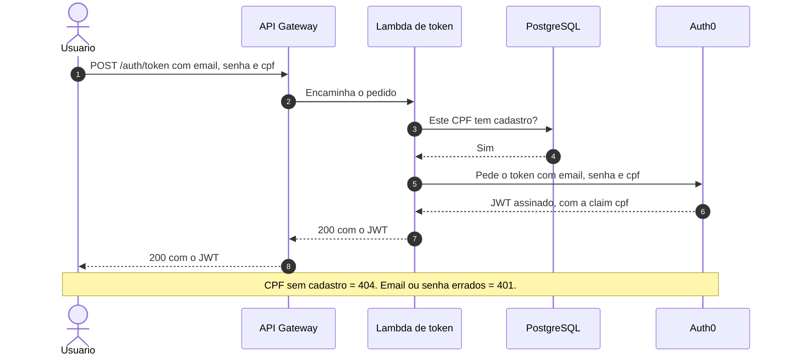
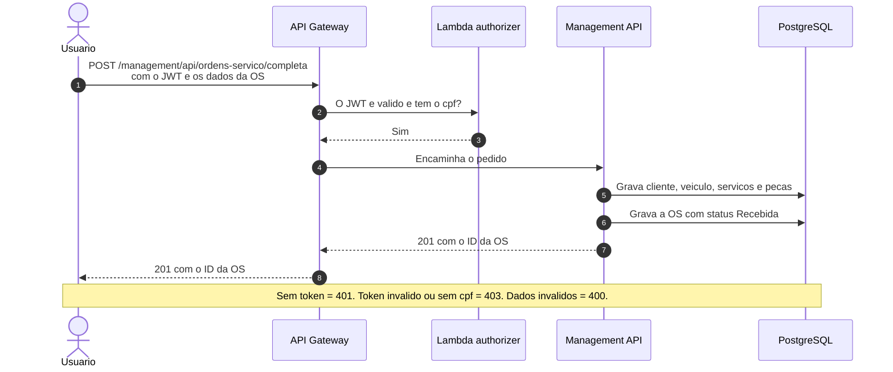

# Arquitetura da solução

Este documento dá a visão geral de como o sistema da oficina funciona de ponta a ponta. Ele junta as peças dos dois repositórios do projeto: **este monorepo** (código da API em `server/`; rede, Kubernetes, API Gateway e Datadog em [kubernetes/](../kubernetes/README.md); banco de dados em [DB/](../DB/README.md)) e o [LAMBDA](https://github.com/GuiToniello/tech-challenge-fase-4-LAMBDA-soat16-rm374658) (autenticação). Na fase 4, os repositórios APP, DB e K8S da fase 3 viraram pastas deste monorepo, e o sistema passou a ter uma só API, a Management API ([ADR-018](./adr/ADR-018-Monorepo-e-API-Unica-Management.md)).

Neste documento:
1. Glossário rápido.
2. Diagrama de componentes: a nuvem, a API, o banco e o monitoramento.
3. Diagrama de sequência da autenticação.
4. Diagrama de sequência da abertura de uma ordem de serviço.
5. Índice das decisões de arquitetura (RFCs e ADRs) deste monorepo e do repo LAMBDA.

Os diagramas usam [Mermaid](https://mermaid.js.org/), que o GitHub desenha sozinho. Eles são uma **visão geral**: escondem detalhes como a rede interna e as pipelines, que estão nos documentos indicados ao longo do texto.

## 1. Glossário rápido

| Termo | O que significa aqui |
|---|---|
| API | Programa que recebe pedidos pela internet (requisições HTTP) e responde em JSON. O sistema tem uma API em .NET, a Management API |
| OS | Ordem de serviço: o pedido de conserto de um veículo, com os serviços e as peças (insumos) |
| JWT (token) | Um "crachá digital" assinado, que prova quem é o usuário. Vai em cada requisição, no header `Authorization` |
| Claim | Uma informação gravada dentro do JWT. Aqui, a mais importante é o `cpf` do cliente |
| AWS | A nuvem da Amazon, onde o sistema roda, na região `us-east-1` (leste dos EUA) |
| API Gateway | A porta de entrada pública. Recebe todas as requisições e envia cada uma para o lugar certo |
| Lambda | Função que roda na AWS só quando é chamada, sem servidor para administrar |
| VPC | A rede do projeto na AWS. O banco fica numa parte dela sem acesso à internet |
| Kubernetes (EKS) | Sistema que roda a API em containers e a reinicia se cair. O Amazon EKS é o Kubernetes gerenciado pela AWS |
| Pod | Uma cópia da API rodando no Kubernetes |
| HPA | Regra do Kubernetes que cria ou remove pods da API conforme o uso de CPU e memória |
| RDS (PostgreSQL) | Banco de dados relacional (organizado em tabelas), gerenciado pela AWS |
| Auth0 | Serviço externo que guarda os usuários (e-mail e senha) e emite os JWTs |
| Datadog | Serviço externo de monitoramento: recebe logs, métricas e traces, mostra painéis e envia alertas |
| Resend | Serviço externo de envio de e-mail |

## 2. Diagrama de componentes

O diagrama mostra as peças principais do sistema e quem conversa com quem.

Como ler: a seta cheia é uma chamada feita durante uma requisição; a tracejada é o envio dos dados de monitoramento.

### 2.1. As peças do diagrama

| Peça | Papel | Onde fica |
|---|---|---|
| API Gateway | Única entrada pública. As rotas com o prefixo `/management` vão para a Management API, e `POST /auth/token` vai para a Lambda de token | `kubernetes/` |
| Lambdas de autenticação | A Lambda de token confere o CPF, pede ao Auth0 o JWT com o CPF do cliente e devolve esse JWT (seção 3). O Lambda authorizer confere o JWT antes de cada requisição chegar à API (seção 4) | Repo LAMBDA |
| Management API (.NET) no EKS | Cadastros e ciclo completo da OS: abertura (inclusive a completa, em uma chamada), lista por prioridade, acompanhamento e aprovação ou recusa do orçamento. O HPA ajusta de 1 a 10 pods | `server/` (código) e `kubernetes/` (cluster) |
| PostgreSQL no Amazon RDS | Banco da Management API, também lido pela Lambda `buscar-cliente` (repo LAMBDA). Sem acesso pela internet | `DB/` |
| Auth0 | Guarda os usuários e emite e assina os JWTs | Externo (configurado no repo LAMBDA) |
| Resend | Envia o orçamento por e-mail | Externo |
| Datadog | Monitoramento: logs, métricas, traces, alertas e dashboard | Externo (configurado em `kubernetes/`) |

Detalhes que o diagrama esconde:
- **Rede:** entre o API Gateway e a API há um VPC Link e um balanceador interno (NLB), e o banco fica numa sub-rede sem internet. Veja o [kubernetes/infra/ESTRUTURA.md](../kubernetes/infra/ESTRUTURA.md).
- **Kubernetes:** Deployment, Service, ConfigMap, Secret e HPA da API estão no [kubernetes/k8s/README.md](../kubernetes/k8s/README.md).
- **Monitoramento:** o Datadog Agent roda dentro do cluster e envia os dados ao Datadog. Veja [observabilidade.md](./observabilidade.md) e o [kubernetes/infra/DATADOG.md](../kubernetes/infra/DATADOG.md).
- **Entrega de versões (CI/CD):** as pipelines deste monorepo (Bootstrap, Deploy, Destroy e K8s Apply) criam a infraestrutura e publicam a imagem da API no Amazon ECR, e o repo LAMBDA tem as suas. Para subir: Bootstrap deste monorepo → Deploy do LAMBDA. Para derrubar: Destroy do LAMBDA → Destroy deste monorepo. Veja as pipelines [deste monorepo](../.github/workflows/README.md) e do [LAMBDA](https://github.com/GuiToniello/tech-challenge-fase-4-LAMBDA-soat16-rm374658#9-pipelines-github-actions).

## 3. Diagrama de sequência: autenticação

Um diagrama de sequência mostra, de cima para baixo, a ordem das mensagens trocadas entre as peças. Este mostra como um cliente **já cadastrado** consegue o JWT com o seu CPF, exigido em todas as rotas da API.

Pontos importantes:
- **Quem cria e assina o token é o Auth0.** A Lambda confere se o CPF tem cadastro, pede o token ao Auth0 e devolve esse token ao usuário.
- **A "Lambda de token" do diagrama é formada por duas funções:** uma consulta o banco, dentro da rede do projeto, e a outra fala com o Auth0, fora dela. Assim o banco continua sem acesso à internet.
- **Cliente novo:** quem ainda não tem cadastro pega um token direto no Auth0 (sem `cpf`), se cadastra em `POST /management/api/clientes`, a única rota que aceita esse token, e depois segue o fluxo acima.
- Respostas de erro e configuração do Auth0: [README do repo LAMBDA](https://github.com/GuiToniello/tech-challenge-fase-4-LAMBDA-soat16-rm374658#2-fluxos). Opções avaliadas: [RFC-003](https://github.com/GuiToniello/tech-challenge-fase-4-LAMBDA-soat16-rm374658/blob/main/docs/rfc/RFC-003-Estrategia-de-Autenticacao.md).

## 4. Diagrama de sequência: abertura de ordem de serviço

Este diagrama mostra a abertura completa de uma OS na Management API, que recebe cliente, veículo, serviços e peças em uma única chamada e devolve o identificador (ID) da OS. O usuário já tem o JWT da seção 3.

Pontos importantes:
- **O token é conferido duas vezes:** pelo Lambda authorizer, na entrada, e pela própria API. Se uma das camadas falhar, a outra ainda protege.
- **A OS nasce com o status `Recebida`** e com a primeira linha do histórico de status, usado na ordenação por antiguidade e nos indicadores.
- **Cada gravação é feita separadamente, sem uma transação única.** Se uma etapa falhar no meio (por exemplo, placa já cadastrada), o que foi gravado antes continua no banco. Nesse caso, abra a OS pela outra rota da Management API, que usa cadastros existentes: `POST /management/api/ordens-servico`.
- O padrão de comunicação (tudo síncrono e sem filas) está na [ADR-015](./adr/ADR-015-Comunicacao-Sincrona-via-API-Gateway.md). Os logs gerados (`os.criada` e `os.falha`) estão em [observabilidade.md](./observabilidade.md).

## 5. Decisões de arquitetura (RFCs e ADRs)

As decisões ficam registradas em dois tipos de documento:
- **RFC (Request for Comments):** proposta escrita que apresenta um problema, compara as opções e recomenda uma. Serve para discutir antes de decidir.
- **ADR (Architecture Decision Record):** registro de uma decisão tomada, com o contexto, as consequências e as alternativas rejeitadas. Explica "por que é assim".

As RFCs e ADRs deste monorepo ficam em `docs/rfc/` e `docs/adr/`. A RFC-003, de autenticação, fica no repo LAMBDA, e a numeração é compartilhada entre este monorepo e o repo LAMBDA.

### 5.1. RFCs

| RFC | Assunto | Resultado | Repositório |
|---|---|---|---|
| [RFC-001](./rfc/RFC-001-Escolha-da-Nuvem.md) | Escolha da nuvem | AWS, região `us-east-1` | Este monorepo |
| [RFC-002](./rfc/RFC-002-Escolha-do-Banco-de-Dados.md) | Escolha do banco de dados | PostgreSQL no Amazon RDS, registrado na ADR-017 | Este monorepo |
| [RFC-003](https://github.com/GuiToniello/tech-challenge-fase-4-LAMBDA-soat16-rm374658/blob/main/docs/rfc/RFC-003-Estrategia-de-Autenticacao.md) | Estratégia de autenticação | O Auth0 continua emitindo o JWT, e o API Gateway exige a claim `cpf` com um Lambda authorizer | LAMBDA |

### 5.2. ADRs

| ADR | Assunto | Repositório |
|---|---|---|
| ADR-001 a ADR-014 | Organização do código, persistência, e-mail, estoque, tratamento de erros e observabilidade. Índice em [docs/adr/INDICE.md](./adr/INDICE.md) | Este monorepo |
| [ADR-015](./adr/ADR-015-Comunicacao-Sincrona-via-API-Gateway.md) | Padrão de comunicação: síncrono (HTTP/REST) via API Gateway e sem filas | Este monorepo |
| [ADR-016](./adr/ADR-016-Escalabilidade-com-HPA.md) | Escalabilidade da API com HPA | Este monorepo |
| [ADR-017](./adr/ADR-017-PostgreSQL-no-Amazon-RDS-e-Modelo-de-Dados.md) | Banco PostgreSQL no Amazon RDS: justificativa formal, diagrama ER e relacionamentos | Este monorepo |
| [ADR-018](./adr/ADR-018-Monorepo-e-API-Unica-Management.md) | Monorepo (os repositórios APP, DB e K8S da fase 3 viraram pastas) e API única, a Management API | Este monorepo |
