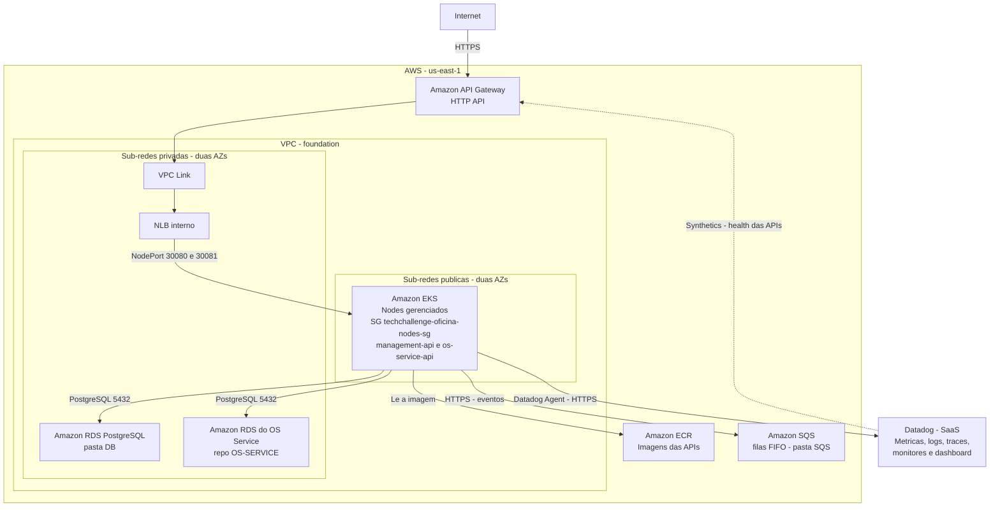

# Rede e Kubernetes (`kubernetes/`)

Infraestrutura de rede e Kubernetes do projeto **Tech Challenge Oficina** (SOAT16, fase 4). O Terraform desta pasta cria na AWS a VPC, o Amazon EKS, o Amazon API Gateway (acesso externo às APIs) e os addons do cluster, e configura a observabilidade no Datadog. Os manifests Kubernetes da Management API também ficam aqui. Tudo é aplicado pelas pipelines da raiz do monorepo ([.github/workflows/README.md](../.github/workflows/README.md)).

A pasta veio do repositório K8S da fase 3 ([ADR-018](../docs/adr/ADR-018-Monorepo-e-API-Unica-Management.md)) e tem os próprios Terraform states. Ela se relaciona com as outras partes do monorepo e com dois repositórios externos:
- **[DB/](../DB/README.md)**: cria o Amazon RDS dentro da rede criada aqui.
- **[SQS/](../SQS/README.md)**: cria as filas entre os serviços e guarda no SSM a chave que o apply dos manifests põe no Secret da API.
- **Aplicação** (`server/`, na raiz do monorepo): a imagem da Management API, publicada no Amazon ECR pelas pipelines.
- **[OS-SERVICE](https://github.com/GuiToniello/tech-challenge-fase-4-OS-SERVICE-soat16-rm374658)** (repositório separado): o OS Service roda neste cluster, no namespace `os-service`, atrás da rota `/os` e do NodePort 30081 criados aqui. O RDS dele fica nas subnets privadas desta rede.
- **[LAMBDA](https://github.com/GuiToniello/tech-challenge-fase-4-LAMBDA-soat16-rm374658)** (repositório separado): publica o Lambda authorizer e a Lambda de `POST /auth/token`, que o API Gateway criado aqui chama pelo nome.

## 1. O que é provisionado

Tudo fica na AWS, região `us-east-1`, em duas configurações Terraform independentes:

| Configuração | State | Recursos |
|---|---|---|
| [infra/foundation](infra/foundation) | `techchallenge-oficina/fase-4/k8s-foundation.tfstate` | VPC `10.0.0.0/16`, subnets públicas e privadas (2 AZs), Internet Gateway e rotas, SGs do cluster e dos nodes, IAM roles, EKS `techchallenge-oficina-eks` (1.36), node group `t3.small` (2/2/2), access entries e o acesso externo: API Gateway (HTTP API, com o Lambda authorizer, as rotas `/management` e `/os` e a rota `/auth/token` do repo LAMBDA), VPC Link e NLB interno (portas 30080 e 30081) |
| [infra/addons](infra/addons) | `techchallenge-oficina/fase-4/k8s-addons.tfstate` | Metrics Server e Datadog Agent, via Helm (APM nos namespaces `oficina` e `os-service`), e os recursos do Datadog no módulo [modules/datadog/](infra/addons/modules/datadog): métricas de log, monitores, synthetics, SLO e dashboard das duas APIs ([infra/DATADOG.md](infra/DATADOG.md)) |

Os manifests em [k8s/](k8s) criam o namespace `oficina` e, para a Management API (`management-api`), um ConfigMap, um Deployment, um Service `NodePort` e um HPA. Também criam o Secret `oficina-api-secrets`, com a connection string, a chave do Resend e a chave do SQS. O Deployment leva os labels `tags.datadoghq.com/env` e `tags.datadoghq.com/service`, que dão ao Datadog o `env` e o `service` da API. Os manifests do OS Service (namespace `os-service`, `os-service-api`) ficam no repo OS-SERVICE.



As subnets privadas não têm NAT nem rota para a Internet. Elas hospedam os bancos (pasta [DB/](../DB/README.md) e repo OS-SERVICE), o VPC Link e o NLB interno do API Gateway. Os pods chegam ao SQS pela saída das subnets públicas, como chegam ao ECR. Os detalhes da arquitetura estão em [infra/ESTRUTURA.md](infra/ESTRUTURA.md), e o passo a passo local em [infra/README.md](infra/README.md). A organização dos manifests está em [k8s/README.md](k8s/README.md), e a observabilidade com Datadog, em [infra/DATADOG.md](infra/DATADOG.md).

As decisões de arquitetura desta pasta ficam em [docs/](../docs), na raiz do monorepo:
- [RFC-001: Escolha da nuvem](../docs/rfc/RFC-001-Escolha-da-Nuvem.md): por que AWS, na região `us-east-1`.
- [ADR-016: Escalabilidade da API com HPA](../docs/adr/ADR-016-Escalabilidade-com-HPA.md): como e por que cada API varia de 1 a 5 pods.

A visão geral do sistema inteiro, com o diagrama de componentes, os diagramas de sequência e o índice de todas as RFCs e ADRs, está no [docs/arquitetura.md](../docs/arquitetura.md).

## 2. Dependências

### Ordem

As partes do monorepo são aplicadas em ordem pelos jobs das pipelines ([.github/workflows/README.md](../.github/workflows/README.md)). Os repositórios OS-SERVICE e LAMBDA são externos:

| Operação | Ordem |
|---|---|
| Subir | **Bootstrap** deste monorepo (testes → foundation → addons → RDS em `DB/` → imagem no ECR → manifests, com restart; o `SQS/` em paralelo, antes dos manifests) → **Bootstrap** do repo OS-SERVICE → **Deploy** do repo LAMBDA |
| Derrubar | **Destroy** do repo LAMBDA e **Destroy** do repo OS-SERVICE → **Destroy** deste monorepo (SQS em paralelo; RDS → addons → foundation) |

- Os manifests são aplicados por último porque os pods precisam do RDS, para montar a connection string, da chave do SQS, no SSM, e da imagem no ECR. Depois de publicar a imagem, o Bootstrap e o Deploy aplicam os manifests com `rollout restart`: é assim que os pods passam a usar a nova `:latest`.
- O OS-SERVICE sobe depois porque usa o cluster, a rota `/os`, o NLB, as subnets privadas e as filas criados aqui. É destruído antes porque o RDS dele fica nas subnets privadas, com um SG que referencia o SG dos nodes. Por isso, o Destroy deste monorepo **falha** se o RDS `techchallenge-oficina-os-postgres` ou o SG `techchallenge-oficina-os-rds-sg` ainda existirem.
- O LAMBDA sobe depois porque as Lambdas usam a VPC e o RDS criados aqui, e é destruído antes porque a Lambda de busca de clientes fica nas subnets privadas, com uma regra no SG do RDS. Por isso, o Destroy deste monorepo **falha** se o SG `techchallenge-oficina-lambda-sg` ainda existir.
- O Destroy apaga o RDS antes da rede. O RDS usa as subnets privadas, e o SG dele referencia o SG dos nodes, então apagar a rede antes travaria em `DependencyViolation`.

### Contrato produzido (usado pelo `DB/` e pelo repo OS-SERVICE)

O `DB/infra` deste monorepo e o do repo OS-SERVICE encontram a rede pelo cluster EKS e por nome ([data.tf](../DB/infra/data.tf)), sem ler o state da foundation. **Estes nomes não podem mudar:**

| Item | Valor |
|---|---|
| Cluster EKS | `techchallenge-oficina-eks` ([variables.tf](infra/foundation/variables.tf)). Os dois `DB/infra` leem a VPC do cluster (`data "aws_eks_cluster"` → `vpc_config`). O nome também é usado pelos addons e pela variable `EKS_CLUSTER_NAME` dos dois repositórios |
| Subnets privadas | `techchallenge-oficina-private-1` e `-2`, em duas AZs ([vpc.tf](infra/foundation/vpc.tf)). Os dois `DB/infra` filtram a tag `Name = techchallenge-oficina-private-*` na VPC do cluster |
| SG dos nodes | `techchallenge-oficina-nodes-sg`, anexado aos worker nodes pelo launch template ([eks-node-groups.tf](infra/foundation/eks-node-groups.tf)) |
| Rota e NodePort do OS Service | Prefixo `/os` e NodePort `30081` (`api_node_ports.os` em [locals.tf](infra/foundation/locals.tf)), igual ao `nodePort` do Service `os-service-api` do repo OS-SERVICE. Target group `techchallenge-oficina-os` |
| Datadog do OS Service | APM no namespace `os-service`, `http_check` em `os-service-api.os-service.svc.cluster.local/health/ready` e synthetic em `GET /os/health`. O Deployment do OS-SERVICE precisa do label `tags.datadoghq.com/service: os-service-api` |

### Contrato consumido

| De | Item | Uso |
|---|---|---|
| `DB/` | Identifier `techchallenge-oficina-postgres`, database `oficina`, usuário `sa`, porta `5432`, senha no secret `RDS_PASSWORD` | O apply dos manifests descobre o endpoint e monta `DatabaseSettings__ConnectionString` no Secret da API |
| `SQS/` | Parâmetros SSM `/techchallenge-oficina/sqs/management/access-key-id` e `/secret-access-key`; filas `techchallenge-oficina-management.fifo` e `techchallenge-oficina-os-service.fifo` | O apply dos manifests grava a chave no Secret da API (`AWS_ACCESS_KEY_ID` e `AWS_SECRET_ACCESS_KEY`), e o ConfigMap traz os nomes das filas |
| Aplicação (`server/`) | Imagem `903936907231.dkr.ecr.us-east-1.amazonaws.com/techchallenge-oficina-management:latest`. O repositório ECR `techchallenge-oficina-management` é criado manualmente e não é gerenciado pelo Terraform | Deployment com `imagePullPolicy: Always`. O pull usa a role IAM dos nodes (`AmazonEC2ContainerRegistryReadOnly`) |
| Aplicação (`server/`) | `GET /health/ready`, anônimo, que checa o banco. O `/health` continua igual, sem banco | `http_check` do Datadog Agent (service check `http.can_connect`). As probes do Kubernetes continuam em `/health` |
| Aplicação (`server/`) | Logs JSON no stdout com os atributos de [docs/observabilidade.md](../docs/observabilidade.md) (`evento`, `dd.*`, `error.*` e as propriedades dos eventos), com o nível de log lido de `Serilog__MinimumLevel__*` | Métricas de log, monitores e dashboard do módulo `datadog/`, que filtram esses nomes (espelho em [infra/DATADOG.md](infra/DATADOG.md#5-contrato-com-a-aplicação-espelho)). O ConfigMap define o nível de log |

## 3. Pré-requisitos (manuais, uma vez)

0. **Ambiente da fase 3 destruído (mesmos nomes de recursos).** Esta pasta cria recursos com os mesmos nomes da fase 3 (EKS, IAM roles, NLB, security groups), mas usa states novos (`techchallenge-oficina/fase-4/`). Se o ambiente da fase 3 ainda existir, o Bootstrap falha com nomes duplicados. Desative também os workflows dos repositórios da fase 3, para que nada seja recriado por engano.
1. **Bucket S3 `terraform-state-soat16`** em `us-east-1`, com versionamento, criptografia e bloqueio de acesso público. É compartilhado com o `DB/` (`techchallenge-oficina/fase-4/database.tfstate`), cada parte com a própria key. Esta pasta usa `techchallenge-oficina/fase-4/k8s-foundation.tfstate` e `techchallenge-oficina/fase-4/k8s-addons.tfstate`, com lock nativo (`use_lockfile`).
2. **Usuário IAM `terraform`**: suas access keys vão nos secrets do GitHub. Ele recebe uma access entry de administrador no EKS (`aws_caller_identity`). **Use sempre o mesmo usuário**, no CI e localmente. Com outro usuário, a access entry é substituída, e o usuário anterior perde o acesso ao cluster. Permissões necessárias, em linhas gerais:
   - `eks:*` no cluster, node group, access entries e access policies.
   - EC2: VPC, subnets, route tables, Internet Gateway, security groups, launch templates, tags e `ec2:Describe*`.
   - IAM:
     - `iam:CreateRole`, `iam:DeleteRole`, `iam:GetRole`, `iam:TagRole`, `iam:PassRole`.
     - `iam:AttachRolePolicy`, `iam:DetachRolePolicy`, `iam:ListAttachedRolePolicies`, `iam:ListRolePolicies`, `iam:ListInstanceProfilesForRole`.
     - `iam:GetUser` (para `cluster_admin`) e `iam:CreateServiceLinkedRole` (EKS, node group, ELB e API Gateway: `ops.apigateway.amazonaws.com`, criada no primeiro VPC Link).
   - API Gateway: `apigateway:*` em `/apis*`, `/vpclinks*` e `/tags*` (HTTP API, rotas, integrações, authorizer, stage e VPC Link).
   - Elastic Load Balancing: criar, alterar e apagar o NLB, os target groups e os listeners, com `elasticloadbalancing:AddTags` e `elasticloadbalancing:Describe*`.
   - Auto Scaling: `autoscaling:AttachLoadBalancerTargetGroups`, `autoscaling:DetachLoadBalancerTargetGroups` e `autoscaling:Describe*` (anexa o ASG do node group aos target groups).
   - `rds:DescribeDBInstances` (apply dos manifests). As permissões para criar o RDS estão no [DB/README.md](../DB/README.md).
   - `ssm:GetParameter` nos parâmetros `/techchallenge-oficina/sqs/*` (apply dos manifests). As permissões para criar as filas, os usuários IAM e os parâmetros estão no [SQS/README.md](../SQS/README.md).
   - S3: `s3:GetObject`, `s3:PutObject` e `s3:DeleteObject` em `arn:aws:s3:::terraform-state-soat16/techchallenge-oficina/fase-4/*` (cobre também os states do `DB/`, do `SQS/` e do repo OS-SERVICE), mais `s3:ListBucket` no bucket.
   - ECR: as permissões de push da imagem estão no [.github/workflows/README.md](../.github/workflows/README.md).
3. **Usuário IAM `cluster_admin`**: acesso alternativo ao cluster. É **obrigatório**: a foundation consulta esse usuário (`data "aws_iam_user"`), e o plan falha se ele não existir.
4. **Repositório ECR `techchallenge-oficina-management`** em `us-east-1`, criado manualmente com *tag mutability* **MUTABLE**, porque a tag `latest` é sobrescrita a cada push. Não é gerenciado pelo Terraform.
5. **Secrets e Variables do GitHub**: veja a seção 4.
6. **Environment `destroy`** (Settings → Environments): crie **antes** do primeiro Destroy, com você como *Required reviewer* e *Deployment branches* restrito a `main`. Não dispare o Destroy com um Deploy ou Bootstrap em andamento (veja o Troubleshooting).
7. **Proteção da branch `main`** (Settings → Branches): exija Pull Request e os status checks abaixo. Eles só aparecem na lista depois que o primeiro PR roda a pipeline.
   - `build-test / build-test`
   - `validate-foundation / terraform`
   - `validate-addons / terraform`
   - `validate-db / terraform`
   - `validate-sqs / terraform`
   - `validate-k8s / kubectl`
8. **Conta Datadog (trial de 14 dias, sem cartão)**: crie só quando for subir o ambiente e demonstrar, porque os 14 dias contam do cadastro. Gere a API Key e a Application Key (não-escopada) e cadastre os secrets e variables `DD_*` (seção 4). Sem conta, defina a variable `DD_ENABLED=false`: o addons sobe só com o Metrics Server. Passo a passo em [infra/DATADOG.md](infra/DATADOG.md#2-configuração).

## 4. Secrets e Variables

Há um único conjunto para o monorepo, todos no nível do **repositório**, não de environment. A tabela completa, com o uso de cada um, está no [.github/workflows/README.md](../.github/workflows/README.md). Os que esta pasta usa:
- `AWS_ACCESS_KEY_ID` e `AWS_SECRET_ACCESS_KEY` (usuário IAM `terraform`), `AWS_REGION` (`us-east-1`) e `EKS_CLUSTER_NAME` (`techchallenge-oficina-eks`).
- `RDS_PASSWORD`, `RDS_INSTANCE_IDENTIFIER` (`techchallenge-oficina-postgres`), `RDS_DATABASE` (`oficina`), `RDS_USERNAME` (`sa`) e `RESEND_API_KEY`, que montam o Secret da API. O `RDS_PASSWORD` é o mesmo secret que cria o RDS em `DB/`, e o repo LAMBDA precisa ter o mesmo valor.
- A chave do SQS não é secret do GitHub: o apply dos manifests a lê do SSM ([SQS/README.md](../SQS/README.md)).
- `DD_API_KEY`, `DD_APP_KEY` e `DD_SITE`, obrigatórios exceto com `DD_ENABLED=false` **e** sem recursos do Datadog no state, e os opcionais `DD_ALERT_RECIPIENTS`, `DD_ENABLED` e `DD_SYNTHETICS_STATUS` ([infra/DATADOG.md](infra/DATADOG.md#22-secrets-e-variables-do-github)).

Ao desligar o Datadog (`DD_ENABLED` de `true` para `false`), mantenha `DD_API_KEY`, `DD_APP_KEY` e `DD_SITE` válidos até o apply que desliga o Datadog terminar: é ele que apaga os recursos do Datadog, e para isso o provider precisa das chaves e do site da conta.

Os segredos são passados ao `k8s/.env` por variáveis de ambiente, sem interpolação no script. Por isso `$` e backtick na senha não são interpretados. O `;` continua proibido, porque quebra a connection string.

As chaves do Datadog chegam ao Terraform do addons como `TF_VAR_datadog_*`, variáveis `sensitive` que não aparecem no plan nem nos logs. A API Key vai ao Agent por `set_sensitive` e fica no state do addons e num Secret do namespace `datadog`. Detalhes em [infra/DATADOG.md](infra/DATADOG.md#22-secrets-e-variables-do-github).

## 5. Pipelines (GitHub Actions)

As pipelines ficam na raiz do monorepo e cobrem também a aplicação e o `DB/`. Os detalhes estão no [.github/workflows/README.md](../.github/workflows/README.md). Em resumo, para esta pasta:

| Workflow | Gatilho | O que faz |
|---|---|---|
| **Bootstrap** | Manual | Sobe tudo: testes → `apply` da foundation → `apply` dos addons (Metrics Server e Datadog) → RDS (`DB/`) → imagem no ECR → apply dos manifests com `rollout restart`. O `SQS/` sobe em paralelo, antes dos manifests |
| **Deploy** | Pull Request para `main` | `build-test` e `validate` offline de foundation, addons, `DB/`, `SQS/` e manifests (checks obrigatórios) → `plan` informativo de foundation, addons, `DB/` e `SQS/` |
| **Deploy** | Push na `main` | Aplica só as partes que mudaram, na ordem do Bootstrap. Mudança em `kubernetes/infra/**`: apply da foundation → addons. Os manifests são reaplicados, com `rollout restart`, sempre que alguma parte muda (inclusive só `kubernetes/k8s/**` ou `SQS/infra/**`) |
| **K8s Apply** | Manual (input `restart-pods`, padrão `true`) | Descobre o RDS, lê a chave do SQS no SSM, gera o Secret, `kubectl apply -k kubernetes/k8s` e, opcionalmente, `rollout restart` |
| **Destroy** | Manual, `confirm = destroy` + aprovação | Confere que as Lambdas do repo LAMBDA (SG `techchallenge-oficina-lambda-sg`) e o RDS do repo OS-SERVICE (RDS `techchallenge-oficina-os-postgres` e SG `techchallenge-oficina-os-rds-sg`) já foram destruídos → destroy do SQS, em paralelo, e do RDS (`DB/`) → dos addons (inclui o Datadog Agent e os recursos do Datadog) → da foundation (inclui API Gateway, VPC Link e NLB), que roda mesmo se o dos addons falhar |

Apply, K8s Apply e Destroy só rodam a partir da `main`. Disparados em outra branch, **falham** com erro.

**Datadog nas pipelines:** no `kubernetes/infra/addons`, o plan, o apply e o destroy começam pelo passo **Conferir secrets e variables do Datadog**. Ele falha se faltar `DD_API_KEY`, `DD_APP_KEY` ou `DD_SITE` e, com `DD_ENABLED=false`, só avisa. Os valores entram no Terraform como `TF_VAR_datadog_*`. O addons instala o Datadog Agent antes do apply dos manifests, e o restart dos pods faz o Datadog injetar neles o tracer .NET (APM). Trocar `DD_ENABLED` ou `DD_SYNTHETICS_STATUS` não dispara nada: rode o Bootstrap para aplicar. Como ele termina com o apply dos manifests com restart, os pods já sobem com (ou sem) o tracer.

**Atenção ao custo: um merge em `kubernetes/infra/**` com o ambiente desligado recria o ambiente.** A foundation não depende de nada existente, então o push na `main` aplica a foundation e os addons do zero, subindo VPC, EKS, nodes, NLB e API Gateway. Isso inclui o **primeiro push** deste código. Como na fase 3, é o comportamento esperado; tenha isso em mente:
- **Com a infra destruída:**
  - O `plan-foundation` do PR mostra a criação completa.
  - O `plan-addons` e o `plan-db` falham, porque não há cluster.
  - Os `validate` continuam verdes.
- **Não faça merge de mudanças em `kubernetes/infra/**` ou `.github/workflows/_terraform.yml` enquanto quiser o ambiente desligado.** Se o merge acontecer, destrua de novo com o Destroy.
- **Primeiro push:** ele muda todas as pastas, então sobe o ambiente inteiro, na ordem do Bootstrap. Se ainda não quiser subir nada, faça o primeiro push **antes** de configurar os secrets AWS. Os applies falham sem credenciais.
- **Merge só em `kubernetes/k8s/**` ou na aplicação com o ambiente desligado:** falha no `apply-k8s`. O próximo Bootstrap aplica os manifests da `main`.
- **Não use "Re-run" em um Deploy antigo:** ele reaplicaria a infra e publicaria a `:latest` de um commit antigo. Use o Bootstrap, que aplica a HEAD da `main`, ou o K8s Apply, só para os manifests.

## 6. Uso local

O passo a passo com AWS CLI e Terraform está em [infra/README.md](infra/README.md).

Para validar sem acessar a AWS:

```powershell
# Terraform (em kubernetes/infra/foundation e em kubernetes/infra/addons)
terraform init -backend=false
terraform validate

# Manifests (a partir da raiz do monorepo, com o template de .env)
Copy-Item kubernetes/k8s/.env.example kubernetes/k8s/.env
kubectl kustomize kubernetes/k8s
```

O `k8s/.env` e os `terraform.tfvars` são ignorados pelo Git. Os `.terraform.lock.hcl` **são** versionados e fixam as versões dos providers (aws 6.66.0, helm 2.17.0 e, no addons, DataDog/datadog 4.25.0). Os charts também são fixos: Metrics Server `3.12.2` e Datadog Agent `3.255.0` (`datadog_chart_version`).

O `validate` não precisa das chaves do Datadog. Para `plan` e `apply` locais do addons, passe as chaves por `TF_VAR_datadog_*` e mantenha as opções do Datadog no `terraform.tfvars` iguais às variables do GitHub ([infra/README.md](infra/README.md#4-instale-os-addons)).

## 7. Destruição e custos

EKS, nodes, NLB, API Gateway (cobrado por requisição), o RDS (`DB/`), o RDS do repo OS-SERVICE e o tráfego geram custo enquanto existem. As filas SQS ficam no nível gratuito ([SQS/README.md](../SQS/README.md#4-custo)).

**Datadog:** sem custo durante o trial de 14 dias, sem cartão. Depois dele, APM, logs e synthetics param (plano Free). Antes do fim, defina `DD_ENABLED=false` e rode o Bootstrap, ou rode o Destroy. Nunca cadastre cartão ([infra/DATADOG.md](infra/DATADOG.md#4-trial-de-14-dias)).

**Atenção à versão do EKS:** `eks_version` é `1.36` ([variables.tf](infra/foundation/variables.tf)), no suporte padrão da AWS até 02/08/2027. Fora do suporte padrão, o control plane é cobrado na tarifa de *extended support*, várias vezes a tarifa padrão. O EKS só atualiza um cluster existente uma minor por vez: para trocar `eks_version`, destrua o ambiente antes do merge e, depois dele, rode o Bootstrap para recriá-lo na nova versão (o Deploy do merge só recria a foundation e os addons).

Para remover tudo:
1. Rode o Destroy do repo [LAMBDA](https://github.com/GuiToniello/tech-challenge-fase-4-LAMBDA-soat16-rm374658) e o do repo [OS-SERVICE](https://github.com/GuiToniello/tech-challenge-fase-4-OS-SERVICE-soat16-rm374658) (este apaga o namespace `os-service` e o RDS do OS Service).
2. Rode o workflow **Destroy** deste monorepo com `confirm = destroy` e aprove. Os ECRs são manuais e ficam fora do destroy.

A ordem interna é SQS (em paralelo) e RDS (`DB/`) → addons → foundation:
- O destroy do RDS apaga os dados. Se ele falhar, a foundation não roda, porque a VPC não sairia com o RDS dentro.
- O destroy dos addons remove o Metrics Server, o Datadog Agent e os recursos do Datadog. A conta e as chaves continuam.
- O destroy da foundation roda **mesmo se o dos addons falhar** (por exemplo, com chaves do Datadog revogadas ou trial vencido), para o EKS não ficar ligado gerando custo, mas não se ele for cancelado. O run fica vermelho, e é preciso agir logo, mesmo sem planos de subir o ambiente de novo: os recursos do Datadog que sobraram continuam ativos (synthetics e monitores alertando), e sem o cluster o addons não roda mais. As saídas estão no troubleshooting do [infra/DATADOG.md](infra/DATADOG.md#8-troubleshooting).

O bucket S3 do state não é removido.

## 8. Troubleshooting

- **`no matching IAM User found` / erro em `aws_iam_user.cluster_admin`**: crie o usuário IAM `cluster_admin` (seção 3).
- **Addons ou apply dos manifests sem acesso ao cluster (`Unauthorized`)**: a foundation foi aplicada por outro usuário IAM, e a access entry mudou. Reaplique a foundation com o usuário `terraform`.
- **Apply dos manifests falha em "Descobrir endpoint do RDS"**: o RDS (`DB/`) não existe ou ainda está sendo criado. Rode o Bootstrap e aguarde.
- **Apply dos manifests falha em "Adicionar a chave do SQS"**: os parâmetros do SSM não existem, porque o `SQS/` ainda não foi aplicado. Rode o Bootstrap.
- **Destroy falha em "Verificar se o RDS do repo OS-SERVICE já foi destruído"**: rode antes o Destroy do repo OS-SERVICE. Se ele acabou de rodar, aguarde a exclusão do RDS terminar e tente de novo.
- **Pods em `ImagePullBackOff`**: a imagem ainda não foi publicada no ECR (repositório `techchallenge-oficina-management`, seção 3). Rode o Bootstrap.
- **Destroy falha em "Verificar se as Lambdas do repo LAMBDA já foram destruídas"**: rode antes o Destroy do repo LAMBDA. Se ele acabou de rodar, aguarde e tente de novo: o SG `techchallenge-oficina-lambda-sg` só some depois que a AWS libera as interfaces de rede da Lambda.
- **Destroy da foundation travado em `DependencyViolation` na VPC/subnets**: procure uma ENI órfã na VPC (por exemplo, do VPC Link do API Gateway). Espere alguns minutos ou apague-a e rode o Destroy de novo.
- **Destroy aparece como "cancelled"**: no padrão do GitHub (`queue: single`), um run mais novo no mesmo grupo de concorrência substituiu o que estava pendente. Rode o Destroy de novo, sem Deploy, Bootstrap ou K8s Apply em andamento.
- **`Error acquiring the state lock`**: há outro apply ou destroy rodando no mesmo root. Se o lock ficou preso depois de um run cancelado, rode `terraform force-unlock <LOCK_ID>` na pasta do root, ou apague o objeto `.tflock` correspondente no bucket.
- **Datadog** (passo "Conferir secrets e variables do Datadog" falhando, Agent ou pods `Pending`, synthetics vermelhos, chaves inválidas ou revogadas): veja o troubleshooting em [infra/DATADOG.md](infra/DATADOG.md#8-troubleshooting).
