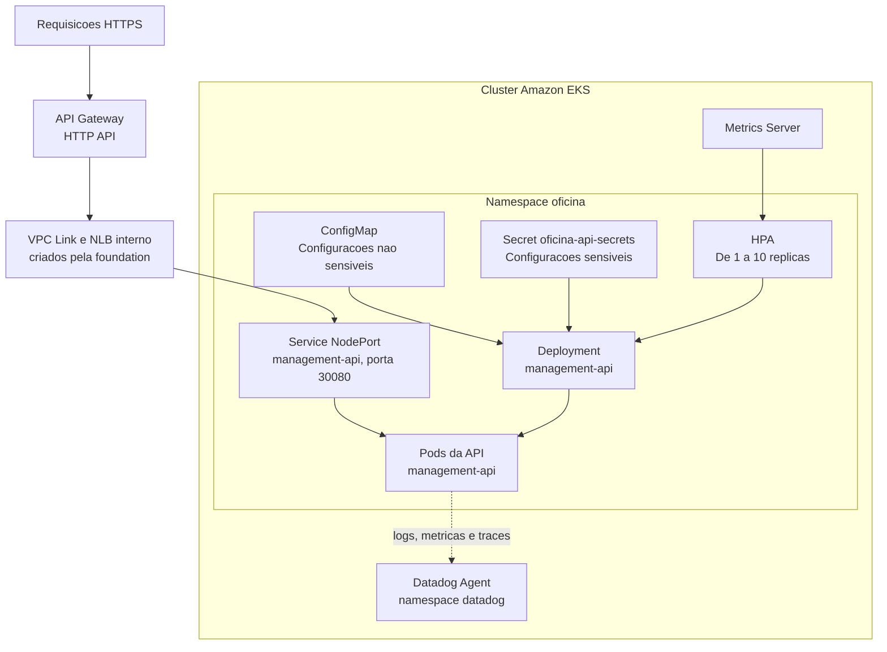

# Kubernetes - Estrutura e Implementação

## 1. Objetivo
Este documento descreve a estrutura desta pasta (`kubernetes/k8s/`), com os manifests da Management API para deploy no EKS criado pela foundation (`kubernetes/infra/foundation`). Os manifests são separados por feature (API) e por tipo de recurso (kind), e são aplicados com Kustomize ([kustomization.yaml](kustomization.yaml)).

Os manifests foram derivados originalmente do docker-compose da aplicação. O código fica em `server/`, na raiz do monorepo, e o build da imagem e o push para o ECR ficam nas pipelines da raiz ([.github/workflows/README.md](../../.github/workflows/README.md)). O banco de dados (Amazon RDS) fica na pasta [DB/](../../DB/README.md). Visão geral da pasta `kubernetes/`: [README](../README.md).

## 2. Estrutura adotada
Foi adotado o padrão folder-by-feature, com uma pasta por serviço.

Estrutura:
- [kustomization.yaml](kustomization.yaml): lista os recursos, define o namespace `oficina` e gera o Secret da API.
- [.env.example](.env.example): template do `k8s/.env` usado pelo `secretGenerator` (seção 5).
- [base/namespace.yml](base/namespace.yml)
- [features/management-api](features/management-api)

A pasta da API contém:
- configmap.yml
- deployment.yml
- service.yml
- hpa.yml

### 2.1 Arquitetura no cluster
- A API tem um Deployment (`management-api`). Ele começa com uma réplica e verifica a saúde em `/health`.
- O Deployment é exposto por um Service do tipo `NodePort`, com porta fixa (30080). A porta só aceita tráfego de dentro da VPC, então o Service não fica exposto diretamente na Internet.
- O API Gateway recebe as requisições HTTPS e, pelo VPC Link e pelo NLB interno (criados pela foundation), entrega o caminho `/management/...` no NodePort da API (seção 8).
- O ConfigMap (`management-api-config`) guarda configurações não sensíveis. O Secret (`oficina-api-secrets`) guarda os dados sensíveis (conexão com o RDS e chave do Resend).
- Um HPA acompanha CPU e memória e ajusta o Deployment entre 1 e 10 réplicas, com base nas métricas do Metrics Server.
- O Datadog Agent (namespace `datadog`, instalado pelo `kubernetes/infra/addons`) coleta métricas, logs e traces dos pods. O tracer .NET (APM) é injetado pelo próprio Agent nos pods do namespace `oficina`, sem mudança na imagem (seção 4.4).



## 3. Ordem de aplicação
Pré-requisitos, nesta ordem (o workflow **Bootstrap** faz os três e, no fim, aplica os manifests):
1. Cluster, API Gateway e addons: foundation → addons, em `kubernetes/infra/`. O API Gateway, o VPC Link e o NLB são criados pela foundation. O Metrics Server e o Datadog Agent são instalados pelo Terraform via Helm, em `kubernetes/infra/addons`.
2. RDS: `DB/infra` ([DB/README.md](../../DB/README.md)).
3. Imagem no ECR: build e push da Management API (`server/`) no repositório ECR `techchallenge-oficina-management`.

A aplicação é feita pelo CI, sempre pelo workflow reutilizável [_k8s-apply.yml](../../.github/workflows/_k8s-apply.yml): ele descobre o endpoint do RDS, gera o `kubernetes/k8s/.env`, roda `kubectl apply -k kubernetes/k8s` e, se pedido, faz o rollout restart da API. Ele é chamado:
- pelo **Bootstrap**, no fim, com restart;
- pelo **Deploy**, em push na `main` que altere qualquer parte (aplicação, `DB/infra`, `kubernetes/infra` ou `kubernetes/k8s`), com restart;
- pelo workflow manual **K8s Apply** ([k8s-apply.yml](../../.github/workflows/k8s-apply.yml)), com o input `restart-pods` (padrão `true`).

Apply só a partir da `main`. Detalhes em [.github/workflows/README.md](../../.github/workflows/README.md).

Para aplicar manualmente, a partir da raiz do monorepo e com o `kubernetes/k8s/.env` preenchido (seção 5):
- `kubectl apply -k kubernetes/k8s`

Não use `kubectl apply -f` por pasta: o Secret `oficina-api-secrets` só é gerado pelo Kustomize.

Comandos para verificação:
- `kubectl get pods,svc,hpa -n oficina`
- `kubectl get pods -n datadog` (2 agents e 1 cluster-agent)

Opcional: para acessar a API via localhost sem passar pelo API Gateway, encaminhe a porta do Service:
- `kubectl port-forward -n oficina service/management-api 8080:80` (depois, `http://localhost:8080/health`)

## 4. Recursos criados para a API
Para a API foram criados os seguintes recursos:
1. ConfigMap `management-api-config` com configurações não sensíveis (`ASPNETCORE_ENVIRONMENT=Production`, `ASPNETCORE_URLS=http://+:8080`) e o nível de log do Serilog (`Serilog__MinimumLevel__Default=Information` e `Serilog__MinimumLevel__Override__Microsoft.AspNetCore=Warning`). A chave com ponto é válida em ConfigMap e em `envFrom` no EKS 1.36.
2. Secret `oficina-api-secrets`, gerado pelo Kustomize a partir do `k8s/.env` (seção 5).
3. Deployment com 1 réplica inicial, porta 8080, probes (startup, liveness e readiness) em `/health`, recursos de 100m/128Mi (requests) e 500m/512Mi (limits) e os labels do Datadog (seção 4.4).
4. Service do tipo NodePort (porta 80 → 8080, com `nodePort` fixo 30080; seção 8).
5. HPA (autoscaling/v2).
6. Pull da imagem privada no ECR usando a role IAM dos nodes do EKS.

### 4.1 API contemplada
- management-api

### 4.2 Imagem utilizada
A imagem é construída e publicada no ECR pelas pipelines do monorepo (job `build-push`, a partir de `server/`). O repositório ECR `techchallenge-oficina-management` é criado manualmente, com *tag mutability* MUTABLE, porque a tag `latest` é sobrescrita a cada push. O Deployment usa a tag `latest` com `imagePullPolicy: Always`:
- 903936907231.dkr.ecr.us-east-1.amazonaws.com/techchallenge-oficina-management:latest

Como a tag não muda, uma imagem nova no ECR não altera os manifests: os pods só a puxam depois de um rollout restart. O Bootstrap e o Deploy fazem esse restart logo depois de publicar a imagem; manualmente, use o K8s Apply com `restart-pods = true`.

### 4.3 Autenticação no ECR privado
A role IAM dos nodes tem a policy gerenciada `AmazonEC2ContainerRegistryReadOnly` ([infra/foundation/iam.tf](../infra/foundation/iam.tf)), permitindo que o kubelet faça pull da imagem privada do ECR sem Secret Kubernetes.

A mesma região AWS facilita o acesso ao registry, mas não substitui a permissão IAM nem a conectividade de rede. Os nodes ficam nas subnets públicas, com IP público, e acessam o ECR pela internet (não há NAT).

### 4.4 Labels do Datadog (Unified Service Tagging)
O Deployment tem, em `metadata.labels` **e** em `spec.template.metadata.labels`:
- `tags.datadoghq.com/env: study`
- `tags.datadoghq.com/service: management-api`, o nome do Deployment

O admission controller do Datadog lê esses labels e injeta `DD_ENV` e `DD_SERVICE` nos pods, e o Agent marca logs, métricas e traces com `env:study` e `service:management-api`. São os valores que os monitores e o dashboard filtram ([infra/DATADOG.md](../infra/DATADOG.md)).
- Os labels **nunca** entram no `spec.selector`, que é imutável.
- O label `admission.datadoghq.com/enabled` não é necessário: a injeção do tracer (Single Step Instrumentation) já fica restrita ao namespace `oficina` na configuração do Agent.
- O tracer só entra nos pods criados com o Agent rodando. Se o Agent for instalado com a API já no ar, os pods precisam de um rollout restart. O Bootstrap e o Deploy já fazem isso: aplicam o addons antes dos manifests, com restart. Isso vale também ao ligar o Datadog (`DD_ENABLED` de `false` para `true`) pelo Bootstrap.
- As probes continuam em `/health`. O `/health/ready`, que checa o banco, é usado só pelo `http_check` do Agent: assim, uma queda do banco não tira os pods do Service.
- Não há `tags.datadoghq.com/version`, porque a imagem usa a tag `latest`.

## 5. Secret da API
O [kustomization.yaml](kustomization.yaml) gera o Secret `oficina-api-secrets` a partir do `k8s/.env`, com as chaves de [.env.example](.env.example):
- `DatabaseSettings__ConnectionString`: aponta para o RDS criado em [DB/](../../DB/README.md).
- `ResendSettings__ApiKey`: chave de envio de email (Resend).

No CI, o apply dos manifests gera o `kubernetes/k8s/.env`:
- Descobre o endpoint pelo identifier do RDS (variable `RDS_INSTANCE_IDENTIFIER`, `techchallenge-oficina-postgres`).
- Monta a connection string com as variables `RDS_DATABASE` e `RDS_USERNAME` e o secret `RDS_PASSWORD`, o mesmo que o `DB/infra` usa como senha master do RDS. O repo LAMBDA precisa ter o mesmo valor.
- Usa o secret `RESEND_API_KEY` para `ResendSettings__ApiKey`.

O `k8s/.env` é ignorado pelo Git e nunca deve ser versionado; apenas o `.env.example` é versionado.

Como o `kustomization.yaml` usa `disableNameSuffixHash: true`, o nome do Secret não muda quando o conteúdo muda, e o Deployment não reinicia sozinho. O mesmo vale para o ConfigMap: ele é lido via `envFrom` e não tem hash no nome. Por isso, o apply do Bootstrap e do Deploy sempre faz o rollout restart. Depois de trocar a chave do Resend fora do Git, rode o K8s Apply com `restart-pods = true`. Para trocar a senha do RDS, rode o Bootstrap, que aplica a senha nova no RDS (`DB/infra`) e depois os manifests, com restart.

## 6. Regras de HPA aplicadas
Foi seguido o requisito informado, com a memória ajustada para o Datadog:
1. CPU alvo: 30% de utilização.
2. Memória alvo: 150% de utilização, ou seja, 192Mi sobre o request de 128Mi. Era 80%, mas o tracer .NET do Datadog (APM) soma memória a cada pod: em repouso, o uso passaria dos 80% (~102Mi), e o HPA escalaria sem carga até faltar espaço nos nodes. Os requests não mudaram. Se, depois do deploy, o HPA ainda escalar sem carga (`kubectl top pods -n oficina` e `kubectl get hpa -n oficina`), deixe só a métrica de CPU.
3. Mínimo: 1 réplica.
4. Máximo: 10 réplicas.

As métricas vêm do Metrics Server, instalado pelo `kubernetes/infra/addons`.

Aplicado em [features/management-api/hpa.yml](features/management-api/hpa.yml).

### 6.1 Capacidade do cluster
O node group tem 2 nodes `t3.small` fixos, com 11 pods por node (22 no total) e cerca de 1,4 GiB alocáveis em cada um.
- Sem o Datadog, rodam 8 pods (1 da API e 7 do próprio Kubernetes). O Datadog soma 3 (um Agent por node e um Cluster Agent): **11 de 22** em regime.
- No rollout restart da API, um pod a mais sobe por um momento: cerca de **12 de 22**.
- Os requests de memória somam cerca de 1,4 GiB em regime, contra ~2,9 GiB alocáveis. Cada réplica extra do HPA soma 128Mi: no máximo de 10 réplicas, são cerca de 20 pods e 2,5 GiB. Cabe, mas apertado: num rollout com muitas réplicas, pods extras podem ficar `Pending`.
- Contingência: nodes `t3.medium` (`node_instance_type` da foundation). A troca **substitui o node group** e é disruptiva; faça só numa janela, ou num Destroy/Bootstrap.

## 7. Namespace
Todos os recursos ficam no namespace `oficina`, definido em [base/namespace.yml](base/namespace.yml) e forçado pelo `namespace` do [kustomization.yaml](kustomization.yaml).

## 8. Acesso externo (API Gateway)
O acesso de fora do cluster é feito pelo Amazon API Gateway (HTTP API `techchallenge-oficina-api`), criado pelo Terraform da foundation ([api-gateway.tf](../infra/foundation/api-gateway.tf) e [nlb.tf](../infra/foundation/nlb.tf)). Não há Ingress nem Ingress Controller.

Caminho de uma requisição: API Gateway → VPC Link → NLB interno → NodePort em qualquer node → Service → pod.

Configuração aplicada:
1. A rota `ANY /management/{proxy+}`, no stage `$default`.
2. A integração remove o prefixo antes de encaminhar ao backend (`overwrite:path`): `/management/api/clientes` chega à API como `/api/clientes`.
3. Um Lambda authorizer (repo LAMBDA) protege a rota da API: exige JWT válido do Auth0 com a claim `cpf`, exceto no cadastro de cliente (`POST /management/api/clientes`), que aceita JWT sem `cpf`. O header `Authorization` é repassado e a API valida o JWT de novo. São públicas as rotas `GET /management/health` e `POST /auth/token`, que gera o JWT com `cpf` (Lambda do repo LAMBDA).
4. A API tem um listener e um target group (`techchallenge-oficina-management`) no NLB, na mesma porta do NodePort. A porta fica em `local.api_node_ports` (`management = 30080`, em [infra/foundation/locals.tf](../infra/foundation/locals.tf)) e **precisa ser igual** ao `nodePort` do [service.yml](features/management-api/service.yml).

| API | Rota | NodePort |
|---|---|---|
| management-api | `https://<id>.execute-api.us-east-1.amazonaws.com/management/...` | 30080 |

O endpoint só atende HTTPS. Um prefixo sozinho (`/management` ou `/management/`) responde 404, porque não casa com `{proxy+}`. O Swagger UI da API busca `/swagger/v1/swagger.json` pela raiz, então não abre atrás do prefixo, mas `/management/swagger/v1/swagger.json` funciona.

Checklist de confirmação, com o ambiente criado:
1. URL da API: output `api_gateway_endpoint` da foundation, ou `aws apigatewayv2 get-apis --query "Items[?Name=='techchallenge-oficina-api'].ApiEndpoint" --output text`.
2. Health da API: `curl.exe -i "<endpoint>/management/health"` → 200.
3. Autenticação passando pelo gateway, em `curl.exe -i "<endpoint>/management/api/clientes"`:
   - 401 sem token;
   - 403 com o token direto do Auth0 (sem `cpf`);
   - 200 com o JWT gerado pela Lambda (`POST <endpoint>/auth/token` com `{"email","senha","cpf"}`, detalhes no README do repo [LAMBDA](https://github.com/GuiToniello/tech-challenge-fase-4-LAMBDA-soat16-rm374658)).
4. Target group `techchallenge-oficina-management` `healthy` no console do EC2 (Target Groups).

## 9. Validação
Para validar os manifests sem acessar a AWS, a partir da raiz do monorepo:

```powershell
Copy-Item kubernetes/k8s/.env.example kubernetes/k8s/.env
kubectl kustomize kubernetes/k8s
```

É a mesma verificação do check `validate-k8s` nos PRs. O `secretGenerator` exige o `k8s/.env`, então o template com placeholders basta. Também é possível usar `kubectl apply --dry-run=client --validate=false -k kubernetes/k8s`, mas ele consulta a API do cluster do contexto atual do kubeconfig.

O build deve gerar:
- Namespace `oficina`.
- ConfigMap `management-api-config`.
- Secret `oficina-api-secrets`, gerado a partir do `k8s/.env`.
- Deployment (com os labels `tags.datadoghq.com/*`), Service (`NodePort`) e HPA `management-api`.

## 10. Finalização
Antes de promover para ambientes compartilhados (qa/homolog/prod), recomenda-se:
1. Trocar a tag `latest` por tags versionadas publicadas pelas pipelines (`build-push`), para ter deploys rastreáveis e rollback. Com elas, dá para adicionar o label `tags.datadoghq.com/version`.
2. Manter a senha do RDS e a chave do Resend apenas nos secrets do GitHub (`RDS_PASSWORD`, `RESEND_API_KEY`).
3. Revisar requests/limits de CPU e memória conforme a carga real. O node group tem 2 nodes `t3.small` fixos (min/desired/max 2/2/2), então o HPA pode criar pods que ficam `Pending` por falta de capacidade. Com o Datadog, a folga é menor (seção 6.1).
4. Garantir que a foundation (API Gateway e NLB) e o `kubernetes/infra/addons` (Metrics Server e Datadog Agent) estejam aplicados antes do apply dos manifests.
